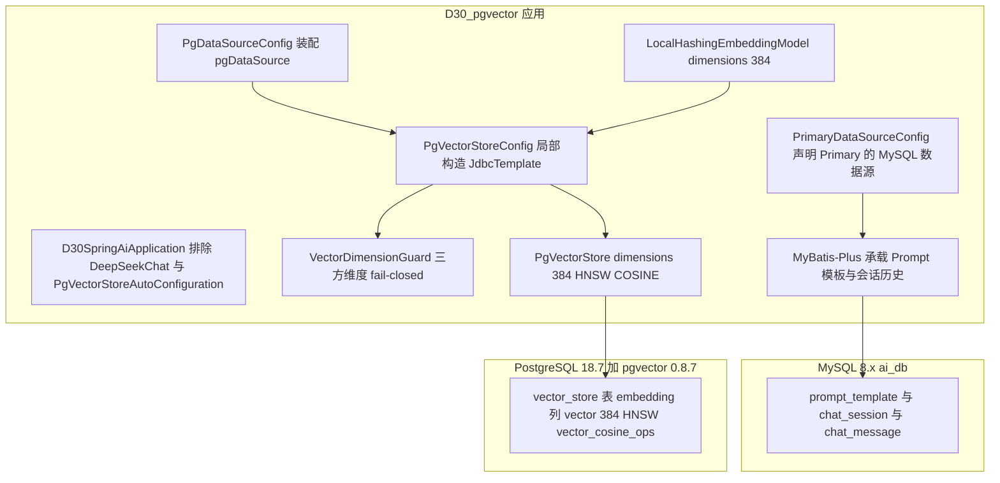
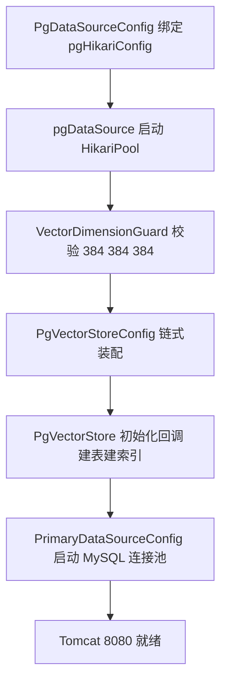

# D30-01 PG 配置与统一向量维度 384 迭代实施全记录

> 模块：`M3-Java/D30/D30_pgvector`　迭代代号：D30　实施日期：2026-11-13　分支：`master`
> 基线：JDK 21.0.7 / Spring Boot 3.5.16 / Spring AI 1.1.8 / Maven 3.9.16 / PostgreSQL 18.7 + pgvector 0.8.7
> 一句话结论：在不触碰 MySQL 主数据源的前提下，把 pgvector 作为独立 RAG 向量库接入 D30，
> 并用「建表列 / 向量库配置 / Embedding 实际输出」三处对齐把向量维度锁死在 384；当前 `mvn test` 282 用例全绿、可执行 jar 已真实启动并完成接口回归。

---

## 一、迭代目标与验收口径

| 编号 | 目标 | 验收口径（可判定） |
| --- | --- | --- |
| AC-01 | 引入 pgvector 依赖与驱动 | 依赖树可见 `spring-ai-pgvector-store:1.1.8`、`postgresql:42.7.11`，版本由 BOM / Boot 管理 |
| AC-02 | PG 独立数据源 | 启动日志出现 `PgVectorHikariPool - Start completed.`，且主数据源仍是 `jdbc:mysql://` |
| AC-03 | MySQL 主库零回归 | Prompt 模板 / 会话接口正常返回 MySQL 内既有数据（`prompt_template_rows=10`） |
| AC-04 | 向量库装配成功 | 启动日志出现 `PgVectorStore 装配完成：... dimensions=384 ...` 与 `Initializing PGVectorStore schema` |
| AC-05 | 维度全链路 384 | 表列 `vector(384)`、`spring.ai.vectorstore.pgvector.dimensions=384`、`EmbeddingModel.dimensions()=384` |
| AC-06 | 维度不一致 fail-closed | 任一处不一致时抛 `IllegalStateException` 阻止启动（有单测覆盖） |
| AC-07 | 真机写入 / 检索可用 | 384 维写入成功、相似度检索命中、383 维被数据库拒绝（`expected 384 dimensions, not 383`） |
| AC-08 | 构建与测试真实通过 | `mvn clean compile` / `package` / `test` 均 BUILD SUCCESS，282 用例 0 失败 0 错误 |
| AC-09 | 配置全外部化 | 全部连接项为 `${ENV:default}` 形式，无硬编码 API Key，密钥不写入日志 |
| AC-10 | 文档交付 | 本文件与《D30-02 PG 向量库与统一向量维度 384 技术说明与实践指南》落在 `docs/proj_docs` |

---

## 二、现状扫描（改造前）

### 2.1 工程结构

```text
M3-Java/
├── D30/                                   # Maven 聚合（org.ai.m2.gpt:D30:1.0-SNAPSHOT，packaging=pom）
│   ├── pom.xml                            # 父 POM：import spring-ai-bom 1.1.8 + Spring Cloud 2025.0.0 + SCA 2025.0.0.0
│   └── D30_pgvector/                      # 唯一 module，本次全部改动集中在此
│       ├── pom.xml
│       └── src/{main,test}/...
├── docs/
│   ├── proj_docs/                         # 技术文档（本文件所在目录）
│   ├── temp_docs/                         # 临时脚本与文本（不自动删除）
│   └── evidence/                          # 证据落盘
└── logs/                                  # 构建 / 测试 / 运行日志
```

`D30_pgvector` 主源 181 个文件，已是成熟 RAG 骨架，包结构（节选）：

```text
com.zl.d30
├── adapter/deepseek      # ChatModel 适配层
├── config                # 全局配置（D30 在此新增 5 个类）
├── conversation          # 会话模型
├── device                # 设备故障问答
├── document              # 文档登记 / 导入 / 页面 / Chunk
│   ├── chunk             # 清洗 + 切分（FixedSize / Structure）
│   └── embedding         # LocalHashingEmbeddingModel + 向量空间兼容性
├── history               # 聊天历史（MySQL 权威存储）
├── observability         # 模型调用记录 / Token 统计
├── prompt                # Prompt 模板（MySQL + Redis cache-aside）
└── resilience            # 重试 / 异常分类
```

### 2.2 技术基线（本次未升级任何一项）

| 项 | 实际值 | 取证方式 |
| --- | --- | --- |
| JDK | 21.0.7 | 测试日志 `using Java 21.0.7` |
| Spring Boot | 3.5.16 | 父 POM + `spring-boot:3.5.16:repackage` 日志 |
| Spring AI | 1.1.8（BOM import） | 父 POM + 依赖树 |
| Maven | 3.9.16 | 本地安装路径 |
| Tomcat | 10.1.x（Servlet 栈） | 启动日志 |
| PostgreSQL 服务端 | 18.7 (Debian 18.7-1.pgdg12+2) | `SELECT version()` |
| pgvector 扩展 | 0.8.7 | `pg_extension.extversion` |
| JDBC 驱动 | postgresql 42.7.11 | 本地仓库实存 jar |

### 2.3 改造前三个必须解决的问题

1. **没有向量库使用点**：全工程无 `VectorStore` 依赖，`application.yml` 连 `spring.ai` 节点都没有（DeepSeek 自动配置在启动类被排除，模型走 `app.ai.*` 自研抽象）。
2. **维度默认值不是 384**：`LocalHashingEmbeddingModel` 读 `app.ai.embedding.dimensions`，**默认 256**。若只改 YAML 不改代码默认值，一旦 YAML 缺失节点就会静默回落到 256，与表列 384 冲突。
3. **单一 `JdbcTemplate` 隐患**：容器里已有 MySQL 主库构建的 `JdbcTemplate`，这是本次最关键的技术陷阱（见第三节）。

---

## 三、依赖引入与 1.1.8 API 实证

### 3.1 依赖改动（`D30/D30_pgvector/pom.xml`）

```xml
<!-- D30 新增：PostgreSQL 驱动，版本由 Spring Boot 3.5.16 管理（实为 42.7.11） -->
<dependency>
    <groupId>org.postgresql</groupId>
    <artifactId>postgresql</artifactId>
    <scope>runtime</scope>
</dependency>

<!-- D30 新增：Spring AI pgvector 向量库 Starter，版本由 spring-ai-bom:1.1.8 管理 -->
<dependency>
    <groupId>org.springframework.ai</groupId>
    <artifactId>spring-ai-starter-vector-store-pgvector</artifactId>
</dependency>
```

两处都**不写 `<version>`**：父 POM 已 import `spring-ai-bom:1.1.8`，Boot 已管理 PG 驱动版本，符合“不使用动态版本”的红线。

### 3.2 与任务书不一致的 4 项实证事实（均来自 1.1.8 jar 反编译，非记忆）

| # | 任务书 / 常见认知 | 1.1.8 真实情况 | 对本项目的影响与处置 |
| --- | --- | --- | --- |
| 1 | 自动配置按 `DataSource` 装配向量库 | `PgVectorStoreAutoConfiguration#vectorStore` 依赖容器内 **`JdbcTemplate`**（即 MySQL 主库那个） | 必须排除自动配置 + 手动装配 `pgDataSource`；否则向量表会被建到 MySQL |
| 2 | `PgVectorStore` 可用 `DataSource` 构建 | 唯一构建入口 `PgVectorStore.builder(JdbcTemplate, EmbeddingModel)` | 手动装配时必须 `new JdbcTemplate(pgDataSource)`，且只在方法内构造、不注册 Bean |
| 3 | YAML 支持 `index-list-size` / `index-m` / `batching-size` | 1.1.8 的 `PgVectorStoreProperties` **只有** 10 个属性：`initialize-schema / schema-name / table-name / dimensions / index-type / distance-type / schema-validation / max-document-batch-size / id-type / remove-existing-vector-store-table` | 三项不写进 YAML（写了会被静默忽略，形成“配置看似生效”的假象）；HNSW 调优走 `ALTER INDEX` |
| 4 | 枚举值命名不确定 | `PgIndexType{HNSW, IVFFLAT, NONE}`、`PgDistanceType{COSINE_DISTANCE, EUCLIDEAN_DISTANCE, NEGATIVE_INNER_PRODUCT}`、`PgIdType{UUID, TEXT, INTEGER, SERIAL, BIGSERIAL}`；默认表 `vector_store`、schema `public`、`schema-validation=false`、`max-document-batch-size=10000` | YAML 全部按真实枚举写；本项目把批量上限下调为 100，避免超长事务 |

另经核验：`AbstractVectorStoreBuilder` 构造器默认注入 `TokenCountBatchingStrategy`（不会 NPE）；`SearchRequest.builder().query().topK().similarityThresholdAll()`、`Document(String id, String content, Map metadata)` 签名均与 1.1.8 一致。

---

## 四、总体架构与关键流程

### 4.1 运行时组件拓扑



### 4.2 启动期装配顺序（真实日志顺序）



对应日志（`logs/D30-05-run.log`，节选）：

```text
PgVectorHikariPool - Starting...
PgVectorHikariPool - Added connection org.postgresql.jdbc.PgConnection@1e592ef2
PgVectorHikariPool - Start completed.
PG 向量库数据源装配完成：poolName=PgVectorHikariPool，jdbcUrl=jdbc:postgresql://192.168.200.153:5432/spring_ai，maximumPoolSize=10
向量维度一致性校验通过：embedding 配置=384，pgvector 列配置=384，模型实际输出=384
Using the vector table name: vector_store. Is empty: false
PgVectorStore 装配完成：schema=public，table=vector_store，dimensions=384，distance=COSINE_DISTANCE，index=HNSW，initializeSchema=true
Initializing PGVectorStore schema for table: vector_store in schema: public
Tomcat started on port 8080 (http) with context path '/'
Started D30SpringAiApplication in 10.777 seconds (process running for 11.963)
HikariPool-1 - Start completed.        # MySQL 主库（MyBatis-Plus 触发）
```

---

## 五、代码改造清单（新增 5 类 / 修改 7 处）

### 5.1 `config/PgDataSourceConfig.java`【新增】

要点：`@ConfigurationProperties("spring.datasource.pg", ignoreUnknownFields = false)` 直接绑定 `HikariConfig`，URL 口令脱敏。

```java
@Bean
@ConfigurationProperties(prefix = "spring.datasource.pg", ignoreUnknownFields = false)
public HikariConfig pgHikariConfig() {
    return new HikariConfig();
}

@Bean(name = "pgDataSource", destroyMethod = "close")
public DataSource pgDataSource(@Qualifier("pgHikariConfig") HikariConfig pgHikariConfig) {
    HikariDataSource dataSource = new HikariDataSource(pgHikariConfig);
    log.info("PG 向量库数据源装配完成：poolName={}，jdbcUrl={}，maximumPoolSize={}",
            pgHikariConfig.getPoolName(),
            maskPassword(pgHikariConfig.getJdbcUrl()),
            pgHikariConfig.getMaximumPoolSize());
    return dataSource;
}
```

**有意偏离任务书 4.2 的第一处**：任务书给的是嵌套写法 `pg.hikari.pool-name`，但 `HikariConfig` 没有 `hikari` 属性，嵌套节点不会被绑定。改为扁平 `pg.jdbc-url / pool-name / maximum-pool-size ...` 与 setter 同层，并用 `ignoreUnknownFields = false` 让误写嵌套结构时启动即失败。

### 5.2 `config/PrimaryDataSourceConfig.java`【新增】

**有意偏离任务书 4.2 的第二处，也是最关键的一处**：一旦注册 `pgDataSource`，`DataSourceAutoConfiguration`（`@ConditionalOnMissingBean(DataSource.class)`）整体退让，容器里只剩 PG，MyBatis-Plus 会把 Prompt 模板与聊天历史写进 PostgreSQL —— 这是“MySQL 静默失效”的隐性回归。故显式重建 MySQL 主库：

```java
@Bean
@Primary
@ConfigurationProperties("spring.datasource.hikari")
public HikariDataSource dataSource(DataSourceProperties properties) {
    return properties.initializeDataSourceBuilder()
            .type(HikariDataSource.class)
            .build();
}
```

连接参数仍读 `spring.datasource.url/username/password/driver-class-name`，**未改动任何 MySQL 连接项**。

### 5.3 `config/PgVectorStoreProperties.java`【新增】

绑定 `spring.ai.vectorstore.pgvector`，默认值即 384 / HNSW / COSINE_DISTANCE / UUID / batch 100，并用 `@PostConstruct validate()` 在装配前挡掉非法配置（空 schema、空表名、维度非正、枚举为空、批量非正）。
类注释明确写出「1.1.8 不存在 index-list-size / index-m / batching-size」以及「HNSW 的 m / ef_construction 走 `ALTER INDEX`」。

### 5.4 `config/VectorDimensionGuard.java`【新增】

```java
public void verifyAlignment(int embeddingConfiguredDimension,
                            int storeConfiguredDimension,
                            int modelActualDimension) {
    if (embeddingConfiguredDimension == storeConfiguredDimension
            && modelActualDimension == storeConfiguredDimension) {
        log.info("向量维度一致性校验通过：embedding 配置={}，pgvector 列配置={}，模型实际输出={}", ...);
        return;
    }
    throw new IllegalStateException("向量维度不一致，已阻止启动（避免写入期 expected N dimensions 报错）："
            + "app.ai.embedding.dimensions=" + embeddingConfiguredDimension
            + "，spring.ai.vectorstore.pgvector.dimensions=" + storeConfiguredDimension
            + "，EmbeddingModel.dimensions()=" + modelActualDimension
            + "；三处必须统一，且维度变更需 DROP TABLE 后重建");
}
```

设计取舍：维度不一致的后果不是“效果变差”，而是第一条写入就失败（`expected 384 dimensions, not N`），且表建好后**只能删表重建**。所以选择 fail-closed（启动期阻断）而不是运行期告警。

### 5.5 `config/PgVectorStoreConfig.java`【新增】

```java
@Bean
public PgVectorStore pgVectorStore(@Qualifier("pgDataSource") DataSource pgDataSource,
                                   EmbeddingModel embeddingModel,
                                   EmbeddingProperties embeddingProperties,
                                   PgVectorStoreProperties pgVectorStoreProperties,
                                   VectorDimensionGuard dimensionGuard) {

    dimensionGuard.verifyAlignment(
            embeddingProperties.getDimensions(),
            pgVectorStoreProperties.getDimensions(),
            embeddingModel.dimensions());

    JdbcTemplate pgJdbcTemplate = new JdbcTemplate(pgDataSource);   // 只在方法内构造，不注册 Bean

    return PgVectorStore.builder(pgJdbcTemplate, embeddingModel)
            .schemaName(pgVectorStoreProperties.getSchemaName())
            .vectorTableName(pgVectorStoreProperties.getTableName())
            .idType(pgVectorStoreProperties.getIdType())
            .dimensions(pgVectorStoreProperties.getDimensions())
            .distanceType(pgVectorStoreProperties.getDistanceType())
            .indexType(pgVectorStoreProperties.getIndexType())
            .initializeSchema(pgVectorStoreProperties.isInitializeSchema())
            .vectorTableValidationsEnabled(pgVectorStoreProperties.isSchemaValidation())
            .removeExistingVectorStoreTable(pgVectorStoreProperties.isRemoveExistingVectorStoreTable())
            .maxDocumentBatchSize(pgVectorStoreProperties.getMaxDocumentBatchSize())
            .build();
}
```

`JdbcTemplate` 若注册为 Bean，会与主库 `JdbcTemplate` 形成按类型注入歧义，因此只在方法内构造。

### 5.6 启动类【修改】

```java
@SpringBootApplication(exclude = {DeepSeekChatAutoConfiguration.class, PgVectorStoreAutoConfiguration.class})
public class D30SpringAiApplication { ... }
```

### 5.7 `document/embedding/config/EmbeddingProperties.java`【修改】

`dimensions` 默认值 **256 → 384**。理由：防止 YAML 缺失该节点时静默回落到 256，与表列 384 冲突；该改动同时被 `EmbeddingPropertiesTest` 的两处断言同步覆盖。

### 5.8 配置与测试资源【修改】

`src/main/resources/application.yml` 新增三块（详见第六节）；`src/test/resources/application-test.yml` 覆盖 `initialize-schema=false / schema-validation=false / remove-existing=false`，保证常规 `mvn test` 零 PG 依赖。

---

## 六、配置契约

### 6.1 `spring.datasource.pg`（扁平 Hikari 键）

```yaml
spring:
  datasource:
    # MySQL 主库保持原样（未改一行）
    driver-class-name: com.mysql.cj.jdbc.Driver
    url: ${MYSQL_URL:jdbc:mysql://127.0.0.1:3306/ai_db?...}
    username: ${MYSQL_USER:root}
    password: ${MYSQL_PASSWORD:123456}

    pg:
      jdbc-url: ${PG_URL:jdbc:postgresql://192.168.200.153:5432/spring_ai}
      username: ${PG_USER:postgres}
      password: ${PG_PASSWORD:Postgres@2026}
      driver-class-name: org.postgresql.Driver
      pool-name: ${PG_POOL_NAME:PgVectorHikariPool}
      maximum-pool-size: ${PG_POOL_MAX:10}
      minimum-idle: ${PG_POOL_MIN:2}
      connection-timeout: 30000
      idle-timeout: 600000
      max-lifetime: 1800000
```

### 6.2 `spring.ai.vectorstore.pgvector`

```yaml
spring:
  ai:
    vectorstore:
      pgvector:
        initialize-schema: ${PGVECTOR_INIT_SCHEMA:true}
        schema-name: ${PGVECTOR_SCHEMA:public}
        table-name: ${PGVECTOR_TABLE:vector_store}
        dimensions: ${PGVECTOR_DIMENSIONS:384}
        index-type: ${PGVECTOR_INDEX_TYPE:HNSW}
        distance-type: ${PGVECTOR_DISTANCE_TYPE:COSINE_DISTANCE}
        schema-validation: ${PGVECTOR_SCHEMA_VALIDATION:false}
        max-document-batch-size: ${PGVECTOR_BATCH_SIZE:100}
        id-type: ${PGVECTOR_ID_TYPE:UUID}
        remove-existing-vector-store-table: ${PGVECTOR_RECREATE:false}
```

### 6.3 `app.ai.embedding`

```yaml
app:
  ai:
    embedding:
      provider: ${EMBEDDING_PROVIDER:local}
      model: ${EMBEDDING_MODEL:local-hashing-embedding}
      model-version: ${EMBEDDING_MODEL_VERSION:local-v1}
      dimensions: ${EMBEDDING_DIMENSIONS:384}
      distance-metric: ${EMBEDDING_DISTANCE_METRIC:COSINE}
      max-input-length: ${EMBEDDING_MAX_INPUT_LENGTH:8192}
      max-attempts: ${EMBEDDING_MAX_ATTEMPTS:3}
```

### 6.4 环境变量全表

| 变量 | 默认值 | 作用 |
| --- | --- | --- |
| `PG_URL` | `jdbc:postgresql://192.168.200.153:5432/spring_ai` | PG 连接串 |
| `PG_USER` / `PG_PASSWORD` | `postgres` / `Postgres@2026`（仅本机开发默认值） | PG 凭据 |
| `PG_POOL_NAME` | `PgVectorHikariPool` | 连接池名（用于日志与证据核对） |
| `PG_POOL_MAX` / `PG_POOL_MIN` | `10` / `2` | 池容量 |
| `PGVECTOR_INIT_SCHEMA` | `true` | 启动建表 / 建索引 |
| `PGVECTOR_SCHEMA` / `PGVECTOR_TABLE` | `public` / `vector_store` | schema 与表名 |
| `PGVECTOR_DIMENSIONS` | `384` | 向量库配置维度 |
| `PGVECTOR_INDEX_TYPE` | `HNSW` | `HNSW / IVFFLAT / NONE` |
| `PGVECTOR_DISTANCE_TYPE` | `COSINE_DISTANCE` | `COSINE_DISTANCE / EUCLIDEAN_DISTANCE / NEGATIVE_INNER_PRODUCT` |
| `PGVECTOR_SCHEMA_VALIDATION` | `false` | 启动校验既有表结构 |
| `PGVECTOR_BATCH_SIZE` | `100` | 单批写入上限 |
| `PGVECTOR_ID_TYPE` | `UUID` | `UUID / TEXT / INTEGER / SERIAL / BIGSERIAL` |
| `PGVECTOR_RECREATE` | `false` | 危险开关：删表重建 |
| `EMBEDDING_*` | `local / local-hashing-embedding / local-v1 / 384 / COSINE` | Embedding 配置 |
| `D30_PG_IT` | 未设置 | 置 `true` 才执行 PG 真机集成测试 |

---

## 七、测试改造

### 7.1 新增 4 个测试类（16 个用例）

| 测试类 | 用例数 | 覆盖点 |
| --- | --- | --- |
| `config/PgDataSourceConfigTest` | 3 | 主库 `@Primary` 仍为 MySQL；PG 池名 / URL 绑定正确；未知键 `ignoreUnknownFields=false` fail-fast |
| `config/PgVectorStorePropertiesTest` | 4 | 默认值 384 / HNSW / COSINE / UUID；非法 schema / 表名 / 维度 / 批量被拒 |
| `config/VectorDimensionGuardTest` | 4 | 三方一致通过；任一不一致抛异常且信息含重建提示 |
| `config/PgVectorStoreIntegrationTest` | 5 | 真机：列类型 `vector(384)`、HNSW 索引、写入 + 检索命中、`vector_dims=384`、模型输出 384、双池隔离 |

### 7.2 修改 2 个既有测试

| 测试类 | 修改内容 | 原因 |
| --- | --- | --- |
| `EmbeddingPropertiesTest` | 两处断言 256 → 384 | 与代码默认值变更同步 |
| `VectorIndexCompatibilityServiceTest` | `switchToSameSpaceKeepsIndex` 内补 `same.setDimensions(256)` | 该用例前提是“同空间”，`setUp` 用 256 构造 service，若沿用新默认值 384 就变成跨空间切换（见第十节） |

### 7.3 真机门控

```java
@EnabledIfEnvironmentVariable(named = "D30_PG_IT", matches = "true")
```

`application-test.yml` 中 `initialize-schema=false`，所以普通 `mvn test` 完全不碰 PostgreSQL，只有显式开启才连真机。

---

## 八、构建与运行操作

### 8.1 命令行（Maven 主路径 `D:\SoftwareInstall\Apache\Maven\apache-maven-3.9.16\bin\mvn.cmd`）

```powershell
$mvn = "D:\SoftwareInstall\Apache\Maven\apache-maven-3.9.16\bin\mvn.cmd"
$pom = "E:\AI\project\AI-Learning-three-GPT\M3-Java\D30\pom.xml"

& $mvn -f $pom -B clean compile                       # 1) 编译
& $mvn -f $pom -B test                                # 2) 常规测试（零 PG 依赖）
$env:D30_PG_IT = "true"
& $mvn -f $pom -B test                                # 3) 全量测试（含 PG 真机集成）
& $mvn -f $pom -B -DskipTests package                 # 4) 打包
```

> 编码坑：pwsh 下 `-Dfile.encoding=UTF-8` 必须整体加引号，否则会被拆成 `.encoding=UTF-8` 导致 `ClassNotFoundException`。

### 8.2 运行

```powershell
java "-Dfile.encoding=UTF-8" -jar `
  "E:\AI\project\AI-Learning-three-GPT\M3-Java\D30\D30_pgvector\target\D30_pgvector-1.0-SNAPSHOT.jar"
```

### 8.3 IDEA 2024.1 操作步骤

1. `File → Project Structure → Project SDK` 选 JDK 21；`Settings → Build Tools → Maven → Runner` 的 JRE 也设为 21。
2. Maven 面板 `Reload All Maven Projects`，确认 `spring-ai-starter-vector-store-pgvector`、`postgresql` 已解析。
3. 运行类选 `com.zl.d30.D30SpringAiApplication`。
4. 默认无需任何环境变量：mock 模式 + 本机开发默认 PG 连接即可启动。
5. 需要指向其它 PG 时，在 Run Configuration 的 Environment variables 里配置 `PG_URL / PG_USER / PG_PASSWORD / PGVECTOR_DIMENSIONS=384`。
6. 切真实模型仍走 `AI_MODE=deepseek` + `AI_API_KEY=...`，与 D30 无关。
7. 真机集成测试：在 Run Configuration 增加 `D30_PG_IT=true`，或命令行注入。

---

## 九、验证证据（真实执行）

### 9.1 构建与测试

| 命令 | 结果 | 证据 |
| --- | --- | --- |
| `mvn clean compile` | BUILD SUCCESS | `logs/D30-02-compile.log` |
| `mvn test`（`D30_PG_IT=true`） | **Tests run: 282, Failures: 0, Errors: 0, Skipped: 0**，BUILD SUCCESS | `logs/D30-04-test.log` |
| `mvn -DskipTests package` | BUILD SUCCESS，产出可执行 jar（`spring-boot:3.5.16:repackage`） | 同次控制台 |

新增集成测试单独复跑结果：`Tests run: 5, Failures: 0, Errors: 0`。

### 9.2 PG 目录与维度约束（`docs/evidence/D30-pg-catalog.txt`）

```text
===== SERVER =====
server_version=PostgreSQL 18.7 (Debian 18.7-1.pgdg12+2) on x86_64-pc-linux-gnu
pgvector_version=0.8.7
timezone=Asia/Shanghai

===== TABLES (public) =====
vector_store

===== STRUCTURE vector_store =====
column       type               udt        notnull  default
id           uuid               uuid       true     uuid_generate_v4()
content      text               text       false    null
metadata     json               json       false    null
embedding    vector(384)        vector     false    null

===== INDEXES =====
spring_ai_vector_index :: CREATE INDEX spring_ai_vector_index ON public.vector_store
                          USING hnsw (embedding vector_cosine_ops)
vector_store_pkey      :: CREATE UNIQUE INDEX vector_store_pkey ON public.vector_store USING btree (id)

===== DIMENSION CONSTRAINT =====
insert_384_dimensions=OK
rows_after_384_insert=1
insert_383_dimensions=REJECTED
sqlstate=22000
message=ERROR: expected 384 dimensions, not 383
residual_rows_after_rollback=0
```

> 说明：本机无 `psql` 客户端，上述结构查询走 JDBC 读 `pg_catalog`，与 `psql \d vector_store` 同源同事实。

### 9.3 启动与接口回归（`logs/D30-05-run.log`）

| 检查项 | 实测 | 结论 |
| --- | --- | --- |
| PG 连接池 | `PgVectorHikariPool - Start completed.` | 通过 |
| 维度三方校验 | `embedding 配置=384，pgvector 列配置=384，模型实际输出=384` | 通过 |
| 向量库装配 | `schema=public，table=vector_store，dimensions=384，distance=COSINE_DISTANCE，index=HNSW` | 通过 |
| 建表 | `Initializing PGVectorStore schema for table: vector_store in schema: public` | 通过 |
| MySQL 主库 | `HikariPool-1 - Added connection com.mysql.cj.jdbc.ConnectionImpl@1bd81e62` | 未被 PG 顶替 |
| 启动耗时 | `Started D30SpringAiApplication in 10.777 seconds` | 通过 |
| `GET /api/v1/embeddings/model` | `{"dimensions":384,"vectorSpaceId":"local|local-hashing-embedding|local-v1|384","indexVersion":1,"distanceMetric":"COSINE"}` | 通过 |
| `GET /api/v1/ai/prompts` | 返回 MySQL 内 `code_review`、`customer_service` 等模板 | MySQL 读取正常 |
| `GET /api/v1/ai/sessions` | 返回既有会话记录（如 `设备无法开机怎么办`） | MySQL 读取正常 |
| `GET /api/v1/ai/roles` | 返回 `customer_service`、`device_customer_service` | MySQL 读取正常 |
| `POST /api/v1/ai/chat` | HTTP 200，`mode=mock`、`mocked=true`、`content=[MOCK:D01] ...`、返回 `sessionId` | mock 链路 + 会话落库正常 |

MySQL 侧只读核查（`docs/evidence/D30-mysql-schema.txt`）：`prompt_template_rows=10`，证明主库仍在正常提供服务。

---

## 十、迭代日志：两次真实失败与修复

### 10.1 集成测试全部报 `Invalid UUID string`

- **现象**：`PgVectorStoreIntegrationTest` 首次执行 4 例全错，根因行 `Invalid UUID string: d30-it-vector-384`。
- **根因**：`id-type=UUID` 时，`PgVectorStore` 会把传入的 document id 当作 UUID 解析，`d30-it-vector-384` 不是合法 UUID。
- **修复**：测试主键改为合法 UUID `aaaaaaaa-bbbb-cccc-dddd-eeeeeeeeeeee`，并在字段注释里写明约束。
- **结论**：这是配置与测试数据的一致性问题，不是代码缺陷；同时印证 `id-type` 会影响应用侧主键形态（生产接入时要保证 documentId 是 UUID 或改用 `TEXT`）。

### 10.2 `switchToSameSpaceKeepsIndex` 期望 1 实得 2

- **现象**：`VectorIndexCompatibilityServiceTest.switchToSameSpaceKeepsIndex` 断言失败，`expected 1 but was 2`。
- **根因**：`setUp` 用 `dimensions=256` 构造 service；该用例新建 `EmbeddingProperties` 走默认值。D30 把默认值从 256 改成 384 后，两边的 `vectorSpaceId` 变成 `...|256` 与 `...|384`，不再是“同空间”，于是切换产生了新索引版本 2。
- **修复**：在用例内显式 `same.setDimensions(256)`，保持“同空间”这一测试前提，断言强度不变。
- **结论**：改默认值会外溢影响依赖默认值的测试，这是必要的伴生修改；保留原测试意图优先于机械改断言。

### 10.3 一次符合预期的“失败”

`PgDataSourceConfigTest.unknownPgPropertyFailsFast` 会主动触发 `ConfigurationPropertiesBindException`，这是对 `ignoreUnknownFields=false` 的断言，测试本身通过。

---

## 十一、风险与未完成事项

| 类别 | 事项 | 现状 / 建议 |
| --- | --- | --- |
| 安全 | `application.yml` 写了 PG 明文默认口令 `Postgres@2026` | 与「明文口令不得提交 Git」存在张力。建议改为 `application-local.yml`（加入 `.gitignore`）或纯环境变量注入；**未擅自改动，待确认** |
| 环境 | MySQL 运行库 `knowledge_document` 缺 `source` 列，文档导入接口报 `Unknown column 'source'` | **既有表结构漂移，与本次改动无关**（证据见 `docs/evidence/D30-http-embedding.txt`）。恢复需 `ALTER TABLE ...`，属数据库结构变更，未执行 |
| 功能边界 | 向量写入目前只有集成测试与文档 Embedding 服务，尚未有检索问答链路 | 符合 D30 边界（只做 PG 配置 + 维度统一）；D31 再接 RAG 检索与引用 |
| 配置 | `schema-validation=false` | 便于首次建表；表结构稳定后建议置 `true`，让结构不符在启动期暴露 |
| 调优 | HNSW 的 `m / ef_construction` 仍为库默认（16 / 64） | 数据量上来后用 `ALTER INDEX spring_ai_vector_index SET (m=..., ef_construction=...)` 调优，不要写 YAML |
| Git | 全部改动未提交 | 用户未授权提交，工作区状态见交付报告 |
| 目录 | `D30/src` 为空目录 | 未处理，避免擅自改动目录结构 |

---

## 十二、附录

### 12.1 改动文件清单

```text
D30/D30_pgvector/
├── pom.xml                                              [修改] 新增 postgresql + pgvector starter
└── src/
    ├── main/java/com/zl/d30/
    │   ├── D30SpringAiApplication.java                  [修改] exclude PgVectorStoreAutoConfiguration
    │   ├── config/PgDataSourceConfig.java               [新增]
    │   ├── config/PrimaryDataSourceConfig.java          [新增]
    │   ├── config/PgVectorStoreProperties.java          [新增]
    │   ├── config/VectorDimensionGuard.java             [新增]
    │   ├── config/PgVectorStoreConfig.java              [新增]
    │   └── document/embedding/config/EmbeddingProperties.java   [修改] 默认 256 -> 384
    ├── main/resources/application.yml                   [修改] 新增三块配置
    └── test/
        ├── java/com/zl/d30/config/PgDataSourceConfigTest.java        [新增]
        ├── java/com/zl/d30/config/PgVectorStorePropertiesTest.java   [新增]
        ├── java/com/zl/d30/config/VectorDimensionGuardTest.java      [新增]
        ├── java/com/zl/d30/config/PgVectorStoreIntegrationTest.java  [新增]
        ├── java/com/zl/d30/document/embedding/EmbeddingPropertiesTest.java        [修改]
        ├── java/com/zl/d30/document/embedding/VectorIndexCompatibilityServiceTest.java [修改]
        └── resources/application-test.yml                [修改]
```

### 12.2 证据与脚本索引

| 路径 | 内容 |
| --- | --- |
| `logs/D30-02-compile.log` | 编译日志 |
| `logs/D30-04-test.log` | 全量测试 282 用例日志 |
| `logs/D30-05-run.log` / `.err` | 启动 + 接口回归日志 |
| `docs/evidence/D30-pg-catalog.txt` | PG 服务端信息 / 表结构 / 索引 / 维度约束 |
| `docs/evidence/D30-mysql-schema.txt` | MySQL `knowledge_document` 实际列 + 主库可用性 |
| `docs/evidence/D30-http-embedding.txt` | 文档导入失败的既有漂移记录 |
| `docs/temp_docs/D30/PgVectorVerify.java` | PG 目录与维度验证脚本 |
| `docs/temp_docs/D30/MySqlSchemaCheck.java` | MySQL 只读核查脚本 |
| `docs/temp_docs/D30/d30-sample.txt` | 导入验证样例文本 |
| `docs/temp_docs/D30/run.pid` | 运行实例 PID 记录 |

### 12.3 复现步骤（从零到证据）

```powershell
# 1) 全量测试（含真机）
$mvn = "D:\SoftwareInstall\Apache\Maven\apache-maven-3.9.16\bin\mvn.cmd"
$pom = "E:\AI\project\AI-Learning-three-GPT\M3-Java\D30\pom.xml"
$env:D30_PG_IT = "true"
& $mvn -f $pom -B clean test

# 2) 打包并启动
& $mvn -f $pom -B -DskipTests package
java "-Dfile.encoding=UTF-8" -jar "E:\AI\project\AI-Learning-three-GPT\M3-Java\D30\D30_pgvector\target\D30_pgvector-1.0-SNAPSHOT.jar"

# 3) 接口验证
Invoke-RestMethod "http://localhost:8080/api/v1/embeddings/model" | ConvertTo-Json -Depth 4

# 4) 数据库证据
java "-Dfile.encoding=UTF-8" -cp "D:\SoftwareInstall\Apache\repository\org\postgresql\postgresql\42.7.11\postgresql-42.7.11.jar" `
  "E:\AI\project\AI-Learning-three-GPT\M3-Java\docs\temp_docs\D30\PgVectorVerify.java"
```

### 12.4 官方参考

- 《Spring AI 1.1 Vector Databases - PGVector | Spring AI 1.1 向量数据库 - PGVector》：https://docs.spring.io/spring-ai/reference/1.1/api/vectordbs/pgvector.html
- 《pgvector GitHub Repository | pgvector 官方仓库》：https://github.com/pgvector/pgvector
- 《Spring Boot 3.5 Common Application Properties | Spring Boot 3.5 常用配置属性》：https://docs.spring.io/spring-boot/appendix/application-properties/index.html
- 《HikariCP Configuration | HikariCP 配置说明》：https://github.com/brettwooldridge/HikariCP
