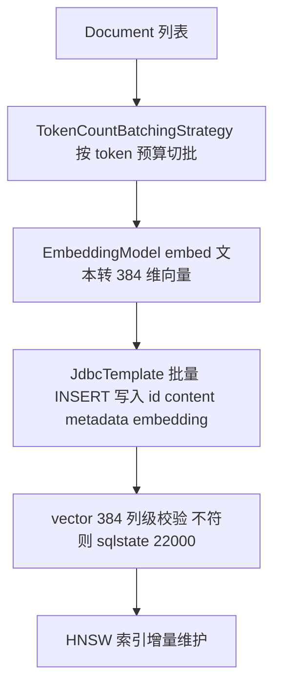
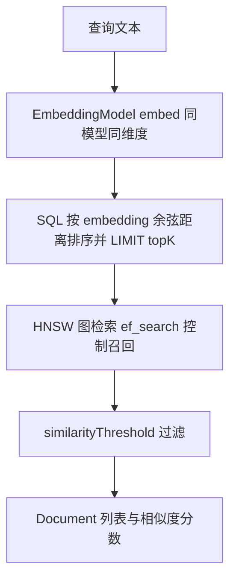
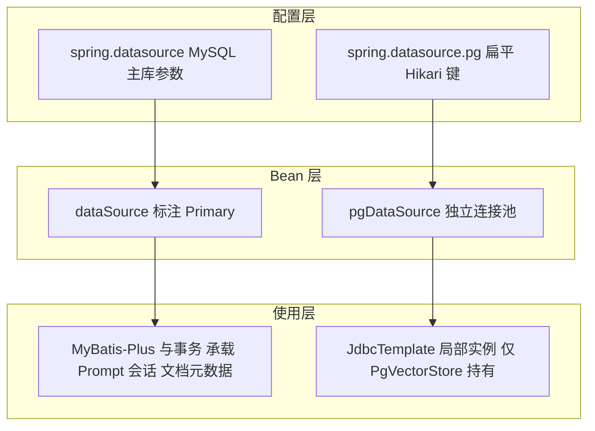
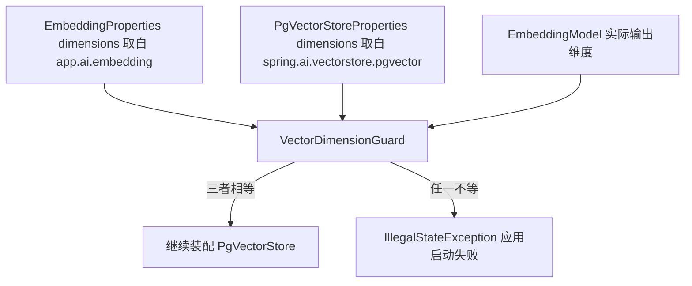
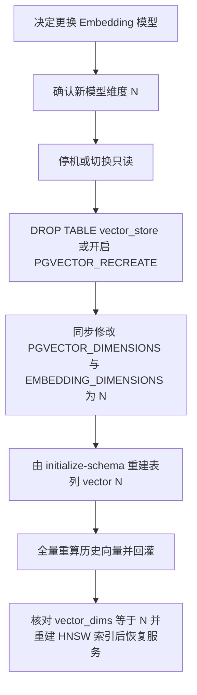

# D30-02 PG 向量库与统一向量维度 384 技术说明与实践指南

> 定位：D30 的技术原理与实践手册。文档 01 记录“改了什么、怎么验”，本文回答“为什么这样设计、
> 底层发生了什么、出问题怎么定位”。以一名 12 年 Java 架构师 + 6 年 AI 工程落地的视角组织，
> 所有技术判断以 1.1.8 jar 反编译、PostgreSQL 真机系统目录、以及本项目真实日志为依据。

---

## 一、是什么：三层抽象，别混为一谈

D30 引入的是一条“向量存储”链路，涉及三个层次，职责严格分离：

| 层次 | 组件 | 职责 | 本项目实例 |
| --- | --- | --- | --- |
| 模型层 | `EmbeddingModel` | 文本 → 定长浮点数组 | `LocalHashingEmbeddingModel`（384 维、零网络） |
| 抽象层 | `VectorStore` | 向量的写入 / 相似度检索 / 删除，屏蔽底层库差异 | `PgVectorStore` |
| 存储层 | PostgreSQL + pgvector | 定长 `vector(n)` 列、距离运算符、ANN 索引 | `spring_ai.vector_store`，HNSW + `vector_cosine_ops` |

**一句话区分**：`EmbeddingModel` 决定“向量长什么样”，`VectorStore` 决定“向量怎么存取”，
pgvector 决定“怎么在毫秒级从百万行里找出最近邻”。

---

## 二、为什么：为什么是 PostgreSQL + pgvector，而不是 MySQL 或内存

| 方案 | 优点 | 在本项目的致命问题 |
| --- | --- | --- |
| MySQL 存 JSON / BLOB 再应用层算距离 | 不引入新组件 | 无向量类型、无 ANN 索引，全表扫描 O(N)；RAG 场景直接不可用 |
| 内存向量库（SimpleVectorStore） | 零依赖、启动快 | 进程重启即丢、无法多实例共享、数据量受限 |
| 专用向量库（Milvus / Qdrant / Weaviate） | 性能与规模上限高 | 多一套运维体系，学习项目成本过高；D30 阶段只需要“能落库、能检索” |
| **PostgreSQL + pgvector** | 一个扩展搞定、SQL 生态复用、事务与备份沿用、HNSW 索引够用 | 规模到亿级需要分区 / 分片；本项目远未触及 |

选型的关键不是“谁最强”，而是**在已有 PostgreSQL 18.7 + pgvector 0.8.7 部署前提下，用最小新增面
拿到可验证的向量能力**。这也解释了 D30 的边界：只做“配置 + 维度统一”，不提前造检索业务。

### 2.1 为什么维度锁定 384

- 384 是 `all-MiniLM-L6-v2` 系列句向量模型的输出维度，也是本地轻量嵌入的常见口径；后续若要换真实
  模型（如中文 `bge-small-zh-v1.5` 为 512 维、OpenAI `text-embedding-3-small` 为 1536 维），
  只允许“整表重建 + 全量重算”，不允许“改配置不改表”。
- 存储成本：`vector(384)` 单行 float4 = 384 × 4B ≈ 1.5 KB；1536 维则约 6 KB，加上 HNSW 图结构，
  百万级数据的差距是数倍。
- 本项目的 `LocalHashingEmbeddingModel` 是词面哈希模型，本身可以输出任意维度，但**工程上必须选一个
  固定值并贯穿全链路**——这正是 D30 要解决的“三处一致”。

---

## 三、底层原理

### 3.1 `vector(n)` 是“列级硬约束”，不是“建议”

```sql
embedding vector(384)
```

- `vector(n)` 声明了固定维度 n；插入时 PostgreSQL 会逐元素校验，维度不符直接报错：
  `ERROR: expected 384 dimensions, not 383`（sqlstate `22000`，真机实测）。
- 与 `vector`（不写 n）不同：后者允许任意维度，等于把维度校验从数据库挪到应用层，
  一旦混写不同维度的向量，检索结果会静默失真。**生产必须写死 n**。
- 维度不能 `ALTER`：PostgreSQL 不支持把 `vector(384)` 直接改成 `vector(512)`，
  只能删列 / 删表重建并全量重算向量。这是 D30 把维度做成启动期 fail-closed 校验的根本原因。

### 3.2 距离度量与运算符的对应关系

| 配置值 | pgvector 运算符 | 索引 opclass | 语义 |
| --- | --- | --- | --- |
| `COSINE_DISTANCE` | `<=>` | `vector_cosine_ops` | 余弦距离，1 - 余弦相似度 |
| `EUCLIDEAN_DISTANCE` | `<->` | `vector_l2_ops` | 欧氏距离 |
| `NEGATIVE_INNER_PRODUCT` | `<#>` | `vector_ip_ops` | 负内积（越大越相似） |

真机索引定义证据：

```sql
CREATE INDEX spring_ai_vector_index ON public.vector_store
  USING hnsw (embedding vector_cosine_ops)
```

**实践要点**：`distance-type` 一旦上线不要改。改距离度量意味着换 opclass → 索引必须重建，
而且历史排序结果的语义全变（余弦只看方向，L2 看绝对位置）。

### 3.3 HNSW 是什么，参数该在哪调

HNSW（Hierarchical Navigable Small World）是分层可导航小世界图：上层稀疏用于快速跳转，下层稠密用于精确收敛。
查询复杂度近似 O(log N)，代价是更高的内存与建索引时间。

| 参数 | pgvector 默认 | 作用 | 调优方式 |
| --- | --- | --- | --- |
| `m` | 16 | 每个节点的最大连接数，越大召回越高、内存越大 | `ALTER INDEX ... SET (m = 32)` 后 `REINDEX` |
| `ef_construction` | 64 | 建索引时候选队列大小，越大索引质量越高、建得越慢 | 同上 |
| `hnsw.ef_search` | 40 | **查询期**候选队列，越大召回越高、延迟越大 | `SET hnsw.ef_search = 100`（会话级）或 `ALTER DATABASE ... SET` |

**这就是 D30 不把 `index-m` / `index-list-size` 写进 YAML 的原因**：Spring AI 1.1.8 的
`PgVectorStoreProperties` 没有这两个属性（jar 反编译确认），写了会被静默忽略，
形成“我调了参数但没生效”的假象。参数属于索引与数据库，应由 SQL 管。

### 3.4 写入与检索的内部流程





关键约束：**查询向量必须与入库向量同模型、同维度、同归一化方式**。
`LocalHashingEmbeddingModel` 是确定性哈希，同一文本必然同向量；但一旦换成真实模型，
历史向量全部失效，必须整表重算——这也是“向量空间标识（vectorSpaceId）”存在的意义。

---

## 四、核心代码：为什么必须手动装配 PgVectorStore

### 4.1 自动配置的陷阱：它要的是 `JdbcTemplate`，不是 `DataSource`

`PgVectorStoreAutoConfiguration#vectorStore` 的方法签名（1.1.8 jar 反编译）：

```java
PgVectorStore vectorStore(JdbcTemplate jdbcTemplate,
                          EmbeddingModel embeddingModel,
                          PgVectorStoreProperties properties, ...)
```

Spring Boot 在单数据源场景下只会有一个 `JdbcTemplate`（由 `JdbcTemplateAutoConfiguration` 基于
`@Primary DataSource` 构建）。**本项目这个 `JdbcTemplate` 建在 MySQL 上**。
如果放任自动配置生效，`PgVectorStore` 会拿 MySQL 的 `JdbcTemplate` 去执行
`CREATE EXTENSION vector` / `CREATE TABLE ... vector(384)` —— 直接失败，或者更糟：
在别的库上建了表却以为在 PG 上。

因此 D30 的处置是“排除 + 自建”：

```java
@SpringBootApplication(exclude = {DeepSeekChatAutoConfiguration.class, PgVectorStoreAutoConfiguration.class})
```

```java
JdbcTemplate pgJdbcTemplate = new JdbcTemplate(pgDataSource);   // 方法内构造，不注册 Bean
return PgVectorStore.builder(pgJdbcTemplate, embeddingModel)    // 1.1.8 唯一构建入口
        .schemaName("public")
        .vectorTableName("vector_store")
        .idType(PgIdType.UUID)
        .dimensions(384)
        .distanceType(PgDistanceType.COSINE_DISTANCE)
        .indexType(PgIndexType.HNSW)
        .initializeSchema(true)
        .vectorTableValidationsEnabled(false)
        .removeExistingVectorStoreTable(false)
        .maxDocumentBatchSize(100)
        .build();
```

**为什么不把 `pgJdbcTemplate` 注册成 Bean**：容器里已有主库 `JdbcTemplate`，再注册一个同类型 Bean，
任何 `@Autowired JdbcTemplate` 的点位都会出现歧义（要么报 `NoUniqueBeanDefinitionException`，
要么靠 `@Qualifier` 逐个修补）。局部构造是侵入最小的做法。

### 4.2 第二个坑：注册了 `pgDataSource` 会让 MySQL 自动配置整体退让

`DataSourceAutoConfiguration` 的前置条件是 `@ConditionalOnMissingBean({DataSource.class, XADataSource.class})`。
只要容器里出现任何一个 `DataSource`，它就不再装配。于是：

```text
注册 pgDataSource  ->  DataSourceAutoConfiguration 退让
                   ->  没有 MySQL DataSource
                   ->  MyBatis-Plus 绑定到 PG
                   ->  Prompt 模板 / 聊天历史静默写进 PostgreSQL
```

这种回归最危险的地方是**不报错**：功能“看起来正常”，数据却写错了库。
所以必须显式重建主库并加 `@Primary`：

```java
@Bean
@Primary
@ConfigurationProperties("spring.datasource.hikari")
public HikariDataSource dataSource(DataSourceProperties properties) {
    return properties.initializeDataSourceBuilder().type(HikariDataSource.class).build();
}
```

`@Primary` 保证：

1. `@ConditionalOnSingleCandidate(DataSource.class)` 认定它是唯一候选；
2. 任何按类型注入 `DataSource` / `JdbcTemplate` / `PlatformTransactionManager` 的点位命中 MySQL；
3. `pgDataSource` 只能靠 `@Qualifier("pgDataSource")` 显式取用。

真机验证结果：`primaryDataSource` 的 URL 以 `jdbc:mysql://` 开头，
`pgDataSource` 的 URL 以 `jdbc:postgresql://` 开头，池名 `PgVectorHikariPool`（集成测试 `poolsAreIsolated` 断言）。

### 4.3 数据源隔离的完整结构



### 4.4 维度守卫放在哪一步



为什么选在“装配前”而不是“首次写入时”：

- 首次写入可能在业务高峰，失败面是整个文档导入链路；
- 启动期失败是**开发 / 运维可见的一次性失败**，改配置重启即恢复，代价最小；
- 维度错误无法靠重试修复，重试只会放大日志噪声。

---

## 五、配置项逐项说明（对照 1.1.8 真实属性集）

| 属性 | 本项目值 | 说明 | 改错的后果 |
| --- | --- | --- | --- |
| `initialize-schema` | `true`（测试环境 `false`） | 启动时建表 / 建索引 | 关掉且表不存在 → 首次写入报 `relation does not exist` |
| `schema-name` | `public` | PG schema | `search_path` 之外的表名会找不到 |
| `table-name` | `vector_store` | 向量表名 | 与证据 / 监控脚本里的表名不一致 |
| `dimensions` | `384` | 建表列维度 | 与模型输出不符 → 写入 `22000` 直接失败 |
| `index-type` | `HNSW` | `HNSW / IVFFLAT / NONE` | 改 `NONE` 退化为全表扫描；改 `IVFFLAT` 需数据量足够才准 |
| `distance-type` | `COSINE_DISTANCE` | 距离度量与 opclass | 改错 → 索引与查询运算符不匹配，检索结果错乱 |
| `schema-validation` | `false` | 启动校验既有表结构 | 长期 `false` 会掩盖表结构漂移 |
| `max-document-batch-size` | `100` | 单批写入上限 | 过大会导致长事务与内存峰值 |
| `id-type` | `UUID` | 主键生成策略 | 若为 `UUID`，应用传入的 id 必须是合法 UUID（否则 `Invalid UUID string`） |
| `remove-existing-vector-store-table` | `false` | 启动删表重建 | 置 `true` 会丢全量向量，属高危开关 |

**1.1.8 不存在的属性**（写了不报错、也不生效，必须靠 SQL 管理）：
`index-list-size`、`index-m`、`batching-size`，以及任意 `hikari` 嵌套节点（如 `pg.hikari.pool-name`）。

---

## 六、操作实践

### 6.1 首次上线（建表）

1. 确认 PG 扩展已安装：`SELECT extversion FROM pg_extension WHERE extname = 'vector';` → `0.8.7`。
2. `initialize-schema=true` 启动一次，日志出现 `Initializing PGVectorStore schema for table: vector_store in schema: public`。
3. 用系统目录核对（不要只看日志）：

```sql
SELECT format_type(atttypid, atttypmod) FROM pg_attribute
 WHERE attrelid = 'public.vector_store'::regclass AND attname = 'embedding';
-- 期望：vector(384)

SELECT indexdef FROM pg_indexes
 WHERE schemaname = 'public' AND tablename = 'vector_store';
-- 期望：USING hnsw (embedding vector_cosine_ops)
```

4. 稳定后把 `initialize-schema` 置 `false`、`schema-validation` 置 `true`，让启动只做校验不做 DDL。

### 6.2 维度变更（唯一正确路径）



**禁止**：`ALTER TABLE ... ALTER COLUMN embedding TYPE vector(N)`（pgvector 不支持维度变更），
也禁止只改 YAML 不改表——那会让所有写入以 `22000` 失败。

### 6.3 池与资源

| 项 | 建议 | 依据 |
| --- | --- | --- |
| `maximum-pool-size` | 10（本地开发） | 向量写入是批量事务，池过大反而增加 PG 连接压力 |
| `minimum-idle` | 2 | 保活，减少冷启动延迟 |
| `connection-timeout` | 30000ms | PG 网络抖动容忍 |
| `max-lifetime` | 1800000ms（30min） | 小于 PG 侧空闲断连阈值，避免拿到半死连接 |

### 6.4 调优与运维 SQL

```sql
-- 召回不足：提高查询期候选队列（会话级）
SET hnsw.ef_search = 100;

-- 提升索引质量（写入低峰执行，随后 REINDEX）
ALTER INDEX spring_ai_vector_index SET (m = 32, ef_construction = 128);
REINDEX INDEX spring_ai_vector_index;

-- 观察索引体积
SELECT pg_size_pretty(pg_relation_size('spring_ai_vector_index'));

-- 验证维度分布（应全部为 384）
SELECT vector_dims(embedding), count(*) FROM vector_store GROUP BY 1;
```

---

## 七、排错手册（真实踩过的坑 + 真机报错原文）

| 现象 | 根因 | 处置 |
| --- | --- | --- |
| `Invalid UUID string: xxx` | `id-type=UUID` 时，document id 被当作 UUID 解析 | 传合法 UUID，或把 `id-type` 改 `TEXT`（改后要重建表） |
| `ERROR: expected 384 dimensions, not 383`（sqlstate `22000`） | 写入向量维度与列定义不符 | 核对三处维度；换模型必须按 6.2 重建 |
| 启动报 `ConfigurationPropertiesBindException` | `spring.datasource.pg` 下写了嵌套节点（如 `hikari.pool-name`） | 改成与 `HikariConfig` setter 同层；本项目的 `ignoreUnknownFields=false` 就是为此 |
| Prompt 模板“查不到”或数据跑到 PG | 注册 `pgDataSource` 后未显式重建 MySQL 主库，`DataSourceAutoConfiguration` 退让 | 必须有 `@Primary` 的 MySQL `DataSource`（D30 已修） |
| `relation "vector_store" does not exist` | `initialize-schema=false` 且表未建 | 先置 `true` 启动一次，或手工建表 |
| 检索结果与预期偏差大 | `distance-type` 与索引 opclass 不匹配；或查询 / 入库用了不同模型 | 核对索引定义 `vector_cosine_ops`；核对 `vectorSpaceId` |
| `Unknown column 'source' in 'field list'` | MySQL 运行库表结构与代码 / DDL 漂移（D30 期间真实遇到） | 属既有问题，需按 DDL 同步表结构（本次未动库） |

---

## 八、常见问题

**Q1：既然是本地哈希模型，为什么还要 384 维？**
维度是“契约”不是“效果”。锁 384 是为了让未来替换真实模型时只需一次整表重建，
而不是在运行期发现维度冲突。哈希模型的 384 维只是当前实现，契约本身更重要。

**Q2：为什么两处都要配 `dimensions`？不能只配一处吗？**
`app.ai.embedding.dimensions` 决定模型输出，`spring.ai.vectorstore.pgvector.dimensions` 决定建表列宽。
二者语义不同，无法合并；`VectorDimensionGuard` 的作用就是禁止它们“各说各话”。

**Q3：`initialize-schema=true` 每次都建表，安全吗？**
它用的是 `CREATE ... IF NOT EXISTS` 语义，重复启动不会丢数据；但仍建议生产改 `false`，
原因不是安全性，而是“启动期不做 DDL”这条运维纪律（DDL 应由发布流程管）。

**Q4：能不能用 `SimpleVectorStore` 省掉 PG？**
可以，但那是“进程内、重启即失、多实例不共享”的方案。D30 明确要的是可持久化的独立向量库。

**Q5：为什么向量表不放在 MySQL 里？**
MySQL 没有向量类型与 ANN 索引，只能存 JSON / BLOB 后应用层全表算，RAG 的延迟与规模都不可接受。

**Q6：`schema-validation=true` 会做什么？**
启动期比对既有表结构与配置（列类型、维度、索引），不符则 fail-fast。首次建表阶段建议关，
表稳定后建议开。

---

## 九、工程实践清单

1. **三处维度写进发布检查单**：表列、`PGVECTOR_DIMENSIONS`、`EMBEDDING_DIMENSIONS`。
2. **`vectorSpaceId` 当版本号用**：本项目形如 `local|local-hashing-embedding|local-v1|384`，
   换模型即换空间，历史向量不得混用。
3. **不要把索引参数写进 YAML**：`m / ef_construction / ef_search` 归 SQL 与数据库配置管。
4. **向量库与业务库分开监控**：PG 侧看连接数、索引体积、写入耗时；MySQL 侧看慢查询与连接池。
5. **备份策略独立**：`vector_store` 可重建（重算向量），但重算成本可能数小时，仍应纳入备份。
6. **危险开关加双人确认**：`PGVECTOR_RECREATE=true` 会删表，必须与重建流程绑定。
7. **密钥只走环境变量**：本项目 YAML 里的 PG 口令仅作本机开发默认值，提交前应改为
   `application-local.yml` 或纯 env 注入（当前为已知待整改项）。

---

## 十、与后续迭代的衔接

D30 建立了“向量能可靠落库”的地基，但**没有**建立检索业务。下一步（D31 起）的自然延伸：

| 方向 | 需要补的能力 | 与 D30 的耦合点 |
| --- | --- | --- |
| RAG 检索问答 | `similaritySearch` + 阈值 + topK 调参、引用回填 | 复用 `PgVectorStore`，维度必须仍为 384 |
| 混合检索 | 关键词召回 + 向量召回融合 | 需要 `metadata` 里带 documentId / chunkIndex |
| 真实 Embedding | 换模型 + 整表重建 + 全量重算 | 触发 6.2 的维度变更流程 |
| 多租户隔离 | 分区表 / 按 schema 隔离 | 影响 `table-name` 与 `schema-name` 配置 |

---

## 十一、官方参考

- 《Spring AI 1.1 Vector Databases - PGVector | Spring AI 1.1 向量数据库 - PGVector》：https://docs.spring.io/spring-ai/reference/1.1/api/vectordbs/pgvector.html
- 《pgvector README - Indexing and Operators | pgvector 说明 - 索引与运算符》：https://github.com/pgvector/pgvector
- 《PostgreSQL 18 Documentation - Data Types | PostgreSQL 18 文档 - 数据类型》：https://www.postgresql.org/docs/18/datatype.html
- 《HikariCP Configuration | HikariCP 配置说明》：https://github.com/brettwooldridge/HikariCP
- 《Spring Boot 3.5 DataSource Configuration | Spring Boot 3.5 数据源配置》：https://docs.spring.io/spring-boot/how-to/data-access.html

> 说明：上述链接为对应项目的官方文档入口；本文中“1.1.8 无 `index-list-size/index-m/batching-size`”
> “自动配置依赖 `JdbcTemplate`”等结论，来自本项目对 `spring-ai-pgvector-store-1.1.8.jar` 的反编译核验，
> 属版本实证结论，与官方文档的通用描述可能存在版本差异，以实证为准。
