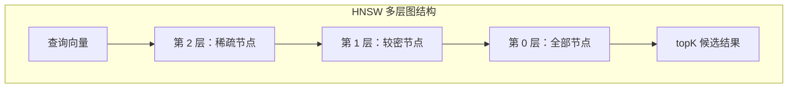
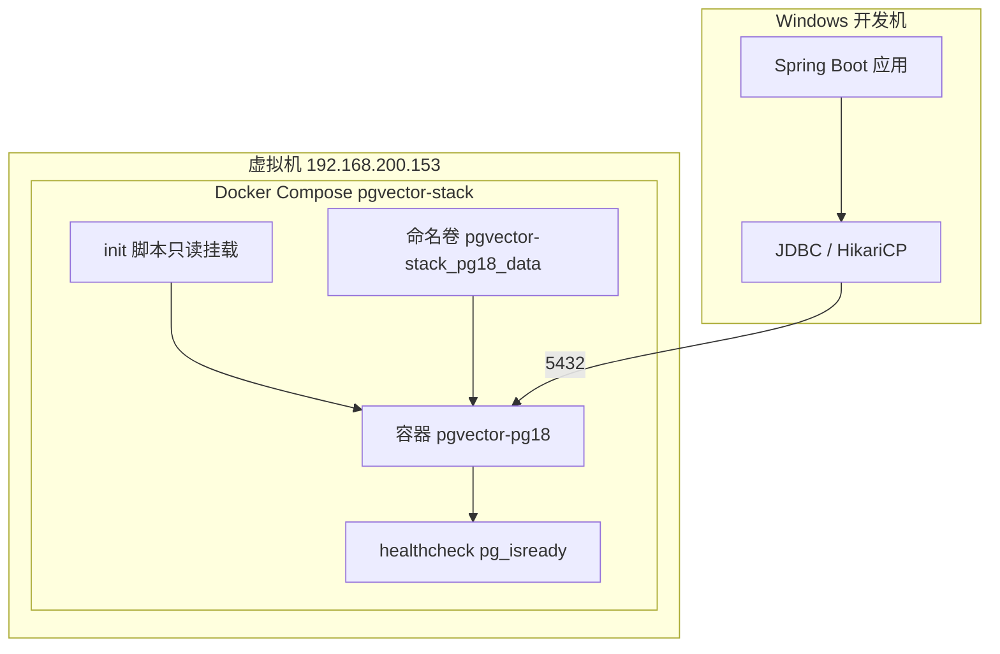
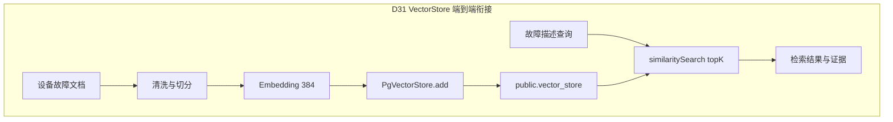

# D30｜PostgreSQL 与 pgvector 技术原理及本地部署操作实践指南

> 适用版本：PostgreSQL 18.7、pgvector 0.8.7、Spring Boot 3.5.16、Spring AI 1.1.8、JDK 21
> 对应项目：`D30_postgresqlAndpgvector`
> 写作视角：12 年 Java 架构经验 + 6 年 AI 工程落地经验
> 原则：概念必须落到 SQL、Java 配置和当前项目的真实执行结果上。

---

## 1. PostgreSQL 的定位

PostgreSQL 不是“另一个 MySQL”。在企业 Java 体系里，它的定位通常是：

- **关系型主库**：强事务、复杂 SQL、JSONB、窗口函数、CTE、部分索引。
- **可扩展数据库平台**：通过 extension 增加向量、全文检索、地理、时序等能力。
- **一致性与可运维性优先**：MVCC、WAL、在线备份、细粒度权限。

对本项目而言，MySQL 继续承担业务主库，PostgreSQL 承担向量库。两者不是替代关系，而是职责分离：

```text
MySQL 主库：业务表、Prompt、聊天历史
PostgreSQL：向量表、向量索引、相似度检索
```

PostgreSQL 的扩展机制是关键：`CREATE EXTENSION vector` 后，数据库获得 `vector` 类型、距离运算符和向量索引能力，不需要额外部署一个独立向量数据库进程。

---

## 2. pgvector 的作用和基本原理

pgvector 是 PostgreSQL 的开源向量相似度搜索扩展。它做三件事：

1. **类型**：提供 `vector(N)`，在数据库层固定向量维度。
2. **运算符**：提供 `<->`（L2）、`<=>`（cosine）、`<#>`（inner product）等距离计算。
3. **索引**：提供 HNSW 与 IVFFlat 两种近似最近邻索引，以及精确扫描。

一个向量列在 PostgreSQL 中不是黑盒：

```sql
CREATE TABLE demo (
    id BIGSERIAL PRIMARY KEY,
    embedding VECTOR(384) NOT NULL
);
```

数据库知道：

- 每行必须是 384 维；
- 可以用 `<=>` 计算 cosine 距离；
- 可以建立 `hnsw (embedding vector_cosine_ops)` 索引；
- 可以用 `ORDER BY embedding <=> query LIMIT k` 做近似检索。

pgvector 不负责“把文本变成向量”。文本 → 向量由 Embedding 模型完成，pgvector 只负责存储和距离计算。这个边界必须分清。

---

## 3. PostgreSQL 与 pgvector 的关系

| 层次 | 归属 | 作用 |
|---|---|---|
| 数据库进程 | PostgreSQL | 连接、事务、WAL、权限、备份 |
| 向量类型与运算符 | pgvector extension | `vector(N)`、`<=>`、`<->`、`<#>` |
| 向量索引 | pgvector extension | HNSW / IVFFlat |
| 文本转向量 | Embedding 模型 | 384 维浮点数组 |
| 应用调用 | Spring AI / JDBC | 写入、查询、结果映射 |

关系可以理解为：

```text
PostgreSQL 是“库”
pgvector 是“库里的向量能力插件”
Embedding 模型是“向量生产者”
Spring AI 是“应用侧调用封装”
```

因此，验证顺序必须是：

```text
容器运行
  -> PostgreSQL 健康
  -> JDBC 可连接
  -> pgvector 扩展存在
  -> vector(384) 可建表
  -> 向量可写入/读取
  -> <=> 可计算
  -> HNSW 索引可用
```

任何一步都不能用前一步替代。容器 healthy 不等于检索通过。

---

## 4. 为什么 Java AI 项目可以使用 PostgreSQL + pgvector

### 4.1 适用条件

| 条件 | 说明 |
|---|---|
| 向量规模中等 | 十万到百万级通常可接受，取决于内存、维度和索引参数 |
| 已有 PostgreSQL 运维能力 | 备份、监控、权限、连接池可复用 |
| 需要事务一致性 | 文档元数据与向量可以在同一数据库内保持一致 |
| 不想引入独立向量库 | 减少一套集群、一套 SDK、一套权限和故障域 |
| 查询模式以 topK + metadata filter 为主 | pgvector + SQL 足够 |

### 4.2 不适合的情况

- 十亿级向量、极高 QPS、强水平扩展；
- 需要多租户隔离、复杂向量分片；
- 需要 GPU 加速的近邻检索；
- 需要跨模态多向量联合索引。

这些场景应考虑专用向量库，但不是 D30 的范围。

### 4.3 本项目的选择理由

1. 项目已经有 PostgreSQL 18 + pgvector 容器，继续沿用比新增 Milvus/Qdrant 更稳。
2. 设备故障知识库当前是学习/本地阶段，数据量远未到专用库阈值。
3. 业务元数据在 MySQL、向量在 PG，职责分离清楚。
4. Spring AI 1.1.8 提供官方 `PgVectorStore`，可直接对接。

结论：**在现有规模与目标下，PostgreSQL + pgvector 是合理且经过验证的选择；但不能把它描述成无限扩展的万能方案。**

---

## 5. 向量数据的基本概念

Embedding 是一组浮点数：

```text
[0.1, 0.1, 0.1, ..., 0.1]    // 384 个
```

它表达的是文本在高维语义空间中的位置。相似文本在空间中距离更近，但“近”由模型和距离度量共同定义。

关键概念：

| 概念 | 含义 | 工程影响 |
|---|---|---|
| 维度 | 向量元素个数 | 必须与模型、表、索引一致 |
| 范数 | 向量长度 | 影响 cosine 归一化 |
| 距离 | 两个向量的差异 | 越小越相似（对 distance 而言） |
| 相似度 | 相近程度 | 越大越相似 |
| 归一化 | 把向量缩放到单位长度 | cosine 对长度不敏感 |

注意：Embedding 不是“关键词哈希”的等价物。本项目 `local-hashing-embedding` 是本地确定性模型，用于工程验证；它的语义质量不能与真实语义模型相提并论。

---

## 6. Embedding 向量维度的含义

维度是模型的输出契约：

```text
模型 local-hashing-embedding -> 384 维
表 embedding VECTOR(384)   -> 只接受 384 维
```

维度不是“越大越好”：

- 维度越大，存储、索引、计算成本越高；
- 维度必须与模型训练/输出一致；
- 换模型可能同时换维度；
- 换维度不是改一行 YAML 就完成，旧表、旧索引、旧向量都要迁移。

本项目统一 384 的原因：

1. `EmbeddingProperties.dimensions` 默认 384；
2. `PgVectorStoreProperties.dimensions` 为 384；
3. `LocalHashingEmbeddingModel` 实际输出 384；
4. 正式表 `vector_store` 为 `vector(384)`；
5. 测试表 `d30_pgvector_test` 为 `vector(384)`。

三方守卫在启动时校验，避免“配置 384、模型 256、表 1536”这种运行期灾难。

---

## 7. `vector(N)` 字段的作用

`VECTOR(384)` 是数据库层的强约束：

```sql
embedding VECTOR(384) NOT NULL
```

它保证：

- 写入 383 维 → 数据库拒绝；
- 写入 385 维 → 数据库拒绝；
- 读取时可使用 `vector_dims(embedding)` 检查；
- 索引和运算符知道维度上限。

实际错误：

```text
ERROR: expected 384 dimensions, not 383
```

这不是应用层“建议”，而是数据库层“硬拒绝”。工程价值：

1. 把维度错误挡在写入点；
2. 避免脏数据进入索引；
3. 让 Embedding 模型升级必须走迁移流程。

限制：

- `vector(N)` 的 N 不能随意 `ALTER` 成另一个维度；
- 修改维度通常需要新列/新表、回填、重建索引、切换读写；
- 不要在生产表上直接 `DROP COLUMN` 或 `TRUNCATE` 试错。

---

## 8. 向量写入与读取

### 8.1 JDBC 写入

当前项目测试使用：

```java
String marker = "D30-JDBC-READ-" + UUID.randomUUID();
String vector = vectorLiteral(384, 0.1f, 0.1f);

jdbc.update(
    "INSERT INTO public.d30_pgvector_test (content, embedding) VALUES (?, ?::vector)",
    marker, vector);
```

为什么用 `?::vector`：

- JDBC 参数是字符串；
- PostgreSQL 需要显式 cast 到 vector；
- 避免依赖驱动隐式转换；
- 让 SQL 在 psql 与 JDBC 中行为一致。

### 8.2 读取

```sql
SELECT id, content, vector_dims(embedding)
FROM public.d30_pgvector_test
WHERE content = ?;
```

实际 `vector_dims=384`。

### 8.3 批量写入建议

- 使用 `batchUpdate`，每批 100 左右；
- 单批过大增加事务、WAL、锁压力；
- 失败批次要记录文档 ID，支持幂等重试；
- 不要把完整向量或文档明文打进日志。

### 8.4 写入事务边界

向量写入与业务元数据是否同一事务，要看数据源：

- 同一 PostgreSQL：可以同事务；
- MySQL 元数据 + PG 向量：跨库，不能依赖单机事务；
- 需要补偿/幂等/状态机，而不是假装两阶段提交。

当前项目是 MySQL + PG 双数据源，后续真实 RAG 写入必须考虑一致性补偿。

---

## 9. cosine distance 的计算语义

余弦相似度：

```text
cosine_similarity(a, b) = (a · b) / (||a|| * ||b||)
```

余弦距离：

```text
cosine_distance(a, b) = 1 - cosine_similarity(a, b)
```

性质：

- 相似度范围 `[-1, 1]`；
- 距离范围 `[0, 2]`；
- 距离越小，越相似；
- 对向量长度不敏感，只看方向。

本项目实际测试：

```text
A = [0.1, 0.1, ..., 0.1]         // 384 维
B = [1.0, 0.0, ..., 0.0]         // 384 维

A 与 A：distance = 0.000000，similarity = 1.000000
B 与 A：distance = 0.948969，similarity = 0.051031
```

为什么 B 的距离不是 0.707：

- A 的范数是 `sqrt(384 * 0.01) ≈ 1.9596`；
- B 的范数是 1；
- 点积是 0.1；
- cosine similarity ≈ 0.0510；
- distance ≈ 0.9490。

这说明：**距离大小取决于向量方向，不是“看起来差多少”。**

---

## 10. `<=>` 运算符

pgvector 的 `<=>` 是 cosine distance：

```sql
SELECT embedding <=> query_vector AS distance
FROM public.d30_pgvector_test
ORDER BY embedding <=> query_vector
LIMIT 5;
```

语义：

| 表达式 | 返回 |
|---|---|
| `a <=> b` | cosine distance，越小越相似 |
| `1 - (a <=> b)` | cosine similarity，越大越相似 |

常见错误：

```sql
-- 错误：把 distance 当 similarity 排序
ORDER BY embedding <=> query DESC
```

正确：

```sql
-- 距离升序
ORDER BY embedding <=> query ASC
```

当前项目测试：

```java
"SELECT content, embedding <=> ?::vector AS cosine_distance FROM ... "
+ "WHERE content IN (?, ?) ORDER BY embedding <=> ?::vector LIMIT 5"
```

断言第一条是 A，且 A 的距离小于 B。

---

## 11. cosine similarity 与 cosine distance 的区别

| 维度 | cosine similarity | cosine distance |
|---|---|---|
| 定义 | `a·b/(||a||·||b||)` | `1 - similarity` |
| 范围 | `[-1, 1]` | `[0, 2]` |
| 越大越相似 | 是 | 否 |
| 越小越相似 | 否 | 是 |
| pgvector 运算符 | 无直接单一运算符，常用 `1 - <=>` | `<=>` |
| 索引排序 | 不能直接按 similarity 升序 | 直接按 distance 升序 |
| 业务展示 | 相似度百分比/分数 | 检索排序键 |

工程建议：

- 数据库排序统一用 distance；
- API 返回可同时给 `distance` 与 `similarity`；
- 不要把 similarity 当 distance 传给前端，否则“分数越高越不相关”。

---

## 12. HNSW 索引的基本原理

HNSW（Hierarchical Navigable Small World）是多层可导航图：

- 底层包含所有节点；
- 上层是稀疏采样，形成“高速路”；
- 查询从上层贪心跳跃，逐层下降；
- 在底层做局部候选扩展。



关键参数：

| 参数 | 含义 | 默认 | 影响 |
|---|---|---|---|
| `m` | 每层最大连接数 | 16 | 越大召回越高、内存越大 |
| `ef_construction` | 构建候选队列 | 64 | 越大构建越慢、图质量越高 |
| `hnsw.ef_search` | 查询候选队列 | 40 | 越大召回越高、延迟越大 |

HNSW 是**近似**索引：

- 不保证 100% 召回；
- 以召回换延迟；
- 需要基准测试，不是“建了索引就一定快”。

最终只读核对为 12 行（早期快照 9 行，最终构建的 JDBC 验收新增 3 行合成标记数据），EXPLAIN 仍选择 Index Scan。这只证明索引可被使用，不代表大规模性能。

---

## 13. `vector_cosine_ops` 的作用

索引不是“给 embedding 列建一个通用索引”，而是要绑定运算符类：

```sql
CREATE INDEX idx_d30_pgvector_test_embedding
ON public.d30_pgvector_test
USING hnsw (embedding vector_cosine_ops);
```

`vector_cosine_ops` 表示：

- 该索引按 cosine 距离组织；
- 查询必须使用 `<=>` 才能匹配；
- 如果用 `<->`（L2）查询，规划器不会用这个 cosine 索引，或需要额外排序。

对应关系：

| 运算符 | 距离 | 索引 opclass |
|---|---|---|
| `<=>` | cosine | `vector_cosine_ops` |
| `<->` | L2 | `vector_l2_ops` |
| `<#>` | inner product | `vector_ip_ops` |

工程教训：

> 建了 cosine 索引，却用 L2 查询，是“索引明明建了却不生效”的常见原因。

---

## 14. Docker Compose 部署架构

实际 Compose：

```yaml
services:
  postgres:
    image: pgvector/pgvector:pg18
    container_name: pgvector-pg18
    restart: unless-stopped
    ports:
      - "5432:5432"
    environment:
      POSTGRES_USER: postgres
      POSTGRES_PASSWORD: ***REDACTED***
      POSTGRES_DB: spring_ai
      TZ: Asia/Shanghai
    volumes:
      - pg18_data:/var/lib/postgresql
      - ./init:/docker-entrypoint-initdb.d:ro
    healthcheck:
      test: ["CMD-SHELL", "pg_isready -U postgres -d spring_ai"]
      interval: 5s
      timeout: 3s
      retries: 10
    shm_size: 256mb

volumes:
  pg18_data:
```

架构：



要点：

- 镜像 `pgvector/pgvector:pg18` 自带 PostgreSQL 18 + pgvector；
- `init` 只读挂载用于首次初始化；
- 健康检查命令是 `pg_isready`；
- 端口映射对宿主机暴露 5432；
- Compose 服务名是 `postgres`，容器名是 `pgvector-pg18`，命令参数不要混用。

---

## 15. 数据持久化与数据卷

命名卷：

```text
pgvector-stack_pg18_data -> /var/lib/postgresql
```

生命周期：

| 操作 | 数据卷 |
|---|---|
| `docker compose stop` | 保留 |
| `docker compose down` | 保留 |
| `docker compose down -v` | **删除** |
| `docker volume prune` | 可能删除 |
| 删除容器 | 保留（命名卷独立） |

因此：

- 不允许为了“重启试试”执行 `down -v`；
- 不允许 `docker volume prune`；
- 备份用 `pg_dump`，不要复制运行中的 data 目录；
- 本项目的容器已 `healthy`，D30 没有执行 up/down/restart。

最小备份命令（示例，需在安全环境执行）：

```bash
docker exec pgvector-pg18 pg_dump -U postgres -d spring_ai -Fc \
  > /root/pgvector-stack/backup_spring_ai_$(date +%F).dump
```

恢复：

```bash
docker exec -i pgvector-pg18 pg_restore -U postgres -d spring_ai \
  < /root/pgvector-stack/backup_spring_ai_YYYY-MM-DD.dump
```

生产环境还要考虑备份保留、加密、异地副本和恢复演练。

---

## 16. Spring Boot JDBC 连接实践

### 16.1 独立数据源

```java
@Bean
@ConfigurationProperties(prefix = "spring.datasource.pg", ignoreUnknownFields = false)
public HikariConfig pgHikariConfig() {
    return new HikariConfig();
}

@Bean(name = "pgDataSource", destroyMethod = "close")
public DataSource pgDataSource(@Qualifier("pgHikariConfig") HikariConfig config) {
    return new HikariDataSource(config);
}
```

关键点：

- `prefix` 直接绑定 HikariConfig setter；
- `ignoreUnknownFields=false` 让错误键启动即失败；
- Bean 名 `pgDataSource`，避免与主数据源混淆；
- `@Qualifier` 注入，禁止按类型裸注入。

### 16.2 密码外部化

```yaml
password: ${PG_PASSWORD}
```

不写默认真实口令。原因：

1. 防止仓库泄露；
2. 防止测试环境误用生产口令；
3. 缺失时明确失败，而不是“悄悄连上”。

### 16.3 初始化失败策略

Hikari 在 `HikariDataSource` 构造时默认会尝试首个连接：

- `initialization-fail-timeout > 0`：等待并失败；
- `initialization-fail-timeout = 0`：尝试一次，失败即抛出；
- `initialization-fail-timeout < 0`：不等待首个连接，池可先创建。

本项目的配置测试需要“只验证属性绑定、不连库”，所以设置：

```java
"spring.datasource.pg.initialization-fail-timeout=-1"
```

这不是生产推荐值。生产应 fail-fast，让配置错误在启动期暴露。

### 16.4 测试隔离

JDBC 真机测试必须显式门控：

```java
@EnabledIfEnvironmentVariable(named = "D30_PG_IT", matches = "true")
```

普通测试套件不连接外部 PG，不产生网络依赖。需要真机时由开发者显式注入 `D30_PG_IT=true` 与 `PG_PASSWORD`。

---

## 17. 常见连接问题排查

### 17.1 排查顺序

```text
1. 网络：端口是否可达
2. 认证：用户名/口令是否正确
3. 数据库：目标库是否存在
4. 扩展：vector 是否安装
5. 维度：模型/表/索引是否一致
6. 索引：查询运算符是否匹配 opclass
7. 资源：连接池、内存、锁
```

### 17.2 常见错误对照

| 现象 | 根因 | 处理 |
|---|---|---|
| `Connection refused` | 容器未运行/端口未映射/防火墙 | `docker compose ps`、`Test-NetConnection` |
| `password authentication failed` | 口令错误/环境变量缺失 | 检查 `PG_PASSWORD`，不要在代码写死 |
| `database "xxx" does not exist` | JDBC URL 库名错误 | 核对 `current_database()` |
| `type "vector" does not exist` | 扩展未安装 | `CREATE EXTENSION vector` |
| `expected 384 dimensions, not 383` | 模型/写入维度错误 | 修模型或迁移表，不要改断言 |
| `operator does not exist: vector <=> vector` | 扩展/类型不匹配 | 确认 `vector` 扩展与列类型 |
| 索引不生效 | 查询用了 `<->` 但索引是 cosine | 改用 `<=>` 或换 opclass |
| Hikari `Failed to initialize pool` | 启动期连接失败 | 检查 URL/口令/网络，或测试用 `initialization-fail-timeout=-1` |

### 17.3 本次真实故障

第一次全量测试失败：

```text
Failed to initialize pool: FATAL: password authentication failed for user "postgres"
```

根因不是数据库坏，而是：

- `PgDataSourceConfigTest` 把真实口令改成占位值；
- Hikari 构造期仍尝试连接；
- 占位值当然无法通过真实认证。

修复：

```java
"spring.datasource.pg.initialization-fail-timeout=-1"
```

修复后：

```text
Tests run: 288, Failures: 0, Errors: 0, Skipped: 0
```

这条故障的工程价值：

> 单元/配置测试不应依赖真实数据库口令；如果必须启动 DataSource，要么设置不等待连接，要么用 mock/embedded，不要靠“仓库里正好有真口令”。

---

## 18. pgvector 常见 SQL

### 18.1 扩展

```sql
CREATE EXTENSION IF NOT EXISTS vector;

SELECT extname, extversion
FROM pg_extension
WHERE extname = 'vector';
```

### 18.2 建表

```sql
CREATE TABLE IF NOT EXISTS public.d30_pgvector_test (
    id BIGSERIAL PRIMARY KEY,
    content TEXT NOT NULL,
    embedding VECTOR(384) NOT NULL,
    created_at TIMESTAMPTZ NOT NULL DEFAULT CURRENT_TIMESTAMP
);
```

### 18.3 维度检查

```sql
SELECT format_type(atttypid, atttypmod)
FROM pg_attribute
WHERE attrelid = 'public.d30_pgvector_test'::regclass
  AND attname = 'embedding';

SELECT vector_dims(embedding)
FROM public.d30_pgvector_test
LIMIT 1;
```

### 18.4 写入

```sql
INSERT INTO public.d30_pgvector_test (content, embedding)
VALUES ('synthetic', ('[' || array_to_string(
    ARRAY(SELECT 0.1::real FROM generate_series(1, 384)), ','
) || ']')::vector);
```

### 18.5 距离查询

```sql
SELECT id, content, embedding <=> query AS distance
FROM public.d30_pgvector_test
ORDER BY embedding <=> query
LIMIT 5;
```

### 18.6 HNSW

```sql
CREATE INDEX IF NOT EXISTS idx_d30_pgvector_test_embedding
ON public.d30_pgvector_test
USING hnsw (embedding vector_cosine_ops);

EXPLAIN
SELECT id, content, embedding <=> query AS distance
FROM public.d30_pgvector_test
ORDER BY distance
LIMIT 5;
```

### 18.7 查询参数

```sql
SET hnsw.ef_search = 40;
SHOW hnsw.ef_search;
```

### 18.8 清理测试表

```sql
DROP TABLE IF EXISTS public.d30_pgvector_test;
```

仅限确认是测试表时使用；生产环境不得随手 drop。

---

## 19. 维度不匹配问题

### 19.1 典型错误

```text
ERROR: expected 384 dimensions, not 383
```

或：

```text
ERROR: expected 256 dimensions, not 384
```

### 19.2 根因分类

| 根因 | 表现 | 处理 |
|---|---|---|
| 模型输出维度变更 | 模型 256，表 384 | 迁移表/重建向量 |
| YAML 维度写错 | 配置 384，模型 256 | 修配置并加启动守卫 |
| 手工测试向量错误 | 383/3 维 | 生成正确维度 |
| 历史表未迁移 | 正式表仍 256 | 新表 + 回填 + 切流 |
| 索引 opclass 不匹配 | 索引不生效 | 换运算符/opclass |

### 19.3 安全迁移步骤

1. 停止写入或进入双写；
2. 建新表 `vector(new_dim)`；
3. 用新模型重算旧文档；
4. 校验条数、维度、抽样距离；
5. 建新 HNSW 索引；
6. 切读流量；
7. 保留旧表一段时间；
8. 确认无回滚需求后再删除旧表。

禁止：

```sql
-- 不要在生产直接改维度
ALTER TABLE ... ALTER COLUMN embedding TYPE vector(256);
```

这不是“改个类型”，而是重写数据与索引，且旧向量无法凭空变成新维度。

### 19.4 本项目防线

- `VectorDimensionGuard` 启动校验；
- `EmbeddingProperties.dimensions=384`；
- `PgVectorStoreProperties.dimensions=384`；
- 测试表 `vector(384)`；
- JDBC 测试断言 `vector_dims=384`；
- 383 维写入负向测试。

---

## 20. 后续 Spring AI VectorStore 的衔接

### 20.1 当前装配

```java
PgVectorStore vectorStore = PgVectorStore.builder(pgJdbcTemplate, embeddingModel)
        .schemaName("public")
        .vectorTableName("vector_store")
        .idType(PgIdType.UUID)
        .dimensions(384)
        .distanceType(PgDistanceType.COSINE_DISTANCE)
        .indexType(PgIndexType.HNSW)
        .initializeSchema(true)
        .vectorTableValidationsEnabled(false)
        .removeExistingVectorStoreTable(false)
        .maxDocumentBatchSize(100)
        .build();
```

### 20.2 为什么不是自动配置

自动配置取主 `JdbcTemplate`，多数据源下会写错库。手动装配明确绑定 `pgDataSource`，是当前项目的最小正确方案。

### 20.3 D31 接入路径



最小验收：

1. 一篇测试文档写入后，`vector_store` 行数增加；
2. `vector_dims(embedding)=384`；
3. `similaritySearch` 返回 topK；
4. 距离排序正确；
5. metadata 过滤可用；
6. 失败可重试且不重复写入；
7. 日志不输出文档明文和密钥。

### 20.4 不要提前做的事

- 不要为 D31 直接上重排序、混合检索、Agent 工作流；
- 不要在没有真实文档质量评估前调 HNSW 参数；
- 不要把 `initializeSchema=true` 当成生产迁移工具；
- 不要用 `removeExistingVectorStoreTable=true` 清表。

---

## 附录 A：D30 关键命令与证据索引

| 目的 | 命令/证据 |
|---|---|
| 容器状态 | `docker compose ps` → `03-docker-status.txt` |
| PG 版本 | 容器内 `psql -c "SELECT version()"` → `02-postgresql-version.txt` |
| 扩展版本 | `pg_extension` → `04-pgvector-extension.txt` |
| 384 维 | 表结构 + `vector_dims` → `05-vector-dimension.txt` |
| 写入/距离/错误维度 | psql 实测 → `06-vector-db-validation-psql.txt` |
| HNSW | 索引 + EXPLAIN → `07-hnsw-index.txt` |
| JDBC | Surefire XML → `08-jdbc-connection.txt` |
| Maven | 编译/测试日志 → `09`、`10` |
| 验证 SQL | 事务执行/回滚 → `12-verification-sql-rollback.txt` |
| 最终状态 | 容器健康/库表复核 → `13-final-db-state.txt` |

---

## 附录 B：官方参考资料

PostgreSQL 18 Documentation | PostgreSQL 18 文档：[https://www.postgresql.org/docs/18/index.html](https://www.postgresql.org/docs/18/index.html)

PostgreSQL Documentation: Explicit Locking | PostgreSQL 文档：显式锁：[https://www.postgresql.org/docs/18/explicit-locking.html](https://www.postgresql.org/docs/18/explicit-locking.html)

pgvector: Open-source vector similarity search for Postgres | pgvector：PostgreSQL 开源向量相似度搜索：[https://github.com/pgvector/pgvector](https://github.com/pgvector/pgvector)

HNSW | 分层可导航小世界索引：[https://github.com/pgvector/pgvector#hnsw](https://github.com/pgvector/pgvector#hnsw)

PGvector :: Spring AI Reference | PGvector：Spring AI 参考文档：[https://docs.spring.io/spring-ai/reference/api/vectordbs/pgvector.html](https://docs.spring.io/spring-ai/reference/api/vectordbs/pgvector.html)

PgVectorStore (Spring AI Parent 1.1.8 API) | PgVectorStore（Spring AI 父项目 1.1.8 API）：[https://docs.spring.io/spring-ai/docs/1.1.x/api/org/springframework/ai/vectorstore/pgvector/PgVectorStore.html](https://docs.spring.io/spring-ai/docs/1.1.x/api/org/springframework/ai/vectorstore/pgvector/PgVectorStore.html)

Docker Compose overview | Docker Compose 概览：[https://docs.docker.com/compose/](https://docs.docker.com/compose/)

Spring Boot Reference Documentation: SQL Databases | Spring Boot 参考文档：SQL 数据库：[https://docs.spring.io/spring-boot/reference/data/sql.html](https://docs.spring.io/spring-boot/reference/data/sql.html)

HikariCP | HikariCP 连接池：[https://github.com/brettwooldridge/HikariCP](https://github.com/brettwooldridge/HikariCP)
