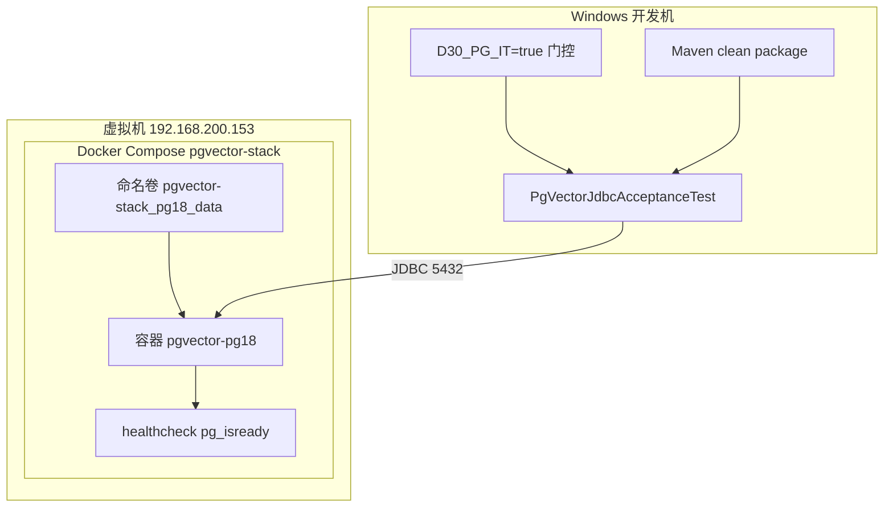

# D30｜PostgreSQL 与 pgvector 本地环境部署及项目迭代全量说明

> 迭代主题：Day 30｜PostgreSQL/pgvector 基础设施落地与统一向量维度 384
> 适用项目：`E:\AI\project\AI-Learning-three-GPT\M3-Java\D30\D30_postgresqlAndpgvector`
> 记录时间：2026-11-13（Asia/Shanghai）
> 写作视角：12 年 Java 架构经验 + 6 年 AI 工程落地经验
> 证据原则：只记录实际执行过的命令与真实输出；未执行项明确标注。

---

## 1. D30 迭代背景

M3-Java 正在为“制造业设备故障知识库 + 工单助手”搭建 AI 工程底座。D22 之后模型调用已收敛到 `app.ai.*`，D24—D29 已完成文档导入、清洗、切分、Embedding、同步/流式聊天与可观测性等能力。进入 D30，需要回答一个基础设施问题：

**向量数据究竟落在哪里，是否已经具备可重复验证的数据库能力？**

如果向量库还停留在“配置里有、代码里疑似能用”的状态，后续 RAG 检索会出现三类不可控问题：

1. 维度漂移：Embedding 模型输出 384，而表结构是 256/1536，写入时才失败。
2. 数据源误用：向量表被建到 MySQL 主库，或误用主 `JdbcTemplate`。
3. 证据缺失：容器 healthy 被误当成“检索通过”，没有 JDBC、写入、距离、索引层面的验证。

D30 的任务不是扩展完整 RAG，而是把 **PostgreSQL 18.7 + pgvector 0.8.7** 做成经过真实验证的唯一向量数据库基础设施。

---

## 2. 本次目标与范围

### 2.1 目标

| 目标 | 验收含义 |
|---|---|
| 技术决策复核 | 仓库已有 PostgreSQL + pgvector 决策则沿用，不引入第二套向量库 |
| 环境只读核验 | 确认容器、镜像、端口、卷、健康检查，不重建健康容器 |
| 数据库能力验证 | 扩展、`vector(384)`、写入/读取、`<=>`、HNSW、错误维度拒绝 |
| Windows 本机 JDBC | 通过应用真实 `pgDataSource` 连接虚拟机数据库 |
| 配置安全 | 真实口令不进入仓库，运行/测试由环境变量注入 |
| 证据与文档 | 两份指定 Markdown + `docs/evidence/D30` 证据集 |
| 构建验证 | Maven 编译、全量测试、打包有真实结果 |

### 2.2 明确不做

- 不引入 Redis、Nacos、第二向量库、向量数据库 SaaS。
- 不实现完整 RAG、Agent Workflow、重排序、混合检索。
- 不重建、重启、down 正在健康运行的容器。
- 不修改 Compose 端口、卷、服务名。
- 不写正式 `vector_store` 业务数据；测试只使用 `public.d30_pgvector_test`。
- 不修改 MySQL 业务表结构。
- 不提交真实数据库口令或 API Key。
- 未经授权不 commit / push。

---

## 3. 仓库扫描结果

### 3.1 真实结构

```text
E:\AI\project\AI-Learning-three-GPT\M3-Java
├── D30
│   ├── pom.xml                          # org.ai.m2.gpt:D30:1.0-SNAPSHOT, packaging=pom
│   └── D30_postgresqlAndpgvector        # 唯一子模块
│       ├── pom.xml
│       ├── src\main\java\com\zl\d30
│       │   ├── D30SpringAiApplication.java
│       │   ├── config
│       │   │   ├── PgDataSourceConfig.java
│       │   │   ├── PgVectorStoreConfig.java
│       │   │   ├── PgVectorStoreProperties.java
│       │   │   └── VectorDimensionGuard.java
│       │   ├── document                 # 导入、解析、切分、Embedding
│       │   ├── controller
│       │   ├── service
│       │   └── ...
│       ├── src\main\resources
│       │   ├── application.yml
│       │   ├── application-local.yml.example
│       │   └── db
│       │       ├── mysql 业务 SQL
│       │       └── pgvector\d30-pgvector-verification.sql   # 本轮新增
│       └── src\test\java\com\zl\d30     # 48 个测试源文件
├── docs\proj_docs
├── docs\evidence
├── logs
└── docs\temp_docs
```

### 3.2 基线核对

| 项 | 实际值 |
|---|---|
| JDK | 21.0.7（Oracle JDK，`D:\SoftwareInstall\JDK\JDK21`） |
| Maven | 3.9.16（`D:\SoftwareInstall\Apache\Maven\apache-maven-3.9.16`） |
| Spring Boot | 3.5.16 |
| Spring AI | 1.1.8（`spring-ai-bom` import） |
| PostgreSQL JDBC | 42.7.11 |
| PostgreSQL 服务端 | 18.7 |
| pgvector | 0.8.7 |
| 当前测试基线 | 全量 288 项，0 失败，0 错误，0 跳过 |

### 3.3 扫描结论

仓库不是空项目：已有独立 PG 数据源、手动装配的 `PgVectorStore`、384 维三方守卫、5 项 PG 真机集成测试，也已有 `vector_store` 表与 HNSW 索引。D30 本轮采用“复核 + 补齐数据库层验收”，没有另建一套向量库。

完整扫描证据：`docs/evidence/D30/01-repository-scan.md`。

---

## 4. 项目原有数据库技术决策

### 4.1 双数据源职责分离

| 数据源 | 用途 | 配置前缀 |
|---|---|---|
| MySQL 主库 | 业务表、Prompt 模板、聊天历史等权威数据 | `spring.datasource` |
| PostgreSQL 向量库 | 仅向量存储与相似度检索 | `spring.datasource.pg` |

`PgDataSourceConfig` 通过 `@ConfigurationProperties("spring.datasource.pg", ignoreUnknownFields = false)` 绑定独立 `HikariConfig`，Bean 名为 `pgDataSource`。显式关闭未知字段，避免把 `pg.hikari.pool-name` 这类嵌套键静默忽略。

### 4.2 为什么排除 Spring AI 自动配置

经 1.1.8 构件核验，`PgVectorStoreAutoConfiguration` 的装配依赖容器内的主 `JdbcTemplate`。在多数据源项目中，这个 `JdbcTemplate` 通常建立在 MySQL 主库上，结果会把向量表建到 MySQL，直接失败。

本项目因此：

- 排除 `PgVectorStoreAutoConfiguration`；
- 由 `PgVectorStoreConfig` 手动创建 `JdbcTemplate(pgDataSource)`；
- 在方法内构造，不注册为 Bean，避免与主库 `JdbcTemplate` 注入歧义；
- 显式传入 HNSW、COSINE、384、schema、table 等参数。

### 4.3 原有向量表

| 项 | 实际值 |
|---|---|
| schema / table | `public.vector_store` |
| embedding 列 | `vector(384)` |
| 距离 | cosine |
| 索引 | `spring_ai_vector_index`，HNSW + `vector_cosine_ops` |
| 初始化 | 首次 `initialize-schema=true`，表存在后可关闭 |

结论：D30 没有推翻原决策，而是把原决策从“代码可装配”推进到“数据库能力可验证”。

---

## 5. PostgreSQL 与 pgvector 环境信息

### 5.1 虚拟机与端口

| 项 | 值 |
|---|---|
| Docker Host | `192.168.200.153` |
| SSH | 22 |
| PostgreSQL | 5432 → 5432 |
| 数据库 | `spring_ai` |
| 用户 | `postgres` |
| 时区 | Asia/Shanghai |

Windows 本机对 22、5432 端口均可达；本机无免密 SSH，使用 Windows OpenSSH + 临时 `SSH_ASKPASS` 完成只读检查，密码未写入仓库、日志或文档。

### 5.2 容器与镜像

| 项 | 值 |
|---|---|
| Compose 目录 | `/root/pgvector-stack` |
| Compose 文件 | `/root/pgvector-stack/docker-compose.yml` |
| 服务名 | `postgres` |
| 容器名 | `pgvector-pg18` |
| 镜像 | `pgvector/pgvector:pg18` |
| 重启策略 | `unless-stopped` |
| 状态 | `Up 6 hours (healthy)` |
| restartCount | 0 |
| 健康检查 | `pg_isready -U postgres -d spring_ai` |
| 健康参数 | interval 5s / timeout 3s / retries 10 |
| 数据卷 | `pgvector-stack_pg18_data:/var/lib/postgresql` |
| 初始化目录 | `./init:/docker-entrypoint-initdb.d:ro` |

### 5.3 版本与扩展

```text
current_database = spring_ai
PostgreSQL 18.7 (Debian 18.7-1.pgdg12+2)
vector|0.8.7
```

证据：

- `docs/evidence/D30/02-postgresql-version.txt`
- `docs/evidence/D30/04-pgvector-extension.txt`
- `docs/evidence/D30/03-docker-status.txt`
- `docs/evidence/D30/03-compose-config-redacted.txt`

---

## 6. Docker Compose 环境检查与启动操作

D30 验收链路的实际拓扑如下：



### 6.1 实际执行的检查

```bash
cd /root/pgvector-stack
docker compose ps
docker inspect pgvector-pg18
docker compose logs --tail=30 postgres
docker exec pgvector-pg18 psql -U postgres -d spring_ai -Atc "SELECT ..."
```

结果：

- `docker compose ps` 显示服务 `postgres`、容器 `pgvector-pg18`、镜像 `pgvector/pgvector:pg18`、状态 `Up 6 hours (healthy)`。
- inspect 显示 `status=running`、`health=healthy`、`restartCount=0`、`restartPolicy=unless-stopped`。
- 健康日志输出 `accepting connections`。
- 容器内 psql 可查询 `spring_ai`、PostgreSQL 18.7、vector 0.8.7。

### 6.2 为什么没有执行 `docker compose up -d`

任务书有两个约束同时成立：

1. 要求核对 Docker Compose 启动、健康检查、端口可达。
2. 特别规则要求：**不得重建、重启正在健康运行的环境，不得修改端口/卷**。

本轮核验时容器已经 `healthy`，因此执行状态为：

```text
docker compose up -d        : NOT RUN（容器已健康运行，禁止无必要重启）
docker compose down         : NOT RUN（禁止销毁现有环境）
docker compose restart      : NOT RUN（禁止）
端口/卷/服务名修改           : NOT RUN（禁止）
```

这不是遗漏，而是遵守“不要为了证明启动而破坏健康环境”。如果是全新机器，启动命令是：

```bash
cd /root/pgvector-stack
docker compose up -d
docker compose ps
```

必须在容器尚未运行时使用；已有健康容器时不得重复执行。

### 6.3 服务名与容器名差异

一次误用：

```bash
docker compose logs --tail=30 pgvector-pg18
```

返回 `no such service`。原因是 Compose 的 `logs` 第一个参数是 **service name**，不是 container name。正确命令为：

```bash
docker compose logs --tail=30 postgres
```

该失败属于命令参数错误，不是数据库故障。

---

## 7. 数据库连接配置

### 7.1 `application.yml`

实际结构：

```yaml
spring:
  datasource:
    driver-class-name: com.mysql.cj.jdbc.Driver
    url: ${MYSQL_URL:jdbc:mysql://127.0.0.1:3306/ai_db?...}
    username: ${MYSQL_USER:root}
    password: ${MYSQL_PASSWORD:123456}

    pg:
      jdbc-url: ${PG_URL:jdbc:postgresql://192.168.200.153:5432/spring_ai}
      username: ${PG_USER:postgres}
      password: ${PG_PASSWORD}
      driver-class-name: org.postgresql.Driver
      pool-name: ${PG_POOL_NAME:PgVectorHikariPool}
      maximum-pool-size: ${PG_POOL_MAX:10}
      minimum-idle: ${PG_POOL_MIN:2}
      connection-timeout: 30000
      idle-timeout: 600000
      max-lifetime: 1800000
```

关键变化：

```yaml
# 修改前（不安全；真实口令已在本文档脱敏）
password: ${PG_PASSWORD:***REDACTED***}

# 修改后（无仓库默认值）
password: ${PG_PASSWORD}
```

含义：

- `PG_PASSWORD` 缺失时，应用首次建立 PG 连接会明确失败，而不是悄悄使用仓库里的真实口令。
- 真实口令只从环境变量/IDE Run Configuration 注入。
- 仓库中不再出现该口令。

### 7.2 `application-local.yml.example`

新增 PG 数据源模板，但仍要求 `PG_PASSWORD`：

```yaml
spring:
  datasource:
    pg:
      jdbc-url: ${PG_URL:jdbc:postgresql://192.168.200.153:5432/spring_ai}
      username: ${PG_USER:postgres}
      password: ${PG_PASSWORD}
      driver-class-name: org.postgresql.Driver
      pool-name: ${PG_POOL_NAME:PgVectorHikariPool}
      maximum-pool-size: ${PG_POOL_MAX:10}
      minimum-idle: ${PG_POOL_MIN:2}
```

模板文件不会被 Spring Boot 自动加载；复制为 `application-local.yml` 后，仍建议用环境变量注入口令。

### 7.3 JDBC URL 日志脱敏

`PgDataSourceConfig` 保留 `maskPassword`：若 URL 出现 `user:password@host` 形式，日志只输出 `***:***@`。当前 URL 不携带口令，但保留该防线。

---

## 8. pgvector 扩展启用与版本查询

### 8.1 当前事实

扩展已存在，不需要本轮重新 `CREATE EXTENSION`：

```sql
SELECT extname, extversion
FROM pg_extension
WHERE extname = 'vector';
```

实际结果：

```text
vector|0.8.7
```

### 8.2 新环境初始化 SQL

仅供全新数据库初始化参考，本轮未执行：

```sql
CREATE EXTENSION IF NOT EXISTS vector;
```

执行位置必须在目标数据库 `spring_ai` 内，而不是 `postgres` 维护库。扩展安装需要数据库超级用户或具备相应权限的账号。

### 8.3 验证边界

扩展存在只能证明：

- `vector` 类型可用；
- `<=>` 等运算符可用；
- HNSW / IVFFlat 索引能力可用。

它不能单独证明业务表已正确建表、向量已写入、索引已被查询使用。后续章节分别验证。

---

## 9. Embedding 维度确认

### 9.1 三方基线

| 位置 | 值 | 代码/配置 |
|---|---|---|
| Embedding 配置 | 384 | `EmbeddingProperties.dimensions = 384` |
| 向量库配置 | 384 | `PgVectorStoreProperties.dimensions = 384` |
| 本地模型实际输出 | 384 | `LocalHashingEmbeddingModel`，集成测试断言 |
| 测试表列 | `vector(384)` | `d30_pgvector_test` |
| 正式表列 | `vector(384)` | `public.vector_store` |

### 9.2 启动守卫

`PgVectorStoreConfig` 在构建 `PgVectorStore` 前调用：

```java
dimensionGuard.verifyAlignment(
        embeddingProperties.getDimensions(),
        pgVectorStoreProperties.getDimensions(),
        embeddingModel.dimensions());
```

三者任一不一致即 fail-fast，避免应用启动成功、首次写入才报 `expected 384 dimensions`。

### 9.3 实际 JDBC 断言

`PgVectorJdbcAcceptanceTest.embeddingAndColumnAre384Dimensions()`：

```java
float[] vector = embeddingModel.embed("D30 向量维度验证文本");
String columnType = jdbc.queryForObject(
        "SELECT format_type(atttypid, atttypmod) FROM pg_attribute "
                + "WHERE attrelid = ?::regclass AND attname = 'embedding'",
        String.class, TABLE);

assertThat(vector).hasSize(384);
assertThat(columnType).isEqualTo("vector(384)");
```

实际结果：PASS。

---

## 10. 向量表结构

### 10.1 专用测试表

本轮新增 SQL：

```sql
CREATE TABLE IF NOT EXISTS public.d30_pgvector_test (
    id BIGSERIAL PRIMARY KEY,
    content TEXT NOT NULL,
    embedding VECTOR(384) NOT NULL,
    created_at TIMESTAMPTZ NOT NULL DEFAULT CURRENT_TIMESTAMP
);
```

实际查询：

```text
id|bigint
content|text
embedding|vector(384)
created_at|timestamp with time zone
```

### 10.2 为什么不直接写 `vector_store`

`public.vector_store` 是正式向量表，当前有业务/历史数据。D30 验收只需要证明数据库能力，不应污染正式表，也不应通过 `remove-existing-vector-store-table=true` 删除表。

因此使用独立测试表：

- 只写确定性合成向量；
- 内容带 `D30-JDBC-*` 标识；
- 测试失败不会破坏正式检索数据；
- SQL 脚本可以重复执行。

### 10.3 正式表现状

`public.vector_store` 仍为 `vector(384)`，索引 `spring_ai_vector_index` 为 HNSW + `vector_cosine_ops`。本轮没有修改。

---

## 11. 测试向量写入和读取

### 11.1 JDBC 写入

`PgVectorJdbcAcceptanceTest.insertAndReadSyntheticVector()` 使用应用真实 `pgDataSource`：

```java
String marker = "D30-JDBC-READ-" + UUID.randomUUID();
String vector = vectorLiteral(384, 0.1f, 0.1f);

jdbc.update("INSERT INTO " + TABLE + " (content, embedding) VALUES (?, ?::vector)",
        marker, vector);

Integer dimensions = jdbc.queryForObject(
        "SELECT vector_dims(embedding) FROM " + TABLE + " WHERE content = ?",
        Integer.class, marker);
```

关键点：

- `?::vector` 显式把 JDBC 字符串转换为 pgvector 类型；
- 不依赖某个 JDBC 驱动的隐式转换；
- 写入后按 marker 精确读取；
- `vector_dims(embedding)` 实际返回 384。

### 11.2 实际查询结果

```text
count
9

9|D30-JDBC-COSINE-B-a5b641dc-eaca-44ad-9f3d-5de5bb8447a9|384
8|D30-JDBC-COSINE-A-a5b641dc-eaca-44ad-9f3d-5de5bb8447a9|384
7|D30-JDBC-READ-53e0f159-b498-4c47-8af0-8a928d65cf1f|384
```

证据：

- `docs/evidence/D30/05-vector-dimension.txt`
- `docs/evidence/D30/06-vector-db-validation-psql.txt`
- `docs/evidence/D30/08-jdbc-connection.txt`

### 11.3 数据性质声明

这 12 行不是设备故障知识库的真实文档向量，而是测试合成数据：早期快照为 9 行，最终全量构建的 JDBC 验收又新增 3 行（每次运行留下 3 条 `D30-JDBC-*` 标记行）：

- A 向量：384 个 `0.1`；
- B 向量：第 1 维 `1.0`，其余 383 维 `0.0`；
- READ 向量：384 个 `0.1`。

不得把这些数据当作业务检索结果。

---

## 12. cosine 距离查询

### 12.1 SQL

pgvector 的 cosine distance 运算符是 `<=>`：

```sql
WITH pair AS (
    SELECT id, content, embedding
    FROM public.d30_pgvector_test
    WHERE content LIKE 'D30-JDBC-COSINE-%'
    ORDER BY id DESC
    LIMIT 2
), q AS (
    SELECT embedding
    FROM pair
    WHERE content LIKE '%COSINE-A-%'
    LIMIT 1
)
SELECT
    p.id,
    p.content,
    p.embedding <=> q.embedding AS cosine_distance,
    1 - (p.embedding <=> q.embedding) AS cosine_similarity
FROM pair p
CROSS JOIN q
ORDER BY p.embedding <=> q.embedding;
```

### 12.2 实际结果

```text
8|D30-JDBC-COSINE-A-a5b641dc...|0.000000|1.000000
9|D30-JDBC-COSINE-B-a5b641dc...|0.948969|0.051031
```

解释：

- A 与自身距离 0，相似度 1；
- B 与 A 的距离约 0.948969，相似度约 0.051031；
- `ORDER BY embedding <=> q.embedding` 升序，距离越小越靠前。

### 12.3 测试断言

`PgVectorJdbcAcceptanceTest.cosineDistanceQueryOrdersByDistance()` 断言：

- 返回 2 条；
- 第一条是 A；
- 两个距离都在 `[0, 2]`；
- 第一条距离严格小于第二条。

实际 PASS。

---

## 13. HNSW 索引创建与验证

### 13.1 索引 DDL

```sql
CREATE INDEX IF NOT EXISTS idx_d30_pgvector_test_embedding
ON public.d30_pgvector_test
USING hnsw (embedding vector_cosine_ops);
```

实际 `pg_indexes`：

```text
idx_d30_pgvector_test_embedding|CREATE INDEX idx_d30_pgvector_test_embedding
ON public.d30_pgvector_test USING hnsw (embedding vector_cosine_ops)
```

### 13.2 EXPLAIN 实际输出

来自 Windows 本机 `PgVectorJdbcAcceptanceTest`：

```text
[D30][EXPLAIN] Limit  (cost=7.09..7.48 rows=5 width=56)
  ->  Index Scan using idx_d30_pgvector_test_embedding on d30_pgvector_test
        Order By: (embedding <=> '[...384 个 0.1...]'::vector)
```

关键结论：

- 实际选择 `Index Scan`；
- 不是 `Seq Scan`；
- 使用的索引就是 `idx_d30_pgvector_test_embedding`。

### 13.3 性能边界

截止最终只读核对，测试表为 12 行，全部是 `D30-JDBC-*` 合成标记数据。小数据量下出现 Index Scan 可以证明“索引可被规划器使用”，但不能推导大规模数据下的延迟、召回率或成本结论。

HNSW 参数：

- `m`：每个节点的最大连接数，pgvector 默认 16；
- `ef_construction`：构建时候选队列大小，默认 64；
- `hnsw.ef_search`：查询时候选队列大小，默认 40。

Spring AI 1.1.8 的 PgVectorStore 属性不提供 `index-m` / `index-ef-construction` / `index-list-size`。本项目没有在 YAML 里写“看似生效、实际被忽略”的参数；如需调优，使用数据库层 `ALTER INDEX ... SET (...)`，并另做基准测试。

证据：`docs/evidence/D30/07-hnsw-index.txt`。

---

## 14. Java / Spring AI 接入情况

### 14.1 依赖

| 依赖 | 版本管理 |
|---|---|
| `spring-ai-bom` | 1.1.8，`import` |
| `spring-ai-starter-vector-store-pgvector` | 由 BOM 管理，不写版本 |
| `spring-ai-starter-model-deepseek` | 由 BOM 管理，不引入 OpenAI |
| `org.postgresql:postgresql` | 由 Spring Boot 3.5.16 管理，runtime |
| `spring-boot-starter-jdbc` | 由 Boot 管理，Hikari/JdbcTemplate |

### 14.2 装配链

```text
application.yml
  ├── spring.datasource        -> MySQL 主库
  └── spring.datasource.pg     -> HikariConfig -> pgDataSource
                                      │
                                      ├── JdbcTemplate(pgDataSource)（方法内）
                                      └── PgVectorStore
                                             ├── schemaName=public
                                             ├── tableName=vector_store
                                             ├── dimensions=384
                                             ├── indexType=HNSW
                                             ├── distanceType=COSINE_DISTANCE
                                             └── initializeSchema=true
```

### 14.3 维度守卫

`VectorDimensionGuard` 对齐：

1. `app.ai.embedding.dimensions`
2. `spring.ai.vectorstore.pgvector.dimensions`
3. `embeddingModel.dimensions()`

### 14.4 本轮没有做的事

- 没有新增第二套 AI 调用入口。
- 没有重写原有 `PgVectorStore`。
- 没有把 Spring AI 自动配置强行改造成多数据源自动配置。
- 没有为 D30 提前建设完整设备故障业务系统。

---

## 15. 实际修改文件清单

### 15.1 代码与配置

| 文件 | 类型 | 修改理由 |
|---|---|---|
| `src/test/java/com/zl/d30/config/PgVectorJdbcAcceptanceTest.java` | 新增 | 数据库层 6 项 JDBC 真机验收，显式 `D30_PG_IT=true` 门控 |
| `src/main/resources/db/pgvector/d30-pgvector-verification.sql` | 新增 | 独立测试表、HNSW、写入、cosine、错误维度 SQL 模板 |
| `src/main/resources/application.yml` | 修改 | PG 口令改为 `${PG_PASSWORD}`，移除仓库默认真实口令 |
| `src/main/resources/application-local.yml.example` | 修改 | 增加 PG 数据源模板，仍要求环境变量注入 |
| `src/test/java/com/zl/d30/config/PgDataSourceConfigTest.java` | 修改 | 使用非真实占位口令，并设置 `initialization-fail-timeout=-1` 隔离真实连接 |
| `src/main/java/com/zl/d30/config/PgDataSourceConfig.java` | 修改 | 修正“Hikari 懒初始化”注释，明确构造期可能尝试连接 |

### 15.2 文档与证据

| 文件 | 说明 |
|---|---|
| `docs/proj_docs/D30-PostgreSQL与pgvector本地环境部署及项目迭代全量说明.md` | 本文档 |
| `docs/proj_docs/D30-PostgreSQL与pgvector技术原理及本地部署操作实践指南.md` | 技术原理与实践指南 |
| `docs/evidence/D30/01-repository-scan.md` | 仓库扫描 |
| `docs/evidence/D30/02-postgresql-version.txt` | PG 版本 |
| `docs/evidence/D30/03-docker-status.txt` | 容器状态与健康日志 |
| `docs/evidence/D30/03-compose-config-redacted.txt` | 脱敏 Compose |
| `docs/evidence/D30/04-pgvector-extension.txt` | 扩展版本 |
| `docs/evidence/D30/05-vector-dimension.txt` | 384 维与测试表 |
| `docs/evidence/D30/06-vector-db-validation-psql.txt` | psql 写入/距离/错误维度 |
| `docs/evidence/D30/07-hnsw-index.txt` | 索引与 EXPLAIN |
| `docs/evidence/D30/08-jdbc-connection.txt` | Windows JDBC 证据 |
| `docs/evidence/D30/09-maven-compile.txt` | 编译证据 |
| `docs/evidence/D30/10-maven-test.txt` | 测试证据 |
| `docs/evidence/D30/11-git-diff-summary.txt` | Git 证据 |
| `docs/evidence/D30/12-verification-sql-rollback.txt` | 验证 SQL 事务执行与回滚证据 |
| `docs/evidence/D30/13-final-db-state.txt` | 最终容器健康与数据库只读复核 |

### 15.3 日志

| 文件 | 内容 |
|---|---|
| `logs/D30/10-jdbc-acceptance-test.log` | 新增 JDBC 测试 6/6 |
| `logs/D30/11-full-test-package.log` | 修复前全量 288/2 失败，保留作为真实失败证据 |
| `logs/D30/12-pg-datasource-config-test.log` | 配置测试隔离修复验证 |
| `logs/D30/13-full-test-package.log` | 修复后全量 288/0，BUILD SUCCESS（代码注释与 SQL 调整前） |
| `logs/D30/14-full-test-package-final.log` | 最终全量 288/0，BUILD SUCCESS（SQL 与注释调整后） |

---

## 16. 实际执行命令及结果

### 16.1 环境版本

```powershell
& "D:\SoftwareInstall\Apache\Maven\apache-maven-3.9.16\bin\mvn.cmd" -version
& "D:\SoftwareInstall\JDK\JDK21\bin\java.exe" -version
```

实际：

```text
Apache Maven 3.9.16
Java version: 21.0.7, vendor: Oracle Corporation
runtime: D:\SoftwareInstall\JDK\JDK21
```

### 16.2 单独 JDBC 验收

```powershell
$env:PG_PASSWORD = "<由安全渠道注入，不写入仓库>"
$env:D30_PG_IT = "true"
& "D:\SoftwareInstall\Apache\Maven\apache-maven-3.9.16\bin\mvn.cmd" `
  -f "E:\AI\project\AI-Learning-three-GPT\M3-Java\D30\pom.xml" `
  -B -pl D30_postgresqlAndpgvector `
  -Dtest=PgVectorJdbcAcceptanceTest test
Remove-Item Env:\PG_PASSWORD
Remove-Item Env:\D30_PG_IT
```

实际：

```text
Tests run: 6, Failures: 0, Errors: 0, Skipped: 0
BUILD SUCCESS
```

日志：`logs/D30/10-jdbc-acceptance-test.log`。

### 16.3 配置隔离测试

```powershell
& "D:\SoftwareInstall\Apache\Maven\apache-maven-3.9.16\bin\mvn.cmd" `
  -f "E:\AI\project\AI-Learning-three-GPT\M3-Java\D30\pom.xml" `
  -B -pl D30_postgresqlAndpgvector `
  -Dtest=PgDataSourceConfigTest test
```

实际：

```text
Tests run: 3, Failures: 0, Errors: 0, Skipped: 0
BUILD SUCCESS
```

### 16.4 全量构建

```powershell
$env:PG_PASSWORD = "<由安全渠道注入>"
$env:D30_PG_IT = "true"
& "D:\SoftwareInstall\Apache\Maven\apache-maven-3.9.16\bin\mvn.cmd" `
  -f "E:\AI\project\AI-Learning-three-GPT\M3-Java\D30\pom.xml" `
  -B clean package
Remove-Item Env:\PG_PASSWORD
Remove-Item Env:\D30_PG_IT
```

实际：

```text
Tests run: 288, Failures: 0, Errors: 0, Skipped: 0
Building jar: ...\D30_postgresqlAndpgvector-1.0-SNAPSHOT.jar
BUILD SUCCESS
Total time: 01:19 min
```

### 16.5 真实失败与修复过程

第一次全量结果为：

```text
Tests run: 288, Failures: 2, Errors: 0, Skipped: 0
BUILD FAILURE
```

失败：

```text
PgDataSourceConfigTest.pgDataSourceBoundFromProperties
PgDataSourceConfigTest.primaryDataSourceIsMysql
```

根因：

```text
Failed to initialize pool: FATAL: password authentication failed for user "postgres"
```

不是 PostgreSQL 不可用：同一轮 `PgVectorJdbcAcceptanceTest` 6/6、`PgVectorStoreIntegrationTest` 5/5 通过。根因是配置测试把真实口令替换为占位值后，`HikariDataSource` 构造期仍尝试建立连接。

修复：

```java
"spring.datasource.pg.initialization-fail-timeout=-1"
```

该测试只验证属性绑定，不再依赖真实数据库。失败日志保留在 `logs/D30/11-full-test-package.log`，修复后日志为 `logs/D30/13-full-test-package.log` 与最终日志 `logs/D30/14-full-test-package-final.log`。

### 16.6 验证 SQL 事务执行

将 `d30-pgvector-verification.sql` 通过 SSH 送入虚拟机，并在 psql 中用 `BEGIN; ... ROLLBACK;` 执行，避免留下额外测试数据：

```bash
{ echo 'BEGIN;'; cat /tmp/d30-pgvector-verification.sql; echo 'ROLLBACK;'; } \
  | docker exec -i pgvector-pg18 psql -U postgres -d spring_ai -v ON_ERROR_STOP=1
```

真实输出摘要：

```text
BEGIN
NOTICE:  extension "vector" already exists, skipping
CREATE EXTENSION
 spring_ai | PostgreSQL 18.7 ...
 vector | 0.8.7
CREATE TABLE
 embedding_type = vector(384)
CREATE INDEX
DELETE 0
INSERT 0 1
INSERT 0 1
Index Scan using idx_d30_pgvector_test_embedding on d30_pgvector_test
ROLLBACK
```

结果：

- `CREATE EXTENSION IF NOT EXISTS vector` 可执行（已存在时只提示）；
- `vector(384)` 表结构校验可执行；
- HNSW 索引存在；
- 合成写入与 `<=>` 查询可执行；
- `EXPLAIN` 仍选择 HNSW Index Scan；
- `ROLLBACK` 后不保留新增行。

证据：`docs/evidence/D30/12-verification-sql-rollback.txt`。

### 16.7 最终数据库只读复核

最终再查一次容器与数据库，不执行任何写操作：

```text
NAME=pgvector-pg18 STATUS=running HEALTH=healthy RESTARTS=0 IMAGE=pgvector/pgvector:pg18
DB=spring_ai PG=18.7 (Debian 18.7-1.pgdg12+2) EXT=0.8.7
TEST_ROWS=12
EMBEDDING_TYPE=vector(384)
VECTOR_STORE_TYPE=vector(384)
```

`TEST_ROWS=12` 均为 `D30-JDBC-*` 合成标记行：早期 05 快照为 9 行，最终构建的 JDBC 验收新增 3 行。不是业务数据，也不在 `vector_store` 中。

证据：`docs/evidence/D30/13-final-db-state.txt`。

---

## 17. Maven 编译与测试结果

### 17.1 编译

```text
[INFO] Compiling 186 source files with javac [debug parameters release 21]
[INFO] Compiling 48 source files with javac [debug parameters release 21]
[INFO] BUILD SUCCESS
```

### 17.2 测试分组

| 测试类/组 | 数量 | 结果 |
|---|---:|---|
| `PgDataSourceConfigTest` | 3 | 0 失败 |
| `PgVectorJdbcAcceptanceTest` | 6 | 0 失败 |
| `PgVectorStoreIntegrationTest` | 5 | 0 失败 |
| 其余既有测试 | 274 | 0 失败 |
| **合计** | **288** | **0 失败 / 0 错误 / 0 跳过** |

### 17.3 产物

```text
JAR: E:\AI\project\AI-Learning-three-GPT\M3-Java\D30\D30_postgresqlAndpgvector\target\D30_postgresqlAndpgvector-1.0-SNAPSHOT.jar
Size: 113,168,158 bytes
MTime: 2026-11-14 00:01:59
```

### 17.4 未执行项

| 项 | 状态 | 原因 |
|---|---|---|
| `docker compose up -d` | NOT RUN | 容器已 healthy，任务书特别规则禁止重启 |
| 应用 JAR 重新启动 + HTTP 回归 | NOT RUN | D30 验收聚焦数据库层；旧启动证据来自改动前构建，不能冒充本轮结果 |
| 大数据量 HNSW 性能基准 | NOT RUN | 任务书未要求，12 行合成测试数据不能推导性能 |
| 真实业务文档向量写入 | NOT RUN | 本轮只做基础设施验收，不扩展完整 RAG |

---

## 18. 已知问题与限制

1. **测试数据不是业务数据**：12 条记录均为合成向量，不能作为设备故障检索结果；每次 JDBC 验收会留下 3 条标记行，当前未自动清理。
2. **小数据量 EXPLAIN 不代表性能**：Index Scan 命中只证明索引可用，不证明大数据量下召回和延迟达标。
3. **应用未在新构建下重启**：本轮没有重新启动 JAR，也没有做 8080 HTTP 回归；不能引用旧实例证据作为本轮结论。
4. **仓库无 Docker Compose 文件**：Compose 在虚拟机 `/root/pgvector-stack`，属于基础设施资产；本轮只读核验，不复制进仓库。
5. **口令治理的边界**：`application.yml` 已移除真实 PG 默认口令，但 MySQL 仍保留本地开发默认 `123456`，属于既有本地环境配置，本轮未扩大到 MySQL 改造。
6. **正式 `vector_store` 未清理**：测试只操作 `d30_pgvector_test`；正式表的历史向量未做质量评估。
7. **HNSW 参数未调优**：使用 pgvector 默认 m/ef_construction，没有做百万级基准。
8. **MySQL `knowledge_document` 缺 `source` 列**：既有文档导入接口存在表结构漂移风险，与本轮 PG 改造无关，未修改。
9. **本轮未 commit / push**：当前工作区仍有本轮未提交修改，未经授权不提交。
10. **任务书凭据风险**：用户提供的任务书含真实 PG 凭据，且在任务执行期间被外部提交 `efb0df0` 纳入版本库。该提交不是本任务创建的；不得继续扩散凭据，建议轮换口令并从 Git 历史清除该文件，或将脱敏版本纳入忽略规则。

---

## 19. Git 变更和提交信息

### 19.1 当前状态

| 项 | 值 |
|---|---|
| 仓库根 | `E:\AI\project\AI-Learning-three-GPT\M3-Java` |
| 分支 | `master` |
| HEAD | `efb0df0 D30 项目问题整改 环境基线是本地 Embedding 384 维`（2026-11-13 23:27:36，外部提交，非本轮创建） |
| 本轮 Commit | 未创建 |
| Push | 未执行 |
| 工作区 | 存在未提交代码、文档、证据、日志；HEAD 外部提交后仍有本轮增量 |

### 19.2 变更性质

- 代码：1 个新增测试类、1 个新增 SQL、1 个测试隔离修复、1 个配置口令治理、1 个模板补充、1 个注释修正。
- 文档：两份新命名文档。
- 证据：`docs/evidence/D30`。
- 日志：`logs/D30`。
- 未使用 `git reset --hard`、`git clean`、`git checkout --` 覆盖用户修改。
- HEAD `efb0df0` 是任务执行期间出现的外部提交；本轮新代码与最终文档/证据仍为未提交状态。

完整 diff 摘要见 `docs/evidence/D30/11-git-diff-summary.txt`。

---

## 20. D31 后续衔接说明

D30 完成后，数据库层已经具备“可连接、可写入、可查询、可拒绝错误维度、索引可被使用”的证据。D31 不应重复搭库，而应把 `PgVectorStore` 接入真实文档链路：

### 20.1 最小衔接方案

1. **文档 → 切分 → Embedding → `vector_store` 写入**
   - 使用现有 `DocumentEmbeddingService`；
   - 写入前后记录 `vector_dims`、文档 ID、批次大小；
   - 为测试文档使用独立 `source` 标识。

2. **`similaritySearch` 端到端**
   - 用一条设备故障文本查询；
   - 断言 topK、距离排序、metadata 过滤；
   - 记录 SQL 实际 EXPLAIN 与耗时。

3. **维度变更保护**
   - 若 D31 更换 Embedding 模型，必须先做维度迁移方案；
   - 不允许直接改 YAML 384 后写旧表。

4. **可观测性**
   - 记录向量写入条数、失败条数、检索 topK、HNSW ef_search；
   - 不记录文档明文或密钥。

### 20.2 D31 不应做的事

- 不引入第二向量库做“对比”。
- 不在 D31 直接上 Agent Workflow、重排序、混合检索全家桶。
- 不用容器 healthy 代替检索验收。

---

## 附录 A：D30 验收追踪矩阵

| 编号 | 验收项目 | 实现/证据位置 | 实际验证 | 状态 |
|---|---|---|---|---|
| D30-01 | 仓库扫描 | `01-repository-scan.md` | 实际目录、POM、Git 扫描 | PASS |
| D30-02 | 技术决策 | `PgDataSourceConfig`、`PgVectorStoreConfig` | 复核并沿用 PG+pgvector | PASS |
| D30-03 | Docker 状态 | `03-docker-status.txt` | healthy，未破坏环境 | PASS |
| D30-04 | PostgreSQL 版本 | `02-postgresql-version.txt` | PostgreSQL 18.7 | PASS |
| D30-05 | pgvector 扩展 | `04-pgvector-extension.txt` | vector 0.8.7 | PASS |
| D30-06 | 数据库连接 | `08-jdbc-connection.txt` | Windows JDBC 6/6 | PASS |
| D30-07 | 向量维度 | `05-vector-dimension.txt` | 模型/配置/列均 384 | PASS |
| D30-08 | 向量字段 | `05-vector-dimension.txt` | `vector(384)` | PASS |
| D30-09 | 向量写入 | `06-vector-db-validation-psql.txt` | INSERT 成功 | PASS |
| D30-10 | 向量读取 | `06-vector-db-validation-psql.txt` | SELECT 成功 | PASS |
| D30-11 | 相似度查询 | `06-vector-db-validation-psql.txt` | `<=>` 距离 0 / 0.948969 | PASS |
| D30-12 | HNSW 索引 | `07-hnsw-index.txt` | HNSW 定义 + Index Scan | PASS |
| D30-13 | 错误维度 | `06-vector-db-validation-psql.txt` | expected 384, not 383 | PASS |
| D30-14 | Maven 编译 | `09-maven-compile.txt` | javac release 21 成功 | PASS |
| D30-15 | Maven 测试 | `10-maven-test.txt` | 288/0/0/0 | PASS |
| D30-16 | 技术文档 | 本文件 + 实践指南 | 两份指定文件名 | PASS |
| D30-17 | 证据归档 | `docs/evidence/D30` | 13 类证据 | PASS |
| D30-18 | 环境安全 | `01-repository-scan.md`、`11-git-diff-summary.txt` | 本轮未提交密钥；但外部提交 `efb0df0` 将含真实凭据的任务书纳入版本库 | FAIL（外部提交引入，待轮换/清理） |

### A.1 NOT RUN 声明

- `docker compose up -d`：NOT RUN（容器已健康运行，禁止无必要重启）。
- 应用 JAR 在本轮新构建下启动：NOT RUN。
- 真实业务文档向量写入与检索：NOT RUN。
- 大规模 HNSW 性能基准：NOT RUN。

---

## 附录 B：官方参考资料

PostgreSQL 18 Documentation | PostgreSQL 18 文档：[https://www.postgresql.org/docs/18/index.html](https://www.postgresql.org/docs/18/index.html)

pgvector: Open-source vector similarity search for Postgres | pgvector：PostgreSQL 开源向量相似度搜索：[https://github.com/pgvector/pgvector](https://github.com/pgvector/pgvector)

HNSW | 分层可导航小世界索引：[https://github.com/pgvector/pgvector#hnsw](https://github.com/pgvector/pgvector#hnsw)

PGvector :: Spring AI Reference | PGvector：Spring AI 参考文档：[https://docs.spring.io/spring-ai/reference/api/vectordbs/pgvector.html](https://docs.spring.io/spring-ai/reference/api/vectordbs/pgvector.html)

PgVectorStore (Spring AI Parent 1.1.8 API) | PgVectorStore（Spring AI 父项目 1.1.8 API）：[https://docs.spring.io/spring-ai/docs/1.1.x/api/org/springframework/ai/vectorstore/pgvector/PgVectorStore.html](https://docs.spring.io/spring-ai/docs/1.1.x/api/org/springframework/ai/vectorstore/pgvector/PgVectorStore.html)

Docker Compose overview | Docker Compose 概览：[https://docs.docker.com/compose/](https://docs.docker.com/compose/)

Spring Boot Reference Documentation: SQL Databases | Spring Boot 参考文档：SQL 数据库：[https://docs.spring.io/spring-boot/reference/data/sql.html](https://docs.spring.io/spring-boot/reference/data/sql.html)

HikariCP | HikariCP 连接池：[https://github.com/brettwooldridge/HikariCP](https://github.com/brettwooldridge/HikariCP)
