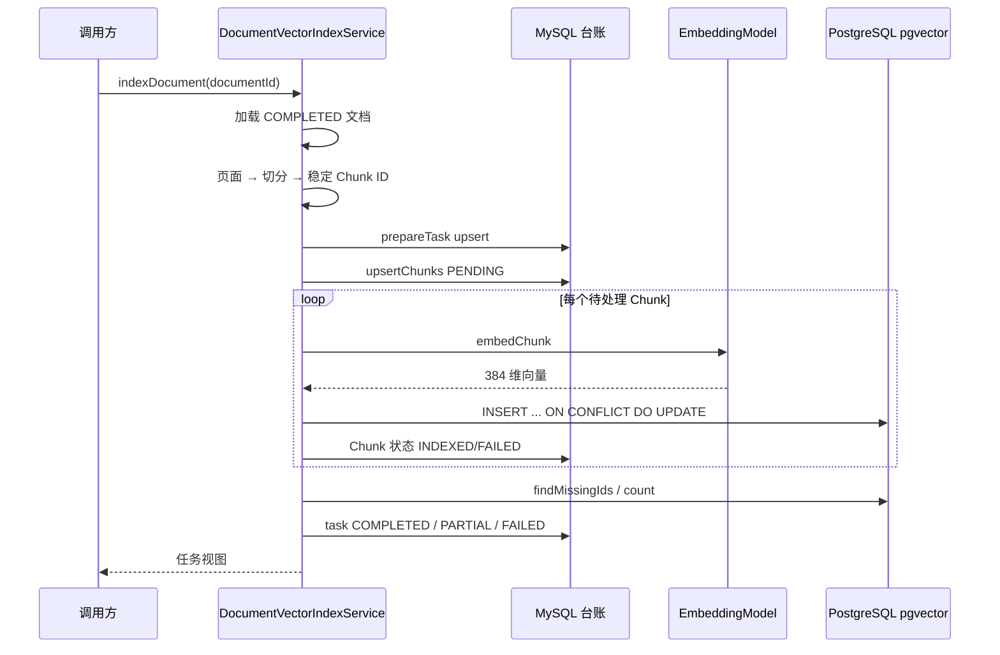
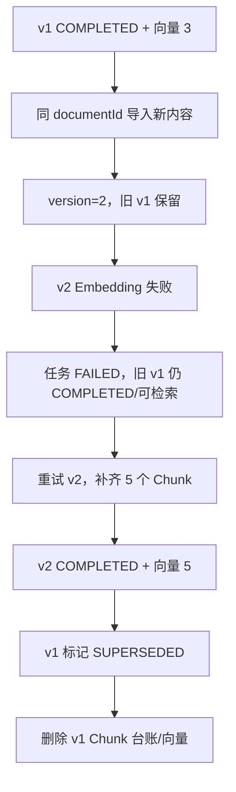
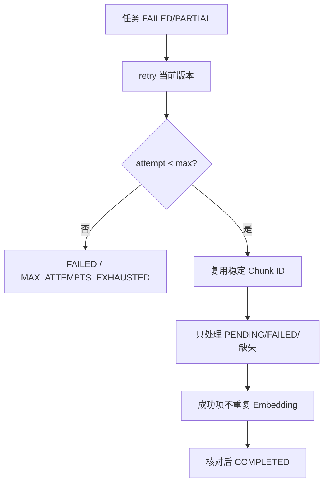
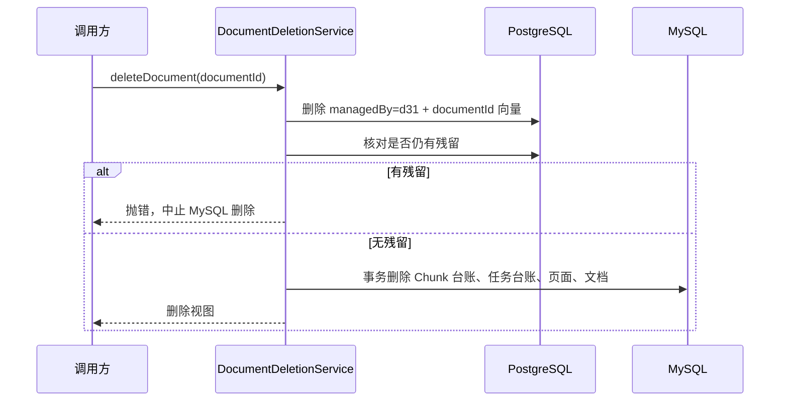
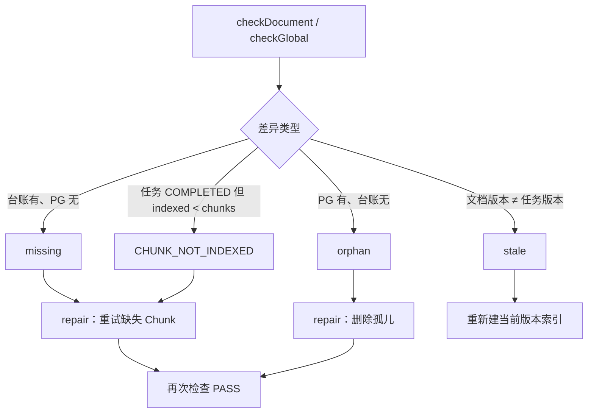

# D31 向量入库、更新与幂等｜技术原理及操作实践指南

> 项目：M3-Java / D31_VSUAI
> 主题：文档切分后的 Chunk 经 Embedding 写入 PostgreSQL + pgvector，并保证更新、删除、失败重试与跨库一致性
> 适用对象：正在维护 D31、准备 D32 或需要理解 RAG 入库链路的 Java / Spring AI 工程师
> 代码基线：JDK 21、Spring Boot 3.5.16、Spring AI 1.1.8、PostgreSQL 18.7、pgvector 0.8.7
> 配套文档：《D31-向量入库更新与幂等项目迭代全量说明.md》

---

## 0. 阅读地图

本文不按“类清单”组织，而按一条真实数据链组织：

```text
文档导入 → 页面 → 切分 → 稳定 ID → Embedding → MySQL 台账 → PostgreSQL 向量
   → 核对 → 更新切换 → 删除 → 失败重试 → 一致性补偿
```

建议阅读顺序：

1. 先看第 1 节概念，建立“文档身份 ≠ 内容身份”“台账 ≠ 向量本体”的边界；
2. 再看第 2～4 节原理，理解为什么这样设计；
3. 第 5～7 节是执行流程和核心代码；
4. 第 8～9 节是可直接照做的 SQL / 接口 / 排障操作；
5. 第 10～12 节是测试策略、工程边界和常见问答。

---

## 1. 核心概念

| 概念 | 在本项目中的含义 | 不是什么 |
|---|---|---|
| 文档 ID | 文档业务身份，来自外部 ID 或 `source+title` 的 SHA-256 前 32 hex | 不是随机 UUID，不是内容哈希 |
| 内容哈希 | 文档全文 SHA-256，用于判断内容是否变化 | 不是文档身份；同内容不同文档可不同 ID |
| Chunk ID | RFC 4122 UUID v5，包含文档 ID、版本、策略、切分版本、序号、Chunk 内容哈希 | 不是数据库自增 ID，不是每次运行重新生成 |
| splitVersion | 切分参数指纹，参数变化即变化 | 不是文档版本 |
| 文档版本 | 同一文档内容变化时递增的 `version` | 不是 `updated_at`，不是文件版本号 |
| 台账 | MySQL `vector_index_task` + `vector_chunk_index` | 不是向量本体；向量在 PG |
| Outbox | Chunk 文本快照 + 稳定 ID + 状态，用于重放 | 不是消息队列；是数据库表 |
| Upsert | 按主键/唯一键“存在则更新，不存在则插入” | 不是“先查再插”的纯 Java 判断 |
| 幂等 | 同一逻辑请求重复执行，最终数据效果一致 | 不是每个副作用只发生一次 |
| 孤儿 | PG 中存在、但 MySQL 台账中无归属的 D31 向量 | 不是所有 PG 中不属于当前文档的行 |
| 补偿 | 按差异删除孤儿、补齐缺失、重试失败 | 不是无条件全量重建 |

### 1.1 两个“身份”必须分开

D31 最容易混淆的一点：

- **文档身份**决定“这条内容属于哪个文档”；
- **内容哈希**决定“内容有没有变化”。

如果只用 contentHash 当文档身份，两个不同文档只要内容相同就会被合并；如果只用随机 UUID，重复导入又无法识别同一文档。D31 用 `documentId` 做归属，用 `contentHash` 做版本判断，用复合唯一键兜底。

### 1.2 “至少一次”与“恰好一次”

D31 的写入语义是 **at-least-once + 幂等效果**：

- 网络超时、进程崩溃、重试都可能让 Embedding 被调用多次；
- 但同一个 Chunk ID 写 PG 是 `ON CONFLICT DO UPDATE`，不会新增第二行；
- 因此“数据库最终只有一行”不等于“Embedding 只调用一次”。

这在成本敏感场景很重要：重试可能重复产生 Embedding 费用，但不会重复产生向量行。要减少重复调用，需要在应用层做更细的请求去重/缓存，而不是把“数据库幂等”误当“调用幂等”。

---

## 2. 为什么需要 D31 这一层

### 2.1 只有“写向量”不够

一个最小 RAG 入库实现可能只做：

```text
文档 → 切分 → Embedding → vectorStore.add()
```

它无法回答：

- 这份文档到底有哪些 Chunk？每个 Chunk 是否写入成功？
- 重复导入会不会产生第二套向量？
- 文档更新后旧向量什么时候删？
- 部分 Chunk 失败，如何只补失败项？
- MySQL 文档删了，PG 还有向量怎么办？
- PG 写成功但应用超时，重试会不会重复？
- 旧版本还在被检索时，能不能先删旧再写新？

D31 增加 MySQL 台账、稳定 ID、状态机、写后核对和补偿，就是为了让这些工程问题有可查询、可重放、可验证的答案。

### 2.2 为什么不用分布式事务

MySQL 与 PostgreSQL 是两个独立资源，跨库事务需要 2PC/Seata 等机制，成本和运维复杂度高，而且 Embedding 是外部 HTTP 调用，本来就不能纳入数据库事务。

D31 选择工程上更可控的方案：

1. MySQL 先落任务/Chunk 快照（本地事务）；
2. 逐 Chunk 调 Embedding；
3. PG 用稳定 UUID upsert；
4. 以 PG 实际行数核对；
5. 失败留下状态，重试/补偿。

核心思想：**不追求跨库原子提交，追求可检测、可重放、最终一致。**

---

## 3. 稳定 ID 的底层原理

### 3.1 文档 ID：SHA-256 截断

```java
public String documentId(String source, String title) {
    String normalizedSource = normalize(source);
    String normalizedTitle = normalize(title);
    return sha256(DOC_PREFIX + normalizedSource + "|" + normalizedTitle).substring(0, 32);
}
```

性质：

- 同一 source/title 在任意进程、任意机器上得到同一 ID；
- `source`、`title` 先 `trim()`，减少首尾空格导致的身份分裂；
- 取 32 hex（128 bit），兼容 `varchar(64)`；
- 不是加密哈希的“安全身份”，只是稳定指纹；不要用它存放敏感信息。

### 3.2 Chunk ID：UUID v5

UUID v5 的公式：

```text
UUIDv5(namespace, name) = SHA-1(namespace_bytes || name_bytes)
然后设置 version=5、variant=IETF，截取 128 bit
```

D31 实现：

```java
String name = normalize(documentId) + "|" + normalize(version) + "|"
        + strategy.name() + "|" + normalize(splitVersion) + "|"
        + chunkIndex + "|" + normalize(contentHash);
return uuidV5(name);
```

为什么用 UUID v5，而不是 `documentId + "-" + index`：

- PG `vector_store.id` 是 `uuid` 类型，必须符合 UUID 格式；
- UUID v5 是确定性的，重复执行可复现；
- 36 位字符串可直接作为 Spring AI 的 UUID 主键；
- 名称中加入内容哈希，Chunk 内容变化会得到新 ID，不会覆盖旧内容。

### 3.3 splitVersion：切分参数也要进入身份

```java
String raw = SPLIT_PREFIX
        + strategy.name() + "|"
        + chunkSize + "|" + chunkOverlap + "|"
        + minChunkSize + "|" + maxChunkSize + "|"
        + boundaryTolerance + "|" + mergeShortBlocks + "|"
        + lengthUnit;
return sha256(raw).substring(0, 16);
```

如果只把文档 ID + 序号作为 Chunk ID，修改 `chunkSize` 后同一序号还是同一 ID，会把不同内容的向量覆盖掉。加入 splitVersion 后，切分参数变化 → splitVersion 变化 → Chunk ID 变化，旧集合会被识别为 stale 并清理。

### 3.4 同内容不同文档为什么会不同

文档 A、B 内容相同：

- `contentHash` 相同；
- `documentId` 不同（source/title 不同）；
- `chunkId` 的 name 包含 documentId；
- 所以 Chunk ID 不同；
- MySQL `vector_chunk_index` 两个唯一键都能容纳；
- PG 两套 UUID 都能存在。

真机测试已验证两文档各自 4 Chunks / 4 Vectors。旧全局唯一键 `uk_knowledge_content_hash(content_hash)` 会阻断这个场景，所以 D31 必须先做迁移。

### 3.5 稳定 ID 的边界

| 边界 | 后果 | 应对 |
|---|---|---|
| 无 source/title | documentId 由 contentHash 生成，同内容不同文档合并 | 正式导入必须给业务身份 |
| source/title 被改名 | 新 documentId，被视为新文档 | 业务侧保持身份稳定，或用外部 ID |
| 切分参数变化 | 同版本内旧 Chunk 被视为 stale | `execute` 清理 stale ID 后重建 |
| 文档版本变化 | 新 Chunk ID，不复用旧版本 | 旧版本保留到新版本完成 |
| SHA-256 截断碰撞 | 理论存在，概率极低 | 业务身份唯一约束 + 台账兜底；不要把截断哈希用于安全场景 |

---

## 4. 数据模型与约束

### 4.1 MySQL 是权威台账

`vector_index_task` 记录“某个文档版本的索引任务”：

```text
(document_id, version) 唯一
status: PENDING / INDEXING / COMPLETED / PARTIAL / FAILED / SUPERSEDED
stage:  REGISTER / EMBED_WRITE / VERIFY / CLEANUP / DELETE
attempt_count: 已尝试次数
next_retry_at: 建议下次重试时间
```

`vector_chunk_index` 记录“某个 Chunk 的稳定 ID、文本快照、状态”：

```text
chunk_id 唯一
(document_id, version, chunk_index) 唯一
status: PENDING / INDEXED / FAILED
content: Chunk 文本快照，支持重放
```

### 4.2 PostgreSQL 只存向量

`vector_store`：

```text
id uuid primary key
content text
metadata json
embedding vector(384)
```

`metadata` 关键字段：

```json
{
  "managedBy": "d31",
  "documentId": "...",
  "version": "1",
  "strategy": "FIXED_SIZE",
  "chunkId": "...",
  "chunkIndex": 0,
  "contentHash": "...",
  "vectorSpaceId": "local|local-hashing-embedding|local-v1|384",
  "modelName": "...",
  "dimensions": 384,
  "source": "...",
  "title": "...",
  "pageNumbers": "1"
}
```

`managedBy` 是治理边界：孤儿检查/删除只处理 `managedBy=d31` 的行，避免误删其他系统数据。

### 4.3 三层唯一约束

| 层 | 约束 | 作用 |
|---|---|---|
| 文档 | `uk_knowledge_document_id(document_id)` | 文档业务身份唯一 |
| 文档内容 | `uk_document_content_hash(document_id, content_hash)` | 同文档同内容唯一；不同文档可同内容 |
| 任务 | `uk_vector_task_doc_version(document_id, version)` | 一个文档版本一个任务 |
| Chunk | `uk_vector_chunk_chunk_id(chunk_id)` | 一个稳定 Chunk 一行 |
| Chunk 位置 | `uk_vector_chunk_doc_version_index(document_id, version, chunk_index)` | 版本内序号唯一 |
| 向量 | `vector_store.id uuid PK` | 一个 Chunk ID 一行向量 |

### 4.4 为什么唯一约束不能只靠 Java 判断

并发请求可能同时执行：

```text
线程 A: SELECT 不存在 → INSERT
线程 B: SELECT 不存在 → INSERT
```

两个线程都通过 Java 判断，只有一个能成功插入；另一个必须由数据库返回 duplicate key，再由应用处理。D31 的 mapper 使用数据库原生 upsert，不依赖“先查后插”的窗口。

---

## 5. 幂等的三个层次

### 5.1 请求层：重复导入

`DocumentImportService` 的顺序：

```text
显式 documentId 优先
  → 查不到直接报错
有 source+title
  → 用 StableIdGenerator.documentId 查既有文档
两者都无
  → 按 contentHash 查（兼容路径）
```

只有“同内容 + COMPLETED”才直接 duplicate：

```java
if (existing != null && sameHash(existing, contentHash)
        && existing.getStatus() == DocumentStatus.COMPLETED) {
    return buildImportView(true, existing);
}
```

同内容但 PENDING/FAILED 继续处理；内容不同则版本 +1。这避免“失败文档被重复导入直接当成成功”。

### 5.2 任务层：重复索引

`indexDocument` 在执行前检查：

1. 当前版本任务存在且 COMPLETED；
2. `contentHash`、`splitVersion`、Chunk 数匹配；
3. 台账中的 Chunk ID 集合与本次生成的集合一致；
4. `findMissingIds` 为空；
5. `indexed == records.size()`。

五个条件同时满足才返回 `duplicate=true`。少一个都进入 `execute`，避免“任务说完成但向量实际缺失”被误判为幂等成功。

### 5.3 数据库层：upsert

#### MySQL Chunk 台账 upsert

```sql
INSERT INTO vector_chunk_index
  (...)
VALUES
  (...)
ON DUPLICATE KEY UPDATE
  strategy = VALUES(strategy),
  chunk_index = VALUES(chunk_index),
  content = VALUES(content),
  chunk_content_hash = VALUES(chunk_content_hash),
  character_count = VALUES(character_count),
  page_numbers = VALUES(page_numbers),
  status = VALUES(status),
  updated_at = VALUES(updated_at)
```

两个唯一键都可能触发 duplicate：

- `chunk_id` 相同；
- 或 `(document_id, version, chunk_index)` 相同。

更新不会新增行。`created_at` 只在首次插入时写入。

#### PG 向量 upsert

```sql
INSERT INTO public.vector_store
  (id, content, metadata, embedding)
VALUES
  (?::uuid, ?, ?::jsonb, ?::vector)
ON CONFLICT (id) DO UPDATE SET
  content = EXCLUDED.content,
  metadata = EXCLUDED.metadata,
  embedding = EXCLUDED.embedding
```

为什么不用 `PgVectorStore.add`：

- `DocumentEmbeddingService` 已经计算了向量；
- `add` 会再次调用 EmbeddingModel，造成二次嵌入和费用；
- 自写 JDBC 保持与 Spring AI 1.1.8 `PgVectorStore` 相同的表结构/冲突语义，只写已算好的向量。

### 5.4 幂等的边界

- 数据库幂等 ≠ 外部调用幂等：Embedding 可能重复调用；
- 重复索引只在“任务 COMPLETED 且数据库核对齐全”时跳过；
- 若任务状态被人工改成 COMPLETED 但台账有 FAILED，D31 的一致性检查会通过 `CHUNK_NOT_INDEXED` 识别，不会 PASS；
- 并发两个 `indexDocument` 可能都进入 execute，数据库唯一键保证最终不重复；但可能重复 Embedding，这是 at-least-once 的成本。

---

## 6. 状态机与执行流程

### 6.1 首次索引



关键点：

- 先落 Chunk 台账，再调 Embedding；失败后仍有快照可重放；
- 逐 Chunk 捕获异常，不让单个失败中断整批；
- 完成后以 PG 实际行数核对，不以“循环结束”判断成功。

### 6.2 更新切换



**顺序原则**：先写新、后删旧。新版本任一步失败，旧版本仍是可用状态；不会出现“更新开始后知识库全空”的窗口。

### 6.3 重试



`retry` 只允许当前版本，`SUPERSEDED` 版本拒绝重试。attempt 由任务表 upsert 自增，达到 `max-task-attempts`（默认 5）后标记耗尽。

### 6.4 删除



先 PG 后 MySQL 的原因：MySQL 台账是向量归属依据；先删台账会失去精确清理依据。若 PG 删除失败，保留 MySQL 记录，便于重试。

### 6.5 一致性补偿



---

## 7. 核心代码走读

### 7.1 稳定 ID：`StableIdGenerator`

```java
private static final UUID D31_NAMESPACE =
        UUID.fromString("7f1e6b2a-3c4d-5e6f-8a9b-0c1d2e3f4a5b");

public String chunkId(String documentId, String version, ChunkStrategy strategy,
                      String splitVersion, int chunkIndex, String contentHash) {
    String name = normalize(documentId) + "|" + normalize(version) + "|"
            + strategy.name() + "|" + normalize(splitVersion) + "|"
            + chunkIndex + "|" + normalize(contentHash);
    return uuidV5(name);
}
```

这段代码的价值不在“生成 UUID”，而在把 **归属、版本、切分参数、位置、内容** 全部压进一个确定性标识。只要任一维度变化，ID 就变化；只要全部不变，重试就得到同一 ID。

### 7.2 任务/Chunk 台账：数据库 upsert

`VectorIndexTaskMapper` 的任务 upsert 在重复键时执行：

```sql
attempt_count = attempt_count + 1
```

因此每次进入 `execute`/重试，attempt 都会真实增加；这不是 Java 内存计数，重试进程重启后仍然准确。

`VectorChunkIndexMapper` 的 Chunk upsert 以两个唯一键兜底。注意：`ON DUPLICATE KEY UPDATE` 在 `chunk_id` 冲突和 `(document_id,version,chunk_index)` 冲突时都会更新；D31 的稳定 ID 保证正常路径两者一致，异常路径由数据库约束暴露。

### 7.3 PG 写入：`VectorStoreJdbcRepository`

```java
String sql = "INSERT INTO " + tableName
        + " (id, content, metadata, embedding) VALUES (?::uuid, ?, ?::jsonb, ?::vector)"
        + " ON CONFLICT (id) DO UPDATE SET content = EXCLUDED.content,"
        + " metadata = EXCLUDED.metadata, embedding = EXCLUDED.embedding";
return jdbcTemplate.update(sql,
        record.getId(), record.getContent(),
        toJson(record), vectorLiteral(record.getEmbedding()));
```

细节：

- `?::uuid` 显式把字符串转 UUID，避免驱动/字符串类型歧义；
- `?::jsonb` 显式转 JSON；
- `?::vector` 把 `[0.1,0.2,...]` 文本转 vector；
- `vectorLiteral` 拒绝 NaN/Infinity，避免 PG 写入异常；
- 表名/schema 只允许安全标识符，防止 SQL 注入。

### 7.4 重复索引判断

```java
VectorIndexTask existing = ledger.findTask(documentId, String.valueOf(doc.getVersion()));
if (existing != null && existing.getStatus() == VectorIndexStatus.COMPLETED
        && sameBatch(existing, records, contentHash)) {
    Set<String> expectedIds = new HashSet<>(chunkIds(records));
    Set<String> existingIds = new HashSet<>(chunkIds(
            ledger.listChunks(documentId, existing.getVersion())));
    List<String> missing = vectorRepository.findMissingIds(chunkIds(records));
    int indexed = ledger.countChunks(documentId, existing.getVersion(), VectorChunkStatus.INDEXED);
    if (expectedIds.equals(existingIds) && missing.isEmpty() && indexed == records.size()) {
        return buildView(existing, indexed, 0, true);
    }
}
```

这段判断不是“看任务状态就跳过”，而是把任务状态、台账集合、PG 实际存在性、INDEXED 数四项一起核对。任何一个不满足都会重新执行。

### 7.5 逐 Chunk 失败与部分失败

```java
for (VectorChunkRecord record : toProcess) {
    try {
        EmbeddingRecord embedding = embeddingService.embedChunk(chunk);
        vectorRepository.upsert(toVectorRecord(doc, record, embedding));
        ledger.updateChunkStatus(record.getChunkId(), VectorChunkStatus.INDEXED);
    } catch (RuntimeException e) {
        ledger.updateChunkStatus(record.getChunkId(), VectorChunkStatus.FAILED);
        failures.add(record.getChunkId());
    }
}
```

关键设计：

- `embedChunk` 是 public，异常由上层逐条捕获；
- 失败项状态落库，不只在日志里；
- 已成功项不会被重置；
- 重试只选择 `!alreadyIndexed` 的项，已成功且内容哈希一致的 Chunk 跳过。

### 7.6 终态更新：为什么用 `UpdateWrapper` 而不是 `updateById`

真机出现过：

- 文档解析成功、接口也返回；
- 但 `knowledge_document.status` 停在 `PROCESSING`；
- 日志没有异常，`updateById` 实际影响 0 行。

D31 修复为：

```java
mapper.update(converter.toPO(doc),
        new UpdateWrapper<KnowledgeDocumentPO>()
                .eq("document_id", doc.getDocumentId()));
```

这背后的工程原则：

- 自增主键是否回填，不应成为业务终态能否落库的唯一依赖；
- 业务唯一键 `document_id` 是更稳定的更新条件；
- 更新后要检查实际影响行数/查询状态，而不是只看“方法没抛异常”。

排查同类问题的步骤：

1. 打开 MyBatis SQL 日志，确认 `UPDATE ... WHERE id = ?` 的 `id` 是否为 null；
2. 查询数据库行，确认 `status` 是否真的变化；
3. 检查插入后的主键回填策略；
4. 对关键终态改用业务唯一键更新，并补集成测试。

### 7.7 一致性检查的“不能只看任务状态”

`checkDocument` 除了 missing/orphan/stale，还检查：

- `indexedChunkCount < chunkCount` → `CHUNK_NOT_INDEXED`；
- `vectorCount < chunkCount` → `VECTOR_COUNT_MISMATCH`。

原因：任务状态可能被人工改成 COMPLETED，或历史数据出现 FAILED Chunk；只看 `task.status=COMPLETED` 会漏报。

---

## 8. 操作实践

### 8.1 启动前检查

#### MySQL

```sql
SELECT DATABASE();
SHOW CREATE TABLE knowledge_document;
SHOW CREATE TABLE knowledge_document_page;
SHOW CREATE TABLE vector_index_task;
SHOW CREATE TABLE vector_chunk_index;
```

必须确认：

- `knowledge_document` 有 `uk_document_content_hash(document_id,content_hash)`；
- 旧 `uk_knowledge_content_hash` 不存在；
- 两个 D31 表存在且唯一键正确。

#### PostgreSQL

在虚拟机 `192.168.200.153` 上：

```bash
docker exec pgvector-pg18 psql -U postgres -d spring_ai -c "SELECT extversion FROM pg_extension WHERE extname='vector';"
docker exec pgvector-pg18 psql -U postgres -d spring_ai -c "\d+ public.vector_store"
```

必须确认：

- `vector` 扩展 0.8.7；
- `embedding` 是 `vector(384)`；
- 存在 HNSW cosine 索引；
- 应用配置的 schema/table/dimensions 与库一致。

### 8.2 环境变量

```powershell
$env:JAVA_HOME = 'D:\SoftwareInstall\JDK\JDK21'
$env:MYSQL_PASSWORD = '<本机口令>'
$env:PG_PASSWORD = '<PG 口令>'
```

不要把真实口令写入 yml、脚本、Git 或文档。`MYSQL_PASSWORD` 与 `PG_PASSWORD` 均无仓库默认值，缺少时启动或首次连接会明确失败。

### 8.3 全量测试

```powershell
& 'D:\SoftwareInstall\Apache\Maven\apache-maven-3.9.16\bin\mvn.cmd' `
  -f 'E:\AI\project\AI-Learning-three-GPT\M3-Java\D31\pom.xml' `
  -pl D31_VSUAI test
```

真机门控：

```powershell
$env:D31_VECTOR_IT = 'true'
$env:D31_PG_IT = 'true'
```

默认不设置门控时，真机测试不会执行；普通单元测试不依赖真实 Key/外网。

### 8.4 只跑向量集成测试

```powershell
$env:D31_VECTOR_IT = 'true'
& 'D:\SoftwareInstall\Apache\Maven\apache-maven-3.9.16\bin\mvn.cmd' `
  -f 'E:\AI\project\AI-Learning-three-GPT\M3-Java\D31\pom.xml' `
  -pl D31_VSUAI '-Dtest=D31VectorIndexIntegrationTest' test
```

### 8.5 接口调用

```powershell
$base = 'http://localhost:8080'
$docId = '<documentId>'

curl.exe -X POST "$base/api/v1/documents/$docId/vector-index?strategy=FIXED_SIZE"
curl.exe "$base/api/v1/documents/$docId/vector-index"
curl.exe "$base/api/v1/documents/$docId/vector-index/chunks"
curl.exe "$base/api/v1/documents/$docId/vector-index/consistency"
curl.exe -X POST "$base/api/v1/documents/$docId/vector-index/retry"
```

删除：

```powershell
curl.exe -X DELETE "$base/api/v1/documents/$docId"
```

只删向量、保留文档：

```powershell
curl.exe -X DELETE "$base/api/v1/documents/$docId/vector-index"
```

### 8.6 手工核对 SQL

```sql
-- 任务状态
SELECT document_id, version, status, stage, chunk_count, attempt_count, next_retry_at
FROM vector_index_task
WHERE document_id = '<docId>'
ORDER BY version;

-- Chunk 台账
SELECT chunk_id, chunk_index, status, character_count, page_numbers
FROM vector_chunk_index
WHERE document_id = '<docId>'
ORDER BY version, chunk_index;

-- 页面
SELECT document_id, page_number, character_count, blank_page, parser_name, parser_version
FROM knowledge_document_page
WHERE document_id = '<docId>'
ORDER BY page_number;
```

PG：

```sql
SELECT count(*)
FROM public.vector_store
WHERE metadata->>'managedBy' = 'd31'
  AND metadata->>'documentId' = '<docId>';

SELECT id, metadata->>'documentId' AS document_id,
       metadata->>'version' AS version,
       metadata->>'chunkIndex' AS chunk_index
FROM public.vector_store
WHERE metadata->>'managedBy' = 'd31'
  AND metadata->>'documentId' = '<docId>'
ORDER BY metadata->>'chunkIndex';
```

### 8.7 迁移操作

```sql
SOURCE db/migration-d31-content-hash-scope.sql;
```

执行前：

- 备份 `knowledge_document`；
- 确认没有同 `document_id` 的重复 contentHash；
- 确认业务低峰；
- 在生产先用只读账号核对 `information_schema.statistics`。

脚本通过 information_schema 判断索引存在性，重复执行不会重复 DROP/ADD；但仍然建议在执行前做备份与影响评估。

---

## 9. 常见故障与排查

| 现象 | 可能原因 | 排查 | 处理 |
|---|---|---|---|
| 文档状态一直 PROCESSING | `updateById` 主键空/未回填 | 看 SQL 日志 WHERE id 是否 null；查 DB 状态 | 用 `document_id` 更新终态；补集成测试 |
| 启动报维度不一致 | 表 vector(N)、配置 dimensions、Embedding 输出不一致 | 看 `VectorDimensionGuard` 日志；查 `\d+ vector_store` | 统一 384；不要只改一处 |
| `expected 384 dimensions, not N` | 向量维度不符 | 查 Embedding 模型/配置/vectorLiteral | 修改模型或表结构；禁止写入错误维度 |
| PG 插入报类型错误 | 未显式 `?::uuid` / `?::jsonb` / `?::vector` | 看 SQL、驱动类型 | 保留显式 cast |
| 任务 COMPLETED 但向量缺失 | 人工删除/写入后未核对 | `checkDocument` 的 missing | `repair` 或 `retry` |
| 任务 COMPLETED 但 indexed < chunks | 台账状态异常 | 看 `CHUNK_NOT_INDEXED` | 重置失败 Chunk 状态并重试 |
| orphan 一直存在 | 不是 D31 管理 / metadata 不符 / 旧版本残留 | `checkGlobal`；查 metadata | 只删 `managedBy=d31` 的孤儿；检查清理阶段 |
| 重试次数耗尽 | attempt >= max | 查 `attempt_count` | 人工介入；修正故障后重置/重建任务 |
| 删除文档后 PG 仍有向量 | PG 删除失败/路径不一致 | `countManagedByDocument`；查 metadata | 修删除逻辑后重试；不要先删 MySQL |
| 更新后旧向量仍在 | 新版本未完成 / 清理失败 | 查任务 v1/v2 状态、CLEANUP | 重试；确认 v2 COMPLETED |
| API 200 但数据没变 | 只查响应未查 DB | 查 MySQL/PG 实际行数 | 以数据库核对为准 |
| 同内容不同文档插入失败 | 旧全局唯一键仍在 | `SHOW CREATE TABLE` | 执行迁移，改为复合唯一键 |

---

## 10. 测试策略

### 10.1 单元测试 vs 真机测试

| 类型 | 目标 | 依赖 | 门控 |
|---|---|---|---|
| 单元测试 | 服务逻辑、状态、转换、异常 | Mock | 默认执行 |
| 真机集成测试 | MySQL/PG 实际写入、约束、计数、补偿 | 真库 | `D31_VECTOR_IT=true` |
| 真实 HTTP 测试 | Tomcat + 真实接口 + 真库 | 真库 | `D31_VECTOR_IT=true` |
| 全量回归 | 既有 D31 能力不被破坏 | 全部 | `mvn clean test` |

### 10.2 故障注入

真机测试使用 `@SpyBean EmbeddingModel`：

- 全失败：所有 Chunk 抛异常；
- 部分失败：按 `chunkIndex=1` 或 marker 文本定位单个 Chunk；
- 恢复：切换 `AtomicBoolean`，让后续调用正常返回。

故障注入只影响 Embedding，不 Mock 数据库；数据库约束、PG 实际行数、HTTP 响应都是真实的。

### 10.3 断言重点

- 不是“接口返回 200”就结束；
- 断言文档状态、版本、任务状态、attempt；
- 断言 MySQL Chunk 数、PG 向量数；
- 断言 Chunk ID 前后一致；
- 断言删除后两库均无残留；
- 断言一致性视图 PASS/FAIL 的具体 missing/orphan；
- 断言同内容不同文档各自独立。

### 10.4 证据留痕

测试输出结构化 `D31_EVIDENCE|...` 行，包含 documentId、状态、版本、Chunk 数、向量数、任务状态、Chunk ID。这样日志可被脚本抽取，不依赖人工看中文日志。

---

## 11. 版本切换的数据边界（重要）

D31 保留旧版本的 **Chunk 台账、Chunk 文本快照、PG 向量**，但 `knowledge_document_page` 的唯一键是 `(document_id, page_number)`，不包含 version。导入新版本时 `replacePages` 会按 `document_id` 删除旧页面，再插入新页面。

因此：

| 数据 | 旧版本是否保留 | 说明 |
|---|---|---|
| 文档行 | 只有一行，version 更新 | 不是多行版本历史 |
| 页面行 | 否，旧页面被新页面替换 | 页面表不按 version 分区 |
| Chunk 台账 | 是，保留到新版本完成 | 含文本快照 |
| PG 向量 | 是，保留到新版本完成 | 旧向量仍可检索 |
| 任务台账 | 是，旧任务标 SUPERSEDED | 便于审计 |

影响：

- 旧向量仍可被检索，因为 PG 有 content/metadata，台账有 Chunk 快照；
- 若需要“旧页面原文回滚”，当前页面表不保留旧版本页面，需要从 Chunk 快照/原始文件重建；
- 这是 D31 的明确边界，不应在文档中宣称“完整多版本页面历史”。

D32 若要支持完整版本历史，可考虑：

1. 页面表增加 `version` 并把唯一键改为 `(document_id, version, page_number)`；
2. 或单独建页面版本归档表；
3. 同时保留旧 Chunk 台账与向量直到审计窗口结束。

---

## 12. 工程实践与边界

### 12.1 重试策略

- Embedding 层有 `app.ai.embedding.max-attempts`；
- 任务层有 `app.ai.vector-index.max-task-attempts`；
- 两者不要无限叠加：外部调用重试 + 任务重试可能导致调用次数相乘；
- 只对可重试异常重试，鉴权失败、参数错误等不应重试；
- 记录 `attempt_count`、`next_retry_at`，不要把重试状态只放日志。

### 12.2 清理旧版本

- 新版本 COMPLETED 后才清理旧版本；
- 清理失败降级 `PARTIAL/CLEANUP`，重试时重新核对当前版本并再次清理；
- 清理按旧 Chunk ID 精确删除，不按 documentId 全删，避免误删新版本；
- 旧任务已 `SUPERSEDED` 时清理循环会跳过，需确保“标记 SUPERSEDED”发生在清理成功之后。

### 12.3 孤儿判断

- 以 `metadata->>'managedBy' = 'd31'` 为边界；
- 以“是否在任何版本台账中”为归属判断；
- 不要用“当前文档版本”判断旧版本向量为孤儿，否则会误删仍保留的旧版本；
- 全局补偿只删孤儿，不碰缺失；缺失由文档级 `repair`/`retry` 补。

### 12.4 事务边界

- `DocumentImportService` 的 MySQL 写入在本地事务内；
- `DocumentPageService.replacePages` 在导入事务内；
- PG 写入不在 MySQL 事务内；
- `DocumentDeletionService` 先 PG 后 MySQL，MySQL 删除用事务；
- 不要在 `@Transactional` 方法里直接调用外部 Embedding 并期待回滚——外部调用不会因数据库回滚而撤销。

### 12.5 安全

- PG/MySQL 口令只从环境变量注入；
- MySQL/PostgreSQL 口令均从环境变量注入，`application.yml` 不提供默认口令；
- 错误信息截断到 200 字符，避免把完整堆栈/敏感内容落库；
- 不记录完整 API Key、口令、用户原文；
- 表名/schema 做标识符白名单校验，避免 SQL 注入；
- 向量 literal 拒绝 NaN/Infinity。

---

## 13. 常见问答

### Q1：为什么文档 ID 不直接用 contentHash？

因为 contentHash 是内容身份，不是业务身份。两个不同文档可以内容相同；用 contentHash 做 documentId 会合并它们，违反“不同文档可区分归属”。

### Q2：为什么 Chunk ID 要包含 version？

内容变化后版本递增，如果不包含 version，同一序号的新 Chunk 会覆盖旧 Chunk 的 UUID，旧版本无法保留，重试/回滚也失去依据。

### Q3：为什么 Chunk ID 要包含 splitVersion？

切分参数变化会改变 Chunk 内容与边界；只有包含 splitVersion，才能把旧切分结果识别为不同批次并清理。

### Q4：重复索引为什么不是直接返回？

任务状态 COMPLETED 不足以证明 PG 实际存在所有向量；必须核对 ID 集合、缺失列表、INDEXED 数。否则人工删了向量后仍会返回“完成”。

### Q5：为什么不先删旧版本再写新版本？

更新窗口内会出现知识库为空；如果新版本失败，旧版本已不可恢复。D31 选择旧版本保留到新版本完整成功。

### Q6：为什么删除先 PG 后 MySQL？

MySQL 台账是向量归属依据；先删 PG 可在仍能读到台账时精确删除并核对。先删 MySQL 会让 PG 行失去归属，增加孤儿风险。

### Q7：PG 写入成功但应用超时，会重复吗？

不会新增行：同一 Chunk ID 的 upsert 会覆盖同一行。但 Embedding 可能被重复调用，成本上不是“恰好一次”。

### Q8：孤儿和缺失的区别？

- missing：台账有（INDEXED）、PG 无；
- orphan：PG 有、台账无；
- 两者方向相反，补偿动作也不同。

### Q9：为什么一致性视图可能有 20 条截断？

视图为了响应大小限制只展示前 20 个 ID；但 `repair`/`repairGlobalOrphans` 内部收集全量孤儿，不依赖视图列表。不要把展示截断当成实际数量。

### Q10：任务 PARTIAL 和 FAILED 怎么选？

- 有成功项、有失败项 → PARTIAL；
- 全部失败或 attempt 耗尽 → FAILED；
- 新版本向量完整但旧版本清理失败 → PARTIAL/CLEANUP。

### Q11：如何证明测试不是 Mock 通过？

看测试断言是否查询真实 MySQL/PG 行数、是否使用真实 HTTP Tomcat、是否有 pgvector 实际 `vector(384)`/HNSW 证据；D31 证据目录保留了 DDL、计数、HTTP 响应。

### Q12：生产还缺什么？

自动调度重试、鉴权/租户、限流、压测、监控、密钥管理、页面多版本、数据库高可用；D31 不宣称这些已完成。

---

## 14. 参考资料

- 《Spring AI Reference: PGVector Store | Spring AI 参考文档：PGVector 向量存储》：https://docs.spring.io/spring-ai/reference/api/vectordbs/pgvector.html
- 《Spring AI Reference: Vector Stores | Spring AI 参考文档：向量存储》：https://docs.spring.io/spring-ai/reference/api/vectordbs.html
- 《Spring AI Reference: Embeddings | Spring AI 参考文档：嵌入模型》：https://docs.spring.io/spring-ai/reference/api/embeddings.html
- 《PostgreSQL 18 Documentation | PostgreSQL 18 文档》：https://www.postgresql.org/docs/18/
- 《PostgreSQL 18: INSERT ... ON CONFLICT | PostgreSQL 18：INSERT ... ON CONFLICT》：https://www.postgresql.org/docs/18/sql-insert.html
- 《pgvector: Open-source vector similarity search for Postgres | pgvector：PostgreSQL 开源向量相似检索》：https://github.com/pgvector/pgvector
- 《RFC 4122: A Universally Unique IDentifier (UUID) URN Namespace | RFC 4122：UUID URN 命名空间》：https://www.rfc-editor.org/rfc/rfc4122
- 《Spring Boot 3.5 Reference | Spring Boot 3.5 参考文档》：https://docs.spring.io/spring-boot/3.5/
- 《MyBatis-Plus Documentation | MyBatis-Plus 文档》：https://baomidou.com/

---

## 15. 一页速查

```text
文档身份 = source + title（或外部 ID）→ SHA-256 前 32 hex
版本 = 内容变化 +1
Chunk ID = UUIDv5(namespace, documentId|version|strategy|splitVersion|index|chunkHash)
MySQL = 任务/Chunk 台账 + 页面 + 文档
PG = vector_store(id uuid, embedding vector(384))
写入 = MySQL 快照 → Embedding → PG ON CONFLICT → 核对
重复 = 任务 COMPLETED + ID 集合一致 + 无缺失 + INDEXED 数一致
更新 = 新版本先完成，旧版本后清理
删除 = 先 PG 后 MySQL
失败 = 逐 Chunk 记录，PARTIAL/FAILED，重试只补缺失
一致性 = missing / orphan / stale / CHUNK_NOT_INDEXED / VECTOR_COUNT_MISMATCH
补偿 = 删孤儿 + 补缺失 + 再检查 PASS
证据 = docs/evidence/D31
```
