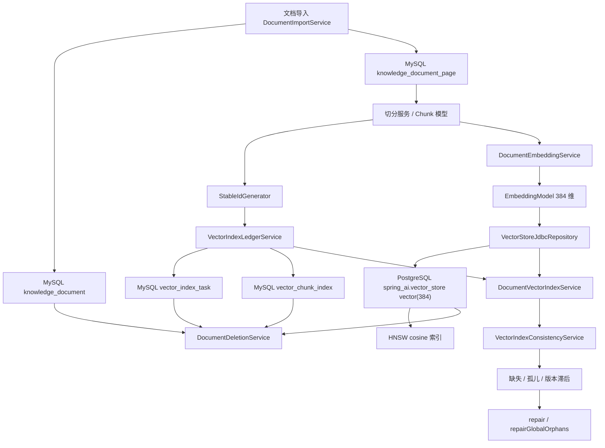
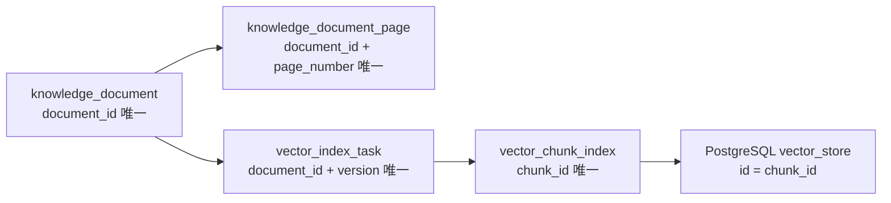
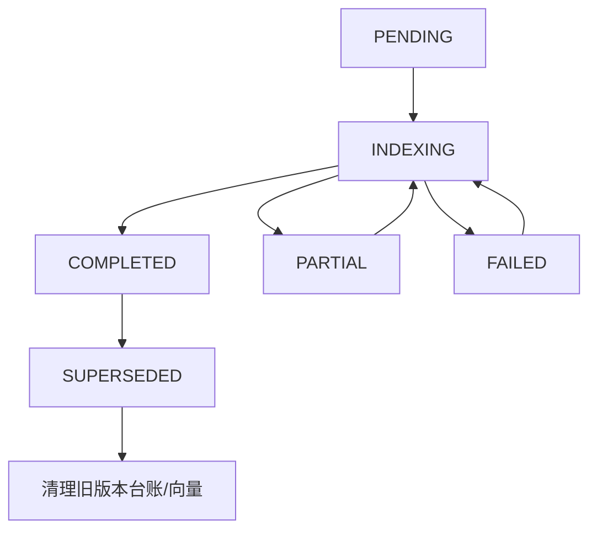

# D31 向量入库、更新与幂等｜项目迭代全量说明

> 项目：M3-Java / D31_VSUAI
> 迭代：Day 31「向量入库、更新与幂等」
> 文档类型：全量信息与操作说明
> 实际代码根：`E:\AI\project\AI-Learning-three-GPT\M3-Java\D31\D31_VSUAI`
> Git 根：`E:\AI\project\AI-Learning-three-GPT\M3-Java`
> 当前分支 / HEAD：`master` / `273fb5d9d58227c74d3f170cd04801ea2a2e3366`
> 归档时间：2026-11-15
> 证据目录：`docs/evidence/D31`

---

## 0. 交付结论

D31 已完成“文档切分后的 Chunk 经 Embedding 向量化，再写入 PostgreSQL + pgvector”的完整链路，并在真实 MySQL、真实 PostgreSQL 18.7 + pgvector 0.8.7 上覆盖：

- 稳定文档 ID 与稳定 Chunk ID；
- 文档、页面、Chunk 台账、向量之间的真实关联；
- MySQL 唯一约束与 PostgreSQL UUID 主键双重幂等；
- 新增、重复导入、更新、删除、全失败重试、部分失败恢复六类场景；
- 文档级与全局级缺失 / 孤儿 / 版本滞后检查及补偿；
- 真实 HTTP 接口调用；
- 全量回归测试。

本迭代最终全量测试结果为 **294 tests、0 failures、0 errors、0 skipped、BUILD SUCCESS**；真机集成测试 5/5、真实 HTTP 测试 1/1。测试结束后 MySQL 四张 D31 表与 PostgreSQL `vector_store` 的 D31 管理行均已清理为 0。

**尚未执行**：Git `add` / `commit` / `push`（用户未授权提交）；独立启动应用后的手工 curl 冒烟（真实 HTTP 集成测试已启动 Tomcat 并完成等价调用）。

---

## 1. 仓库现状扫描

### 1.1 工程结构

| 层级 | 路径 | 说明 |
|---|---|---|
| Git 根 | `M3-Java` | 多日迭代聚合仓库 |
| D31 聚合 POM | `D31/pom.xml` | 声明 D31 子模块 |
| D31 应用模块 | `D31/D31_VSUAI` | Spring Boot 应用、测试、SQL、配置 |
| D31 任务书 | `docs/temp_docs/D31/D31_task_book.md` | 本次验收依据 |
| 技术文档 | `docs/proj_docs` | 本文件与《技术原理及操作实践指南》 |
| 证据 | `docs/evidence/D31` | DDL、集成测试、HTTP、全量测试、Git 证据 |
| 日志 | `logs/D31` | Maven 与测试原始输出 |
| 临时脚本 | `docs/temp_docs/D31` | 数据库核实、迁移、证据采集脚本；未删除 |

### 1.2 技术基线（以实际 POM / 运行日志为准）

| 项 | 实际值 |
|---|---|
| JDK | 21.0.7 |
| Spring Boot | 3.5.16 |
| Spring AI | 1.1.8（BOM 统一管理） |
| Maven | 3.9.16 |
| MySQL | 库 `ai_db`；任务书基线 MySQL 9.7.0-commercial |
| PostgreSQL | 18.7（Debian 构建） |
| pgvector | 0.8.7 |
| PG 地址 | `192.168.200.153:5432`，库 `spring_ai` |
| 向量维度 | 384 |
| 距离 | cosine（`<=>` / `vector_cosine_ops`） |
| 向量索引 | HNSW |
| 应用模块 | `D31_VSUAI` |
| 测试框架 | JUnit 5 + Spring Boot Test + Mockito |

### 1.3 扫描发现的关键问题

D31 不是从空仓库新建功能，而是在 D29/D30 已有文档导入、切分、Embedding、pgvector 能力上继续演进。实际扫描后确认并修复了以下问题：

1. **PO 映射与真机 MySQL 列名不一致**
   - `knowledge_document` 实际使用 `source_system`、`file_size`；
   - `knowledge_document_page` 实际使用 `character_count`、`blank_page`，并包含 `parser_name`、`parser_version`；
   - 原代码部分字段按 `source`、`content_length`、`blank` 等命名映射，真机查询会错列或漏列。

2. **旧全局内容唯一键阻断“同内容不同文档”**
   - 原 `uk_knowledge_content_hash(content_hash)` 会让两个不同文档只要内容相同就插入失败；
   - D31 需要“文档身份”而不是“内容身份”作为归属边界，因此迁移为 `uk_document_content_hash(document_id, content_hash)`。

3. **自增主键未回填时 `updateById` 静默 0 行**
   - 真机测试出现文档最终状态停在 `PROCESSING`；
   - 根因是部分 JDBC/MyBatis 执行路径下，插入后的自增主键未按预期回填，`updateById` 以空主键更新，影响 0 行但不抛异常；
   - 改为按业务唯一键 `document_id` 更新终态，避免“看起来执行成功、状态却没落库”。

4. **文本导入没有页面来源**
   - 文本内容原先不落页面表，后续 Chunk 缺少真实 page 来源；
   - D31 将完整文本写入 page 1，并记录 parser 名称/版本。

5. **没有稳定 ID、任务状态和 Chunk 台账**
   - 原实现没有可重放的 Chunk 快照、没有任务状态机、没有跨 MySQL/PG 的补偿依据；
   - D31 新增 `vector_index_task`、`vector_chunk_index` 与完整服务层。

---

## 2. 本次范围与边界

### 2.1 范围内

- 文档、页面、Chunk、向量四层关联；
- 稳定文档 ID、稳定 Chunk ID、切分版本指纹；
- MySQL 台账与 PostgreSQL 向量表；
- 重复导入、重复索引的幂等；
- 文档版本更新与旧版本延迟清理；
- 文档删除与向量删除；
- Chunk 级失败、任务级 FAILED / PARTIAL、重试；
- 缺失 / 孤儿 / 版本滞后检查与补偿；
- 真实集成测试、真实 HTTP 测试、全量回归；
- 两份正式 Markdown 文档与证据归档。

### 2.2 范围外（不在 D31 冒充完成）

- 生产级鉴权、租户隔离、接口限流；
- 分布式事务 / Seata / 两阶段提交；
- 定时调度器自动扫描重试（当前提供状态、`next_retry_at` 与手动重试接口）；
- 大规模性能压测、容量规划、PG 主从切换；
- 对所有非 D31 写入数据的治理；
- 前端管理页面。

---

## 3. 总体架构



### 3.1 组件职责

| 组件 | 职责 | 边界 |
|---|---|---|
| `DocumentImportService` | 校验、内容指纹、稳定文档 ID、版本递增、解析、页面落库、终态更新 | 不直接写向量 |
| `StableIdGenerator` | 文档 ID、splitVersion、Chunk UUID v5、内容 SHA-256 | 不访问数据库 |
| `DocumentEmbeddingService` | 调 EmbeddingModel，返回 384 维向量 | 不做持久化 |
| `VectorIndexLedgerService` | MySQL 任务/Chunk 台账 upsert、状态变更、清理 | 不写 PG |
| `VectorStoreJdbcRepository` | PG 向量 upsert、删除、计数、缺失核对、孤儿枚举 | 不建表（表由 Spring AI 初始化） |
| `DocumentVectorIndexService` | 编排加载、切分、ID、Embedding、写 PG、核对、清理 | 不直接删除文档 |
| `VectorIndexConsistencyService` | 文档级/全局级检查与补偿 | 只处理 D31 `managedBy` 数据 |
| `DocumentDeletionService` | 先 PG 删除/核对，再 MySQL 事务删除 | 不负责重建向量 |
| `DocumentRowDeletionService` | MySQL 内删页面与文档行 | 事务边界在 MySQL |

### 3.2 为什么是“双库 + 状态机”，而不是“一个事务”

MySQL 保存文档、页面、任务、Chunk 快照；PostgreSQL 保存向量。两个数据库不共享事务，无法用单机 `@Transactional` 保证跨库原子性。D31 采用：

1. **MySQL 为权威台账**：任务和 Chunk 状态可查、可重放；
2. **稳定 ID**：同一逻辑对象在重试中保持同一 UUID；
3. **数据库唯一约束**：并发/重复请求由数据库兜底；
4. **写后核对**：以 PG 实际行数判断是否成功，不以“SQL 没抛异常”判断；
5. **补偿**：识别缺失、孤儿、旧版本残留，按状态修复。

---

## 4. 数据模型

### 4.1 MySQL 表与关键约束

#### `knowledge_document`

实际关键列：

| 列 | 类型 | 说明 |
|---|---|---|
| `id` | bigint AI | 代理主键 |
| `document_id` | varchar(64) NOT NULL | 业务文档 ID，稳定生成或外部传入 |
| `source_system` | varchar(128) | 来源系统 |
| `title` | varchar(300) | 文档标题 |
| `version` | varchar(64) | 文档版本（字符串存储，实际按整数递增） |
| `status` | varchar(16) | `PENDING/PROCESSING/COMPLETED/FAILED` |
| `file_name` / `content_type` / `file_size` | — | 文件元信息 |
| `content_hash` | char(64) | 全文 SHA-256 |
| `error_code` / `error_message` | — | 安全错误摘要 |
| `created_at` / `updated_at` | datetime(6) | 时间 |

实际唯一键：

- `uk_knowledge_document_id(document_id)`；
- `uk_document_content_hash(document_id, content_hash)`。

原 `uk_knowledge_content_hash(content_hash)` 已由迁移删除。

#### `knowledge_document_page`

关键列：`document_id`、`page_number`、`content`（longtext）、`character_count`、`blank_page`、`parser_name`、`parser_version`、`updated_at`。

唯一键：`uk_knowledge_document_page(document_id, page_number)`。

PO 中 `source/title/version/createdAt` 标记 `@TableField(exist=false)`，因为这些列在实际页面表中不存在；领域对象仍保留这些字段用于转换与组装。

#### `vector_index_task`

| 列 | 说明 |
|---|---|
| `document_id` / `version` | 任务业务键 |
| `strategy` | `FIXED_SIZE` / `STRUCTURE` |
| `content_hash` | 文档内容指纹 |
| `split_version` | 切分参数指纹 |
| `vector_space_id` | 模型 + 版本 + 维度 |
| `chunk_count` | 该版本 Chunk 数 |
| `status` | `PENDING/INDEXING/COMPLETED/PARTIAL/FAILED/SUPERSEDED` |
| `stage` | `REGISTER/EMBED_WRITE/VERIFY/CLEANUP/DELETE` |
| `error_code` / `error_message` | 失败摘要 |
| `attempt_count` | 尝试次数（含首次） |
| `next_retry_at` | 建议重试时间 |

唯一键：`uk_vector_task_doc_version(document_id, version)`。  
索引：`idx_vector_task_status_retry(status, next_retry_at)`、`idx_vector_task_status_updated(status, updated_at)`。

#### `vector_chunk_index`

| 列 | 说明 |
|---|---|
| `document_id` / `version` | 归属文档与版本 |
| `strategy` / `chunk_index` | 切分策略与序号 |
| `chunk_id` | 稳定 UUID v5，写入 PG 的 `id` |
| `content` | Chunk 文本快照，用于重放 |
| `chunk_content_hash` | Chunk 文本 SHA-256 |
| `character_count` / `page_numbers` | 长度与来源页 |
| `status` | `PENDING/INDEXED/FAILED` |

唯一键：

- `uk_vector_chunk_chunk_id(chunk_id)`；
- `uk_vector_chunk_doc_version_index(document_id, version, chunk_index)`。

索引：`idx_vector_chunk_document(document_id, version)`。

### 4.2 PostgreSQL `vector_store`

真机结构：

| 列 | 类型 |
|---|---|
| `id` | uuid（主键） |
| `content` | text |
| `metadata` | json |
| `embedding` | `vector(384)` |

索引：

- `vector_store_pkey`：btree(id)；
- `spring_ai_vector_index`：`hnsw (embedding vector_cosine_ops)`。

`vector_store` 由 Spring AI 1.1.8 的 `PgVectorStore` 负责初始化；D31 的 `VectorStoreJdbcRepository` 只做受控 upsert / delete / count，不自行建表。

### 4.3 实体关系



关键关联口径：

- 文档与页面：`document_id`；
- 文档与任务：`document_id + version`；
- 任务与 Chunk：`document_id + version + chunk_index`；
- Chunk 与向量：`chunk_id = vector_store.id`；
- 向量 metadata 中保留 `documentId`、`version`、`chunkIndex`、`managedBy`，用于孤儿判断。

### 4.4 数据库迁移

迁移脚本：`db/migration-d31-content-hash-scope.sql`。

执行逻辑：

1. 通过 `information_schema.statistics` 判断旧索引 `uk_knowledge_content_hash` 是否存在；
2. 存在才 `DROP INDEX`；
3. 判断新索引 `uk_document_content_hash` 是否存在；
4. 不存在才 `ADD UNIQUE KEY (document_id, content_hash)`；
5. 输出索引复核结果。

真机执行前后证据：

- 迁移前：`HAS_OLD=true`、`HAS_NEW=false`、`DOCUMENT_ROWS_BEFORE=0`；
- 迁移后：`HAS_OLD_AFTER=false`、`HAS_NEW_AFTER=true`；
- 最终同时保留 `uk_knowledge_document_id(document_id)` 与 `uk_document_content_hash(document_id, content_hash)`。

迁移只改约束，不删除、不清空业务行；执行时 `knowledge_document` 为 0 行，未触碰用户数据。

---

## 5. 稳定 ID 设计

### 5.1 为什么需要稳定 ID

如果文档 ID、Chunk ID 使用随机 UUID：

- 重复导入同一文档会生成新文档，无法幂等；
- 重试同一批 Chunk 会生成新向量，旧向量成为孤儿；
- 部分失败后无法只补失败项；
- 无法从 MySQL 台账精确映射到 PG 行。

D31 用“业务身份 + 内容指纹 + 切分参数”派生 ID，使同一逻辑对象在重复执行时得到同一标识。

### 5.2 文档 ID

| 场景 | 公式 | 说明 |
|---|---|---|
| 外部传入 documentId | 直接使用 | 必须已登记，否则报“文档不存在” |
| 有 source + title | `SHA-256("D31|document|" + trim(source) + "|" + trim(title))` 前 32 hex | 同一来源同一标题视为同一文档 |
| 无 source/title | `SHA-256("D31|file|" + contentHash)` 前 32 hex | 兼容路径，无法区分同内容不同文档 |

### 5.3 splitVersion

`splitVersion` 由以下字段拼接后 SHA-256 取前 16 hex：

- 策略 `strategy`；
- `chunkSize`、`chunkOverlap`；
- `minChunkSize`、`maxChunkSize`；
- `boundaryTolerance`；
- `mergeShortBlocks`；
- `lengthUnit`；
- 算法版本前缀 `D31|split|v1|`。

切分参数变化会改变 splitVersion，从而改变 Chunk ID，避免把不同切分参数的结果误认为同一批次。

### 5.4 Chunk ID

Chunk ID 使用 RFC 4122 UUID v5：

```text
namespace = 7f1e6b2a-3c4d-5e6f-8a9b-0c1d2e3f4a5b
name      = documentId | version | strategy | splitVersion | chunkIndex | chunkContentHash
id        = UUIDv5(namespace, name)
```

实现位于 `StableIdGenerator#chunkId`：对 namespace 字节 + name 做 SHA-1，按 RFC 4122 设置 version=5、variant=IETF，再格式化 36 位 UUID。

关键性质：

- 同文档、同版本、同策略、同切分参数、同序号、同内容 → 同 ID；
- 文档版本变化 → 新 ID，旧版本 ID 不跨版本复用；
- 切分参数变化 → 新 ID；
- 不同文档即使内容相同 → documentId 不同 → 不同 ID。

### 5.5 同内容不同文档的边界

`uk_document_content_hash(document_id, content_hash)` 允许：

- 文档 A、文档 B 的 contentHash 相同；
- 只要 documentId 不同，两行可共存；
- 各自有独立页面、任务、Chunk、向量。

真机测试 `sameContentDifferentDocumentsStaySeparate` 已验证：两文档各自 4 Chunks、4 Vectors，contentHash 相同但 documentId 不同。

**仍需注意**：无 source/title 的兼容路径使用 `D31|file|contentHash` 生成 documentId，此时同内容不同文档仍会合并。正式导入应提供 source/title 或显式 documentId；这是 D31 明确记录的边界，不是已解决能力。

---

## 6. 幂等与状态机

### 6.1 任务状态

| 状态 | 含义 | 是否终态 |
|---|---|---|
| `PENDING` | 已登记，未开始 | 否 |
| `INDEXING` | 正在 Embedding/写 PG | 否 |
| `COMPLETED` | 当前版本 Chunk 与 PG 向量齐全，且已核对 | 是（可被 SUPERSEDED） |
| `PARTIAL` | 部分 Chunk 成功，仍有失败/缺失 | 可重试 |
| `FAILED` | 当前版本无成功项，或超过最大尝试 | 可重试/人工介入 |
| `SUPERSEDED` | 旧版本已被新版本替代，等待/完成清理 | 旧版本终态 |

### 6.2 阶段

| 阶段 | 含义 |
|---|---|
| `REGISTER` | 建任务/Chunk 台账 |
| `EMBED_WRITE` | 逐 Chunk Embedding + PG upsert |
| `VERIFY` | 以 DB 实际行数核对 |
| `CLEANUP` | 清理旧版本台账/向量 |
| `DELETE` | 文档/向量删除 |

### 6.3 状态流转



### 6.4 幂等判定

#### 重复导入

`DocumentImportService` 的判定顺序：

1. 显式 `documentId` 优先，查不到直接报错；
2. 有 `source+title`，按稳定 ID 查既有文档；
3. 两者都没有，才按 contentHash 查（兼容路径，可能取第一条）。

只有既有文档 **同内容且状态为 COMPLETED** 才直接返回 `duplicate=true`。  
同内容但 `PENDING/FAILED` 继续处理；内容不同则 `version+1`。

#### 重复索引

`DocumentVectorIndexService` 在完整执行前检查：

- 任务已 `COMPLETED`；
- 当前版本 Chunk ID 集合与 PG 中实际存在的 ID 集合一致；
- 数量一致。

满足则直接返回 `duplicate=true`，不重新 Embedding、不重复插入、不增加 attempt。

#### 数据库兜底

即使应用层并发判断同时通过，数据库约束仍然兜底：

- `vector_index_task`：`(document_id, version)` 唯一；
- `vector_chunk_index`：`chunk_id` 唯一 + `(document_id, version, chunk_index)` 唯一；
- `vector_store`：`id uuid` 主键 + `ON CONFLICT (id) DO UPDATE`。

---

## 7. 六类场景实现

### 7.1 新增

流程：

1. 导入文档，页面落库，文档 `COMPLETED`；
2. 调用索引，加载文档 → 页面 → 切分；
3. 为每个 Chunk 生成稳定 ID，写任务/Chunk 台账；
4. 调 `DocumentEmbeddingService.embedChunk` 得到 384 维向量；
5. `VectorStoreJdbcRepository.upsert` 写入 PG；
6. 以 `countManagedByDocument` / `findMissingIds` 与 Chunk 台账核对；
7. 全部齐全才 `COMPLETED`。

真机结果：3 Chunks / 3 Vectors / `[1:COMPLETED:attempt=1]`。

### 7.2 重复导入与重复索引

- 重复导入：同身份同内容已 COMPLETED，直接 `duplicate=true`，版本不增加；
- 重复索引：任务 COMPLETED 且 PG 实际 ID 集合与台账一致，直接 `duplicate=true`，attempt 保持 1；
- 注意：重复导入 `PENDING/FAILED` 同内容不会误判为 duplicate，而是继续处理。

### 7.3 更新

1. 同 documentId 内容变化 → `version+1`；
2. 旧版本任务/Chunk/向量保留；
3. 新版本从 `PENDING/INDEXING` 开始；
4. 新版本全部成功并核对后，旧版本标记 `SUPERSEDED`，清理旧版本 Chunk 台账和 PG 向量；
5. 新版本失败时旧版本仍可用；不会先删旧再写新。

真机证据：v2 全失败时 chunks=8（v1 3 + v2 5）、vectors=3（旧 v1 保留）、任务 `[1:COMPLETED, 2:FAILED]`；v2 重试成功后 chunks=5、vectors=5、`[1:SUPERSEDED, 2:COMPLETED]`。

**版本切换的数据边界**：旧版本的 `vector_chunk_index` 与 PG 向量会保留到新版本完成，但 `knowledge_document_page` 的唯一键是 `(document_id, page_number)`，不含 version；导入新版本时页面会按 documentId 整体替换。因此旧版本向量/Chunk 快照可保留，旧版本页面原文不会作为独立版本历史保留。若业务需要页面级回滚，D32 应把 `version` 引入页面唯一键或增加页面归档表。

### 7.4 删除

`DocumentDeletionService` 顺序：

1. 按 documentId 删除 PG 中 `managedBy` 匹配的全部向量；
2. 从 PG 再核对是否仍有残留；
3. MySQL 事务内由 `DocumentRowDeletionService` 删除页面与文档；
4. 删除 Chunk 台账、任务台账。

真机日志：`chunkRows=5, taskRows=2, vectorRows=5`；文档删除成功。

**为什么先 PG 后 MySQL**：如果 MySQL 先删文档，PG 向量将失去归属依据，后续孤儿识别只能靠 metadata；先删向量可以在仍能读到 MySQL 台账时完成精确核对。若 PG 删除失败，MySQL 事务不提交，文档保留，避免“文档已删但向量残留且无法定位”。

### 7.5 全失败重试

- 每个 Chunk 独立捕获异常，不因一个 Chunk 失败放弃全部；
- 全部失败 → `FAILED`，`indexedChunkCount=0`；
- 重试时复用同任务、同 Chunk ID，只重算失败/缺失项；
- attempt 自增（数据库 upsert 的 `attempt_count = attempt_count + 1`）；
- 真机：FAILED→COMPLETED，3 个 Chunk ID 前后完全一致，attempt 1→2。

### 7.6 部分失败恢复

- 成功项写 PG，失败项保持 `FAILED`；
- 任务 `PARTIAL`，`indexed/total` 反映实际；
- 重试只补失败/缺失项，已成功项不重复 Embedding；
- 真机：4/5 → 5/5，Chunk ID 不变，attempt 1→2。

---

## 8. 跨系统一致性

### 8.1 失败矩阵

| 故障点 | MySQL 状态 | PG 状态 | 恢复方式 |
|---|---|---|---|
| 切分/ID 生成失败 | 无任务或任务 PENDING | 无向量 | 重新索引 |
| Embedding 失败（部分） | PARTIAL，Chunk 部分 FAILED | 部分向量 | 只补失败/缺失 |
| Embedding 失败（全部） | FAILED | 0 向量 | 重试 |
| PG upsert 抛错 | 任务 INDEXING/PARTIAL | 无/部分 | 重试，UUID 幂等 |
| PG 写成功但响应超时 | 任务可能 INDEXING | 向量已存在 | 重试 upsert 同 ID，不新增 |
| 核对时 PG 少行 | PARTIAL/FAILED | 缺失 | 补偿写缺失 ID |
| PG 多行 | 任务 COMPLETED | 孤儿 | 删除孤儿 |
| 旧版本清理失败 | 新版本 COMPLETED，任务降级 PARTIAL/CLEANUP | 旧向量残留 | 重试清理 |
| 删除 PG 失败 | 文档仍保留 | 向量残留 | 重试删除或人工核查 |

### 8.2 检查维度

`VectorIndexConsistencyService` 已实现：

- **missing**：台账中当前版本的 Chunk ID 在 PG 中不存在；
- **orphan**：PG 中 `managedBy=d31` 且 `documentId` 对应，但不在当前版本台账中的向量；
- **stale**：文档版本与任务版本不一致；
- **task status**：任务是否 COMPLETED、向量数/Chunk 数是否一致；
- **CHUNK_NOT_INDEXED**：任务 COMPLETED 但 `indexedChunkCount < chunkCount`；
- **VECTOR_COUNT_MISMATCH**：PG 管理向量数小于当前版本 Chunk 数。

### 8.3 补偿

- 文档级 `repair`：删除该文档全部孤儿，重试缺失；
- 全局 `repairGlobalOrphans`：内部收集全部孤儿 ID，不受视图 20 条展示截断影响；
- 补偿后再次查一致性，必须 PASS 才宣称恢复。

真机证据：

- 手动删 1 个向量 + 插入 1 个 version=999 孤儿；
- 文档检查：`status=FAIL`、`missing=1`、`orphan=1`、`findings=[MISSING_VECTOR, ORPHAN_VECTOR]`；
- 全局检查：孤儿 1；`repairGlobalOrphans` 删除 1；
- 文档 `repair` 后：`status=PASS`、missing=0、orphan=0、向量数恢复 3、attempt=2。

### 8.4 一致性边界

- **展示截断 vs 补偿全量**：一致性视图的 `missingChunkIds` / `orphanVectorIds` 仍可能只展示前 20 条；补偿服务内部收集全量，不依赖视图列表长度。文档和 UI 不应把“视图只显示 20 条”误读为“只有 20 条”。
- **只治理 D31 数据**：孤儿检查以 `metadata->>'managedBy' = d31` 为边界，不删除其他系统写入的向量。
- **无自动调度**：当前 `next_retry_at` 只是建议时间，重试由接口或上层调度触发；没有定时任务自动重试。
- **跨库非原子**：任何“删除成功”结论都必须以两库实际查询为准；不能仅凭一次异常未抛出。

---

## 9. 实际代码修改清单

### 9.1 修改的既有文件

| 文件 | 修改目的 |
|---|---|
| `document/po/KnowledgeDocumentPO.java` | `source` 映射 `source_system`，`contentLength` 映射 `file_size` |
| `document/po/DocumentPageContentPO.java` | `character_count`、`blank_page`、`parser_name/parser_version` 对齐真机 |
| `document/model/DocumentPageContent.java` | 新增 parser 字段，默认 `BasicDocumentParser` / `D31` |
| `document/support/DocumentConverter.java` | 页面 parser 字段双向映射；文档列映射同步 |
| `document/service/DocumentImportService.java` | 稳定 ID、版本递增、重复判定、文本 page 1、终态按 document_id 更新 |
| `document/service/DocumentRegistrationService.java` | 稳定 ID、同身份登记幂等、`deleteByDocumentId` |
| `document/service/DocumentPageService.java` | `deletePages(documentId)` |
| `document/embedding/service/DocumentEmbeddingService.java` | `embedChunk` 公开，支持逐 Chunk 失败捕获 |
| `resources/application.yml` | `app.ai.vector-index`、PG 配置、向量索引配置 |
| `resources/db/schema-knowledge-document.sql` | 与真机列名、复合唯一键一致 |
| `resources/db/schema-document-page.sql` | 与真机列名、唯一键一致 |
| `test/.../DocumentImportServiceTest.java` | 同步 `update` 断言 |
| `test/.../DocumentRegistrationServiceTest.java` | 同步稳定登记行为 |

### 9.2 新增文件

| 文件 | 作用 |
|---|---|
| `document/support/StableIdGenerator.java` | 稳定文档/Chunk ID、splitVersion、SHA-256 |
| `document/vector/config/VectorIndexProperties.java` | `app.ai.vector-index` 配置 |
| `document/vector/model/*` | 状态、阶段、任务、Chunk 模型 |
| `document/vector/dto/*` | 任务视图、Chunk 视图、一致性视图、删除视图 |
| `document/vector/support/*` | 转换器、向量记录 |
| `document/vector/po/*` | 任务/Chunk 台账 PO |
| `document/vector/mapper/*` | 自定义幂等 upsert |
| `document/vector/repository/VectorStoreJdbcRepository.java` | PG 受控读写 |
| `document/vector/service/VectorIndexLedgerService.java` | 台账状态服务 |
| `document/vector/service/DocumentVectorIndexService.java` | 索引编排 |
| `document/vector/service/VectorIndexConsistencyService.java` | 一致性检查/补偿 |
| `document/vector/service/DocumentRowDeletionService.java` | MySQL 行删除 |
| `document/vector/service/DocumentDeletionService.java` | 跨库删除编排 |
| `document/vector/controller/*` | 文档级/管理级 HTTP 接口 |
| `resources/db/schema-d31-vector-index.sql` | D31 台账 DDL |
| `resources/db/migration-d31-content-hash-scope.sql` | 内容唯一键迁移 |
| `test/.../D31VectorIndexIntegrationTest.java` | 5 个真机测试 |
| `test/.../D31VectorIndexHttpTest.java` | 真实 HTTP 测试 |

---

## 10. HTTP 接口

### 10.1 文档级

| 方法 | 路径 | 作用 |
|---|---|---|
| `POST` | `/api/v1/documents/{documentId}/vector-index` | 建立/重试索引，可带 `strategy` |
| `GET` | `/api/v1/documents/{documentId}/vector-index` | 查询任务视图 |
| `GET` | `/api/v1/documents/{documentId}/vector-index/chunks` | 查询 Chunk 台账 |
| `POST` | `/api/v1/documents/{documentId}/vector-index/retry` | 手动重试 |
| `DELETE` | `/api/v1/documents/{documentId}/vector-index` | 只删除向量，保留文档与台账 |
| `GET` | `/api/v1/documents/{documentId}/vector-index/consistency` | 文档级一致性 |
| `POST` | `/api/v1/documents/{documentId}/vector-index/consistency/repair` | 文档级补偿 |

### 10.2 管理级

| 方法 | 路径 | 作用 |
|---|---|---|
| `DELETE` | `/api/v1/documents/{documentId}` | 删除文档 + 台账 + 向量 |
| `GET` | `/api/v1/vector-index/consistency` | 全局一致性 |
| `POST` | `/api/v1/vector-index/consistency/orphans` | 全局孤儿补偿 |

### 10.3 真实 HTTP 证据

测试文档 `1678f4fb593ae200145571215ca967c2`：

| 请求 | 状态 | 响应要点 |
|---|---|---|
| `POST /vector-index?strategy=FIXED_SIZE` | 200 | `chunkCount=2`、`indexedChunkCount=2`、`attemptCount=1`、COMPLETED |
| `GET /vector-index` | 200 | COMPLETED，stage=VERIFY |
| `GET /vector-index/consistency` | 200 | PASS，missing=0，orphan=0 |
| `DELETE /api/v1/documents/{id}` | 200 | `documentDeleted=true`，删除 chunk=2/task=1/vector=2 |

---

## 11. 配置

### 11.1 `app.ai.vector-index`

```yaml
app:
  ai:
    vector-index:
      max-task-attempts: ${VECTOR_INDEX_MAX_ATTEMPTS:5}
      retry-delay-seconds: ${VECTOR_INDEX_RETRY_DELAY_SECONDS:60}
      managed-by: ${VECTOR_INDEX_MANAGED_BY:d31}
      cleanup-old-versions: ${VECTOR_INDEX_CLEANUP_OLD:true}
```

### 11.2 `spring.ai.vectorstore.pgvector`

```yaml
spring:
  ai:
    vectorstore:
      pgvector:
        initialize-schema: ${PGVECTOR_INIT_SCHEMA:true}
        schema-name: ${PGVECTOR_SCHEMA:public}
        table-name: ${PGVECTOR_TABLE:vector_store}
        dimensions: ${PGVECTOR_DIMENSIONS:384}
        index-type: ${PGVECTOR_INDEX_TYPE:HNSW}
        distance-type: ${PGVECTOR_DISTANCE_TYPE:COSINE_DISTANCE}
        schema-validation: ${PGVECTOR_SCHEMA_VALIDATION:false}
        max-document-batch-size: ${PGVECTOR_BATCH_SIZE:100}
        id-type: ${PGVECTOR_ID_TYPE:UUID}
        remove-existing-vector-store-table: ${PGVECTOR_RECREATE:false}
```

### 11.3 环境变量

| 变量 | 作用 | 是否可提交 |
|---|---|---|
| `MYSQL_PASSWORD` | MySQL 口令 | 否 |
| `PG_PASSWORD` | PostgreSQL 口令 | 否 |
| `PGVECTOR_*` | 向量库结构参数 | 默认值可提交，敏感值不可 |
| `VECTOR_INDEX_*` | 任务重试/管理标识 | 默认值可提交 |
| `D31_VECTOR_IT` | 是否启用真机集成测试 | 测试开关，可提交为 `false` 或不写 |
| `D31_PG_IT` | 是否启用 PG 真机能力测试 | 同上 |

### 11.4 口令边界

- `spring.datasource.pg.password: ${PG_PASSWORD}`，无默认值；PG 不配置口令时应用无法连接，这是有意设计。
- MySQL 与 PostgreSQL 的口令均只从环境变量注入（`MYSQL_PASSWORD` / `PG_PASSWORD`），仓库不提供默认口令；缺少时启动或首次连接明确失败。
- 本文档不记录任何真实口令；证据文件也不包含口令。

---

## 12. 实际验证

### 12.1 命令

```powershell
$env:JAVA_HOME = 'D:\SoftwareInstall\JDK\JDK21'
$env:MYSQL_PASSWORD = '<本机口令>'
$env:PG_PASSWORD = '<PG 口令>'
$env:D31_VECTOR_IT = 'true'
$env:D31_PG_IT = 'true'

& 'D:\SoftwareInstall\Apache\Maven\apache-maven-3.9.16\bin\mvn.cmd' `
  -f 'E:\AI\project\AI-Learning-three-GPT\M3-Java\D31\pom.xml' `
  -pl D31_VSUAI clean test
```

### 12.2 结果

| 验证项 | 结果 |
|---|---|
| 干净构建 | `target` 被清理，211 个源文件重新编译 |
| 全量测试 | 294 tests / 0 failures / 0 errors / 0 skipped |
| `D31VectorIndexIntegrationTest` | 5/5 通过 |
| `D31VectorIndexHttpTest` | 1/1 通过 |
| `PgVectorJdbcAcceptanceTest` | 真机 PG 能力通过 |
| `PgVectorStoreIntegrationTest` | 真机 PG 能力通过 |
| `DocumentImportServiceTest` / `DocumentRegistrationServiceTest` | 9 + 5 = 14 个相关测试通过（含 update 断言） |
| HTTP Tomcat | 随机端口启动，真实请求/响应 |
| 测试数据清理 | MySQL 四表 0 行；PG total=0、managed_d31=0 |

### 12.3 关键证据位置

| 证据 | 文件 |
|---|---|
| MySQL 实际 DDL/索引/行数 | `docs/evidence/D31/01-mysql-schema-and-rows.txt` |
| PG 版本/pgvector/维度/HNSW/行数 | `docs/evidence/D31/02-pgvector-schema-and-rows.txt` |
| 5 个集成测试结构化快照 | `docs/evidence/D31/03-vector-integration-evidence.txt` |
| 真实 HTTP 响应 | `docs/evidence/D31/04-http-endpoint-evidence.txt` |
| 全量测试摘要 | `docs/evidence/D31/05-full-test-suite-summary.txt` |
| Git 状态 | `docs/evidence/D31/06-git-status.txt` |
| 六场景表 | `docs/evidence/D31/07-six-scenarios.md` |

### 12.4 数据库最终状态

MySQL `ai_db`：

- `knowledge_document`：0 行；
- `knowledge_document_page`：0 行；
- `vector_index_task`：0 行；
- `vector_chunk_index`：0 行；
- 复合唯一键与页面/台账唯一键均存在。

PostgreSQL `spring_ai`：

- `vector_store`：total=0、managed_d31=0；
- `embedding`：`vector(384)`；
- HNSW cosine 索引存在。

---

## 13. Git 状态

- 分支：`master`
- HEAD：`273fb5d9d58227c74d3f170cd04801ea2a2e3366`（提交信息 `D31 项目基础骨架`）
- 工作区：
  - 13 个已修改文件；
  - 未跟踪：`StableIdGenerator.java`、`document/vector/` 整包、两个 D31 SQL、`src/test/java/com/zl/d31/document/vector/`、`docs/evidence/D31/`、两份 D31 正式文档；
- **尚未执行 `git add` / `commit` / `push`**，符合“未授权不提交”的项目规则。

完整状态见 `docs/evidence/D31/06-git-status.txt`。

---

## 14. 风险、边界与未完成事项

| 编号 | 风险/边界 | 影响 | 建议 |
|---|---|---|---|
| R1 | MySQL/PG 口令必须由部署环境注入 | 漏配时启动失败 | 启动检查、部署清单和环境变量注入 |
| R2 | 无 source/title 的兼容文档 ID 按内容生成 | 同内容不同文档仍会合并 | 正式导入强制 source/title 或外部 ID |
| R3 | 一致性视图列表可能截断 20 条 | UI 误读为只有 20 个问题 | 视图只作展示，补偿以服务内部全量为准 |
| R4 | 旧版本清理失败会使任务降级 PARTIAL/CLEANUP | 新版本可用，但旧向量可能残留 | 重试清理；监控 CLEANUP 阶段 |
| R5 | 无自动调度器 | 失败不会自动定时重试 | 上层调度读取 `next_retry_at` 或人工触发 |
| R6 | 删除接口未来可能与新增文档删除接口路径重叠 | 路由冲突风险 | 新增接口前先做路径约定与路由测试 |
| R7 | 未做生产性能/容量压测 | 不能证明高并发/大规模表现 | 后续单独做压测与索引调优 |
| R8 | 未执行 Git 提交 | 代码仅在工作区 | 获授权后提交并保留证据 |
| R9 | 未做手工 curl 冒烟 | 未覆盖真实进程外调用 | HTTP 集成测试已覆盖等价链路；需要时补 |
| R10 | 旧版本页面不保留 | 只能从 Chunk 快照/原文件重建旧页面，无法直接页面级回滚 | D32 引入页面版本唯一键或归档表 |

---

## 15. 验收追踪矩阵

> 任务书共 14 项验收要求，编号 AC-01～AC-14 为本文档映射，不是任务书原文编号。

| 编号 | 要求 | 实现位置 | 验证方式 | 结果 | 证据 |
|---|---|---|---|---|---|
| AC-01 | 文档 Chunk 经现有 Embedding 向量化 | `DocumentEmbeddingService`、`DocumentVectorIndexService` | 真机集成测试 | PASS | `03` |
| AC-02 | 写入 PG + pgvector，384 维 | `VectorStoreJdbcRepository`、`application.yml` | PG 实际列/索引/行数 | PASS | `02` |
| AC-03 | 稳定文档 ID | `StableIdGenerator#documentId`、`DocumentImportService` | 重复导入/同内容测试 | PASS | `03`、`07` |
| AC-04 | 稳定 Chunk ID | `StableIdGenerator#chunkId` | 失败重试/部分重试 ID 一致 | PASS | `03` |
| AC-05 | 文档与 Chunk 关联 | `vector_chunk_index(document_id,version,chunk_index)` | 台账/视图/删除 | PASS | `01`、`03` |
| AC-06 | 数据库唯一约束 | 两个 D31 表 + knowledge_document 复合唯一 | 真机 DDL + 并发/重复路径 | PASS | `01` |
| AC-07 | 重复导入 | `DocumentImportService` duplicate 判定 | 真机重复导入 | PASS | `03`、`07` |
| AC-08 | 更新 | 版本递增 + 旧版本延迟清理 | v1→v2 真机 | PASS | `03`、`07` |
| AC-09 | 删除 | `DocumentDeletionService` | HTTP DELETE + 真机行数 | PASS | `04`、`07` |
| AC-10 | 失败重试 | 任务状态机 + `retry` | 全失败→成功 | PASS | `03` |
| AC-11 | 部分失败恢复 | 逐 Chunk 捕获 + 只补缺失 | 4/5→5/5 | PASS | `03` |
| AC-12 | 原文库/向量库一致性 | `VectorIndexConsistencyService` | missing/orphan 注入与补偿 | PASS | `03` |
| AC-13 | 孤儿检查/版本一致性 | 文档级 + 全局级 | 篡改/修复 | PASS | `03` |
| AC-14 | 真实构建、测试、接口证据 | Maven + HTTP 测试 | 294 tests、HTTP 200 | PASS | `04`、`05` |

---

## 16. 后续建议

1. 将 MySQL/PG 口令纳入部署环境检查，禁止任何默认口令；
2. 为 `next_retry_at` 增加受控调度器，并限制自动重试上限；
3. 为全局一致性视图增加总数与分页，避免“展示截断”误读；
4. 增加同文档并发导入/并发索引的竞争测试；
5. 对 HNSW 参数、批量写入、Embedding 并发做压测；
6. 补生产级鉴权、租户隔离、审计日志；
7. 获授权后执行 Git 提交并把提交 ID 写入证据目录。

---

## 17. 参考资料

- 《Spring AI Reference: PGVector Store | Spring AI 参考文档：PGVector 向量存储》：https://docs.spring.io/spring-ai/reference/api/vectordbs/pgvector.html
- 《Spring AI Reference: Vector Stores | Spring AI 参考文档：向量存储》：https://docs.spring.io/spring-ai/reference/api/vectordbs.html
- 《Spring AI Reference: Embeddings | Spring AI 参考文档：嵌入模型》：https://docs.spring.io/spring-ai/reference/api/embeddings.html
- 《PostgreSQL 18 Documentation | PostgreSQL 18 文档》：https://www.postgresql.org/docs/18/
- 《PostgreSQL 18: INSERT ... ON CONFLICT | PostgreSQL 18：INSERT ... ON CONFLICT》：https://www.postgresql.org/docs/18/sql-insert.html
- 《pgvector: Open-source vector similarity search for Postgres | pgvector：PostgreSQL 开源向量相似检索》：https://github.com/pgvector/pgvector
- 《RFC 4122: A Universally Unique IDentifier (UUID) URN Namespace | RFC 4122：UUID URN 命名空间》：https://www.rfc-editor.org/rfc/rfc4122
- 《Spring Boot 3.5 Reference | Spring Boot 3.5 参考文档》：https://docs.spring.io/spring-boot/3.5/
- 《MyBatis-Plus Documentation | MyBatis-Plus 文档》：https://baomidou.com/
