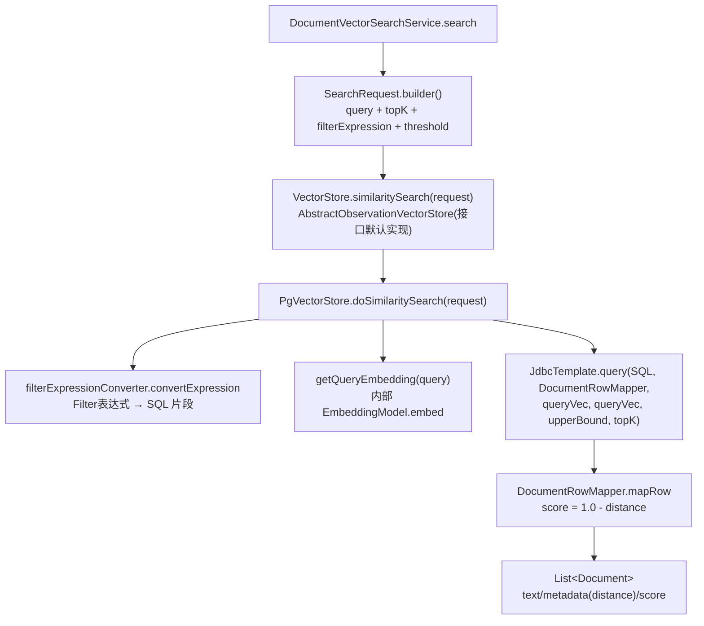

# D32-相似度检索与Top-K技术原理及操作实践指南

> 面向读者：需要理解"查询怎么变成向量、向量怎么变成 Top-K 结果、分数从哪来、过滤怎么生效"的 Java AI 工程师。
> 技术基线：JDK 21、Spring Boot 3.5.16、Spring AI 1.1.8、PostgreSQL 18.7 + pgvector 0.8.7、384 维、cosine `<=>`、HNSW。
> 本文所有框架行为结论均经本地仓库 1.1.8 jar 字节码核验（证据：docs/temp_docs/D32/），非凭记忆描述。

---

## 1. 是什么：相似度检索与 Top-K

**是什么**：把用户问题（Query）转成与文档向量同空间的 384 维向量，在 pgvector 里按余弦相似度找出最相近的 K 条片段（默认 K=5），返回片段全文、来源 metadata 与真实分数。它是 RAG 的"R"（检索），D31 完成了"I"（索引/入库），两者共享同一向量空间。

**为什么 Top-K 而不是阈值**：阈值需要分数分布先验；在语料小、模型弱时硬阈值会漏答案（见 §6 评估），Top-K 保证结果可控、可评估，阈值留到分布明确后决策。

## 2. 为什么：Query Embedding 为什么必须与入库同模型同维度

余弦相似度只在**同一向量空间**内有意义。两个向量若来自不同 Embedding 模型（或同模型不同维度配置），数值维度之间的对应关系不存在，算出的 cosine 是无意义的数。D30 用 `VectorDimensionGuard` 在启动期对齐三方（Embedding 配置 / pgvector 列定义 / 模型实际输出），D32 检索侧复用同一条链路：

```
入库：chunk 文本 → EmbeddingModel.embed(chunk)   → vector(384) → vector_store
检索：query 文本 → DocumentEmbeddingService.embedQuery(query) → float[384]
                      ↓ 同一 EmbeddingModel Bean / 同一重试执行器 / 同一维度校验器
```

`embedQuery` 与 `embedChunk` 的唯一差异是输入类型：检索不需要组装 EmbeddingRecord（不落库），只要校验后的 float[]。

## 3. 底层原理一：pgvector 的 cosine 距离与 HNSW

### 3.1 距离算子

pgvector 提供三种距离：L2 `<->`、内积 `<#>`、余弦 `<=>`。本项目用 **cosine distance**：

```
cosine_distance(a, b) = 1 - cos(θ) ，其中 cos(θ) = a·b / (|a| × |b|)
```

- 相似度 similarity = cos(θ) ∈ [-1, 1]，语义嵌入归一化后实际落在 [0,1]；
- 距离 distance = 1 - similarity，越小越相似；
- 排序上"距离升序"与"相似度降序"完全等价。

### 3.2 SQL 形态（1.1.8 PgVectorStore 字节码常量，PgDistanceType-118.txt）

```sql
SELECT *, embedding <=> ? AS distance
FROM spring_ai.vector_store
WHERE embedding <=> ? <= ?    -- 第二个 ? 是查询向量，第三个 ? 是距离上界(1 - similarityThreshold)
ORDER BY distance
LIMIT ?                        -- topK
```

四个参数依次：查询向量（SELECT 投影）、查询向量（WHERE）、距离上界、topK。**不设阈值时上界 = 1.0 - 0.0 = 1.0，WHERE 恒真，退化为纯 Top-K。**

### 3.3 HNSW 索引

D30 建库语句为 `embedding vector_hnsw_ops`（`vector_cosine_ops` 距离类）：查询时从图的入口层贪心下行，只比较少量邻居即可近似最近邻，复杂度从全表 O(N) 降为对数级，代价是**近似**——极端情况下可能漏掉真正最近的第 K 条（召回率换速度）。当前 28 向量语料上等价于精确检索；语料上量后需用黄金集复查召回。

## 4. 底层原理二：Spring AI 1.1.8 检索链路（源码机制）

调用链（字节码核验）：



**分数语义铁证**（PgDocumentRowMapper-118.txt，`mapRow` 字节码）：

```
88: dconst_1        // 常量 1.0
89: aload 6         // ResultSet.getFloat("distance")
95: dsub            // 1.0 - distance
99: Builder.score(...)
70: Map.put(DocumentMetadata.DISTANCE.value(), distance)  // metadata["distance"]=原始距离
```

即 **Document.score = 1.0 − cosine distance（余弦相似度）**；原始距离不丢弃，存进 metadata 的 `distance` 键。D32 的 DTO 同时暴露两者（score/cosineDistance），并在真机用"自算余弦"交叉验证：`|selfSimilarity − score| = 9.3e-9`（float 精度内一致），`|score − (1−distance)| = 0.0`。**这就是"不伪造分数"的可验证形态。**

## 5. 底层原理三：Metadata 过滤（Filter Expression → jsonb SQL）

### 5.1 机制

Spring AI 的过滤是**内存无关的谓词下推**：`Filter.Expression` 树由 `FilterExpressionConverter` 翻译为 SQL 片段拼进 WHERE。PgVectorStore 使用 `PgVectorFilterExpressionConverter`，metadata 列是 `json/jsonb`，键值条件翻译为 `metadata->>'key' = 'value'` 形态（列名默认 `metadata`，构造时可换）。

### 5.2 D32 的用法

```java
builder.filterExpression(new Filter.Expression(
        Filter.ExpressionType.EQ,
        new Filter.Key("documentId"),          // 真实存在的 metadata 键
        new Filter.Value(request.getDocumentId().trim())));
```

只用真实字段：D31/D32 入库实际写入的 metadata 键为 `managedBy/documentId/version/strategy/chunkId/chunkIndex/contentHash/vectorSpaceId/modelName/dimensions/source/title/pageNumbers`（02 号证据为 PG 实查样本）。`documentId` 是业务上最常用的过滤维度。

**过滤失效的验证**：给不存在的 `DOC-NOT-EXIST-999` 做过滤，返回 0 命中（04 号证据）——若转换器静默忽略表达式会返回全库 Top-K，此测试证明下推真实生效。

**注意**：`chunkIndex` 在 metadata 中是数字类型，jsonb 的 `->>` 取出的是文本；对数字键做 EQ 时 Spring AI 侧值类型要与入库一致，否则匹配不到（本次仅用字符串键 documentId 验证，数字键过滤建议真机复核后再用于生产）。

## 6. 检索质量评估方法（10 问题实践）

### 6.1 出题原则

问题必须对应**已入库**文档的真实内容，覆盖：不同设备（机床/液压/空压/变频/PLC/轴承）、不同问法（书面语 Q1 vs 口语 Q2/Q5）、不同意图（故障排查 Q1~Q7 / 规范查询 Q8/Q9 / 操作要求 Q10）。

### 6.2 标注口径与结果

逐条对照命中 content 与原文，判 R（直接回答）/ P（部分相关）/ N（不相关）：

| 指标 | 结果 | 关键个案 |
|---|---|---|
| Top-1 命中率 | 100% | 全部 10 问直接答案排 rank1 |
| MRR | 1.00 | — |
| P@5 | 0.38 | R=11、P=16、N=23（共 50 条） |
| 漏召回 | 1 条 | Q1 的"温度传感器判据"片段未进 Top-5（原文依据 + 成因：同文档聚合挤占 + 字符哈希语义弱） |

### 6.3 阈值决策（基于真实分数分布）

- R（正确答案）分数 ∈ [0.1707, 0.4508]
- P（部分相关）∈ [0.1710, 0.2546]
- N（噪声）∈ [0.0796, 0.1976]
- **R 与 N 重叠于 0.17~0.1976**：任何阈值都无法既保留全部 R 又滤掉全部 N。
- 结论：**维持不设阈值**（`similarityThresholdAll()`=0.0）；更换语义 Embedding 模型后重新出题评估；业务若必须硬过滤，0.15 起步 + Top-K 截断组合，并接受 Q7 类低分正确答案可能被滤。

## 7. 核心代码讲解

### 7.1 检索服务主干（DocumentVectorSearchService.search）

```java
float[] queryVector = embeddingService.embedQuery(query);   // ① 同链路 Query Embedding
SearchRequest.Builder builder = SearchRequest.builder()
        .query(query)
        .topK(topK)                                          // ② clamp 后的 K
        .similarityThresholdAll();                           // ③ 不设阈值(0.0)
if (StringUtils.hasText(request.getDocumentId())) {
    builder.filterExpression(new Filter.Expression(          // ④ 真实字段下推
            Filter.ExpressionType.EQ,
            new Filter.Key("documentId"),
            new Filter.Value(request.getDocumentId().trim())));
}
List<Document> documents = vectorStore.similaritySearch(builder.build());  // ⑤ PgVectorStore 真实检索
```

为什么 ① 之后 ⑤ 内部还会再 embed 一次：`doSimilaritySearch` 的接口约定是"传文本"，内部 `getQueryEmbedding(query)` 自行 embed。服务层前置 embedQuery 的价值是**在进入向量库之前**完成维度校验与失败拦截（错误分类清晰、可单测），并拿到查询维度写进响应（证据可追溯）。本地哈希模型双次调用无成本；换远程 Embedding 时可评估改造（见 §9 风险）。

### 7.2 结果映射（分数不加工）

```java
hit.setScore(document.getScore());                            // 1.0 - distance，真实值
Object distance = document.getMetadata().get("distance");     // PgVectorStore 写入的原始距离
hit.setCosineDistance(distance instanceof Number n ? n.doubleValue() : null);
hit.setMetadata(document.getMetadata());                      // 全量透传，不构造字段
```

### 7.3 embedQuery（与入库同链路）

```java
public float[] embedQuery(String query) {
    if (query == null || query.isBlank()) throw EmbeddingServiceException.nonRetryable("查询文本为空…");
    if (query.length() > properties.getMaxInputLength()) throw EmbeddingServiceException.nonRetryable(…);
    float[] vector = retryExecutor.execute(() -> embeddingModel.embed(query));  // 有限重试
    validator.validate(vector, properties.getDimensions());                     // 维度守卫
    return vector;
}
```

## 8. 操作实践

### 8.1 启动与环境

```powershell
$env:JAVA_HOME='D:\SoftwareInstall\JDK\JDK21'
$env:MYSQL_PASSWORD='<MySQL口令>'      # 必填，缺失启动失败
$env:PG_PASSWORD='<PG口令>'            # 必填，缺失启动失败
mvn -f D32\pom.xml -pl D32_SSATK spring-boot:run
```

### 8.2 检索接口

```
POST http://127.0.0.1:8080/api/v1/document-search/top-k
Content-Type: application/json

{"query": "数控机床主轴过热报警应该怎么处理？", "topK": 5}
```

带 metadata 过滤：

```json
{"query": "空压机高温跳机", "topK": 20, "documentId": "d3f1ab50bfda2e83cd3901185cc9b3db"}
```

响应（节选，真实分数）：

```json
{"code":200,"msg":"success","data":{
  "query":"…","topK":5,"appliedFilterExpression":null,
  "queryDimensions":384,"elapsedMs":36,"hitCount":5,
  "hits":[{"rank":1,
           "content":"第3章 冷却系统日常巡检\n数控机床出现主轴过热报警时，应先检查冷却液液位…",
           "score":0.2326512336730957,"cosineDistance":0.7673487663269043,
           "vectorId":"ba1f…","documentId":"43b9…","title":"数控机床冷却系统维护手册（教学夹具）",
           "source":"d32-search-corpus","chunkIndex":0,
           "modelName":"local-hashing-embedding","dimensions":384,
           "metadata":{"managedBy":"d32","documentId":"43b9…","chunkId":"0161…","distance":0.7673…}}]}}
```

### 8.3 测试门控

```powershell
$env:D32_SEARCH_IT='true'   # 检索真机集成测试（导入语料+10问题评估+过滤+分数验证）
mvn -f D32\pom.xml -pl D32_SSATK test '-Dtest=D32VectorSearchIntegrationTest' '-Dsurefire.failIfNoSpecifiedTests=false'
$env:D32_VECTOR_IT='true'   # 入库六场景回归（移植自 D31）
$env:D32_PG_IT='true'       # pgvector JDBC 验收
```

普通 `mvn clean test`（门控关）验证 300 tests：294 移植回归 + 5 检索单测 + 1 门控（skipped）。

## 9. 常见问题与注意事项

1. **检索全空**：先确认向量已入库（`SELECT count(*) FROM vector_store WHERE metadata->>'managedBy'='d32'`），再确认 Query Embedding 维度（响应 `queryDimensions` 应为 384）。
2. **分数看着都低**：local-hashing 模型的相似度天然区分度弱（Top1 最高 0.45）；分数绝对值只在本模型本语料内有横向意义，换模型后分布会整体变化，阈值需重评。
3. **过滤不生效疑似**：确认过滤键真实存在（02 号证据清单）、值类型与入库一致（字符串 vs 数字），不存在值应得 0 命中而非全库结果。
4. **K 越界**：topK 在 [1, maxTopK] 之外直接 400，不静默收敛——错误尽早暴露。
5. **双次 Embedding 计费**：切换远程 Embedding API 后，服务层 embedQuery + PgVectorStore 内部 embed 会对同一查询调用两次；优化路径是自定义 VectorStore（传向量检索）或接受双次成本，本迭代不改（保持框架标准用法）。
6. **多迭代共表**：D31/D32 共用 vector_store，检索如需隔离加 `managedBy == 'd32'` 过滤表达式。
7. **HNSW 近似性**：语料上量后（>1 万向量）用黄金问题集复查召回率，必要时调 HNSW 参数或改精确扫描。

## 10. 官方文档溯源

- 《Spring AI Reference — PgVectorStore | Spring AI 参考文档 — PgVectorStore 向量存储》：https://docs.spring.io/spring-ai/reference/api/vectordbs/pgvector.html
- 《Spring AI Reference — Vector Stores | Spring AI 参考文档 — 向量存储（SearchRequest/Filter 表达式）》：https://docs.spring.io/spring-ai/reference/api/vectordbs.html
- 《pgvector — Open-source vector similarity search for Postgres | pgvector — 开源的 Postgres 向量相似度检索》：https://github.com/pgvector/pgvector
- 《Spring Boot Reference Documentation | Spring Boot 参考文档》：https://docs.spring.io/spring-boot/index.html

> 版本口径：Spring AI 1.1.8 行为以本地仓库 jar（spring-ai-pgvector-store-1.1.8.jar / spring-ai-vector-store-1.1.8.jar）字节码为准，官方文档描述的通用语义与字节码核验结论一致。
