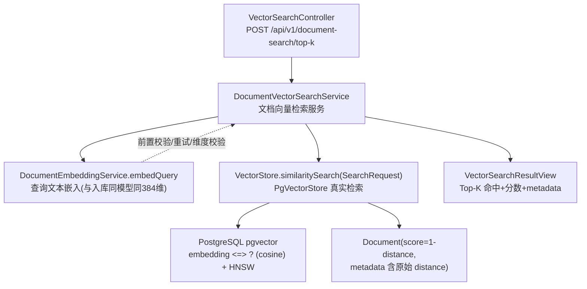

# D32-相似度检索与Top-K项目迭代全量说明

> 迭代主题：Day 32 相似度检索与 Top-K（Query Embedding + Spring AI 1.1.8 VectorStore 相似度检索 + Metadata 过滤 + 检索质量评估）
> 迭代日期：2026-11-15 ｜ 技术基线：JDK 21、Spring Boot 3.5.16、Spring AI 1.1.8、Maven 3.9.16、PostgreSQL 18.7 + pgvector 0.8.7（VM 192.168.200.153）、向量维度 384、cosine `<=>`、HNSW `vector_cosine_ops`
> 模块：`M3-Java/D32/D32_SSATK`（主类 `com.zl.d32.D32SpringAiApplication`）

---

## 1. 概述

D31 已交付"向量入库、更新与幂等"（MySQL 台账 + PG/pgvector + 稳定 ID + 六场景）。D32 在此基础上**只新增检索能力**，不重复实现入库：

| 任务书要求 | 完成情况 |
|---|---|
| Query Embedding 与入库同模型同 384 维向量空间 | 已完成：`DocumentEmbeddingService.embedQuery()` 与入库共用同一 EmbeddingModel、重试执行器、维度校验器 |
| 调用 Spring AI 1.1.8 VectorStore 相似度检索，默认 Top-5、K 可调 | 已完成：`DocumentVectorSearchService` 走 `VectorStore.similaritySearch(SearchRequest)`，默认 5、上限 20 |
| 返回片段/来源/真实分数，明确分数语义 | 已完成：返回 content/documentId/title/source/chunkIndex/score；字节码核验 **score = 1.0 − cosine distance（余弦相似度）**，原始 distance 随 metadata 透出 |
| Metadata 过滤只用真实存在的字段 | 已完成：先查 `vector_store.metadata` 实际内容（02 号证据），过滤字段用真实写入的 `documentId`；不存在 documentId 过滤返回 0 命中（过滤真实生效） |
| ≥10 个真实业务问题、Top-5 逐条人工标注 | 已完成：10 问题基于真实入库语料出题，逐条标注 R/P/N（05 号证据），Top-1 命中率 100%、MRR=1.0、P@5=0.38 |
| 噪声/漏召回分析（漏召回必须有原文依据） | 已完成：漏召回 1 条（Q1 的 CNC-001-C02 温度传感器判据），原文依据与成因分析见 05 号证据 |
| 暂不设阈值，评估后给建议 | 已完成：`similarityThresholdAll()`（0.0）；评估发现 R∈[0.17,0.45] 与 N∈[0.08,0.198] 区间重叠，本模型上无可用硬阈值，建议换语义 Embedding 后重评 |
| 真实 Maven 编译与测试 | 已完成：基线 294 tests → 全量 300 tests 全绿 → 门控真机检索测试通过 |

不在本期范围：RAG 问答链、重排序、阈值硬编码生效。

## 2. 架构

### 2.1 骨架与基线

- 用户预置骨架 `D32_SSATK`（根 pom groupId `org.ai.m3.glm`）已含 D31 全量 main 能力的 `com.zl.d32.*` 移植（229 文件，与 D31 main 逐文件等价，StableIdGenerator 前缀已改为 `D32|`），managed-by 默认 `d32`。
- 骨架 **test 目录为空**：本次移植 D31 的 50 个测试文件（包名 `com.zl.d31→com.zl.d32`、类名 `D31*→D32*`、门控 `D31_VECTOR_IT/D31_PG_IT→D32_VECTOR_IT/D32_PG_IT`），基线回归 294 tests 全绿后才开始新增检索代码——保证入库能力回归不丢。

### 2.2 检索调用链（新增部分仅 search 包 + embedQuery 入口）



设计约束（任务书红线）：
- 不绕过现有架构重复编写数据库检索层：检索 SQL 完全由 PgVectorStore 承担，本项目不手写相似度查询；
- 不扩展 RAG 问答链：检索接口独立于 KnowledgeChatOrchestrator（内存关键词检索服务保留不动）；
- 不伪造分数：分数直接取 `Document.getScore()`，原始距离取 metadata `distance` 键，均来自真实 SQL。

## 3. 改动清单

新增（`com.zl.d32.document.search`，7 个文件）：

| 文件 | 职责 |
|---|---|
| `config/SearchProperties.java` | `app.ai.search` 配置：defaultTopK=5、maxTopK=20、maxQueryLength=8192，@PostConstruct 校验 |
| `dto/VectorSearchRequest.java` | 检索请求：query（必填）、topK（可空）、documentId（可空，metadata 过滤） |
| `dto/VectorSearchHitView.java` | 单条命中：rank/content/score/cosineDistance/vectorId/documentId/version/title/source/chunkIndex/modelName/dimensions/metadata 透传 |
| `dto/VectorSearchResultView.java` | 结果：query/topK/appliedFilterExpression/queryDimensions/elapsedMs/hitCount/hits |
| `service/DocumentVectorSearchService.java` | 核心检索服务：校验→embedQuery→SearchRequest→similaritySearch→结果映射 |
| `exception/VectorSearchException.java` | 业务异常（badRequest/execution 两类） |
| `controller/VectorSearchController.java` | `POST /api/v1/document-search/top-k`，统一 Result 返回 |

修改（3 个文件）：

| 文件 | 改动 |
|---|---|
| `document/embedding/service/DocumentEmbeddingService.java` | 新增公开方法 `embedQuery(String)`（空文本/超长拒绝，重试+维度校验） |
| `resources/application.yml` | 新增 `app.ai.search` 配置段（SEARCH_DEFAULT_TOP_K/SEARCH_MAX_TOP_K/SEARCH_MAX_QUERY_LENGTH 环境变量） |
| `resources/knowledge/equipment-fault-corpus.json` | 语料 3 篇 8 片段扩充为 8 篇 28 片段（新增液压机/空压机/变频器/PLC/轴承润滑五篇设备故障知识文档，全部真实入库） |

测试（新增 2 个文件 + 移植 50 个文件）：

| 文件 | 覆盖 |
|---|---|
| `test/.../document/search/DocumentVectorSearchServiceTest.java` | 5 个单测：空/超长查询拒绝、TopK 默认与越界、filter 表达式构造、Document→View 映射与 score=1-distance 不变量、空向量防御 |
| `test/.../document/search/D32VectorSearchIntegrationTest.java` | 真机门控（D32_SEARCH_IT=true）：语料导入索引→实际 metadata 核查→10 问题 Top-5→documentId 过滤/零命中→分数交叉验证，证据自动落盘 |
| `test/**`（移植 50 文件） | D31 全量回归（d31→d32 机械替换，无逻辑改动） |

## 4. 配置

```yaml
app:
  ai:
    search:
      default-top-k: ${SEARCH_DEFAULT_TOP_K:5}     # 默认 Top-5
      max-top-k: ${SEARCH_MAX_TOP_K:20}            # K 上限，防拉全库
      max-query-length: ${SEARCH_MAX_QUERY_LENGTH:8192}  # 查询文本上限(UTF-16 字符)
```

相关既有配置（未改动，D30/D31 基线）：`spring.ai.vectorstore.pgvector.*`（384 维/cosine/HNSW）、`app.ai.embedding.*`（local-hashing-embedding）、`app.ai.vector-index.*`（managed-by=d32）。
数据库口令沿用 D31 约定：`MYSQL_PASSWORD` / `PG_PASSWORD` 环境变量注入，无默认值，缺失启动即失败。

## 5. 验证（真实执行）

| 轮次 | 命令 | 结果 |
|---|---|---|
| 基线回归 | `mvn -f D32\pom.xml -pl D32_SSATK clean test` | 294 tests / 0 failures / 17 skipped，BUILD SUCCESS |
| 全量回归 | 同上（新增检索代码后） | 300 tests / 0 failures / 18 skipped，BUILD SUCCESS |
| 真机检索 | `mvn ... test -Dtest=D32VectorSearchIntegrationTest`（`D32_SEARCH_IT=true`） | 1 test 通过；MySQL/PG 真实读写，28 向量 |

真机链路数据：8 篇文档导入 MySQL 台账 → STRUCTURE 切分 28 向量入 PG（managedBy=d32）→ 10 问题 Top-5 全部返回真实分数与 metadata → documentId 过滤命中 2 条全属目标文档 → 不存在 documentId 零命中 → score 与 1−distance 差 0.0、与自算余弦差 9.3e-9。

## 6. 检索质量评估结论（10 问题）

| 指标 | 数值 |
|---|---|
| Top-1 命中率（严格相关） | 10/10 = 100%（最高分 0.4508：产线停机定级；最低 0.1707：PLC 通讯） |
| MRR | 1.00 |
| P@5（R=1、P=0.5） | 0.38（R=11 条、P=16 条、N=23 条） |
| 漏召回 | 1 条：Q1 的 CNC-001-C02（温度传感器判据）未进 Top-5 |

关键发现：
1. **同文档聚合挤占**是漏召回主因（C01/C02 特征高度重叠，Top-K 名额被占用）；
2. **跨设备同现象噪声**（油温/高温/过热在液压机/空压机/变频器间互串）来自 local-hashing 字符特征模型对设备语义边界无判别力；
3. **阈值不可设**：R∈[0.1707,0.4508] 与 N∈[0.0796,0.1976] 重叠——0.20 阈值滤光 N 但会漏 Q7 正确答案；维持 similarityThreshold=0.0，待换语义 Embedding（如 bge-m3 等 384 维）后基于新分布重评；若业务必须硬过滤，0.15 起步并配合 Top-K 截断。

## 7. 注意事项与风险

1. **D32 与 D31 共用同一张 PG `vector_store` 表**：D32 向量的 managedBy=d32、ID 前缀 `D32|`（chunkId UUID v5 与 D31 同命名空间但前缀不同，不冲突）。跨迭代数据隔离靠 metadata managedBy 过滤，检索侧如需严格隔离应在 SearchRequest 加 `managedBy == 'd32'` 表达式（当前知识库为 D32 独占，未加）。
2. **local-hashing-embedding 是 D30 引入的本地确定性模型**：可离线复现但语义能力弱（本次噪声模式直接源于此）；接入真实语义模型时只需换 `app.ai.embedding.*` 与维度守卫，检索代码零改动。
3. **Query Embedding 会执行两次**：服务层 embedQuery 用于前置校验与维度证据，PgVectorStore 内部再 embed 查询文本（同一模型，本地哈希无成本）；若切换远程 Embedding API 需注意双次调用计费，可评估改为传向量检索的自定义实现。
4. **HNSW 是近似检索**：结果顺序与 topK 召回受索引参数影响；本语料 28 向量规模下单测与全表扫描等价，生产规模需复查召回率。
5. **人工标注口径**：R/P/N 为本次会话内对照原文的标注结论，用户可按 03 号证据复核修正；修正后汇总指标需重算。
6. **Git 未提交**：3 个修改文件 + search 包/测试树/证据目录为 untracked/modified，等待用户授权提交。

## 8. 证据索引

`docs/evidence/D32/`：01 语料入库清单 ｜ 02 metadata 实际样本 ｜ 03 十问题 Top-5 JSON ｜ 04 过滤与分数验证 ｜ 05 人工标注与评估 ｜ 06 Maven 构建记录 ｜ 07 Git 状态 ｜ README。
构建日志：`logs/D32/`（baseline/search-unit/search-it/test-compile 四份）。
字节码核验：`docs/temp_docs/D32/`（PgVectorStore doSimilaritySearch/DocumentRowMapper/PgDistanceType/FilterExpressionConverter/SearchRequest）。
