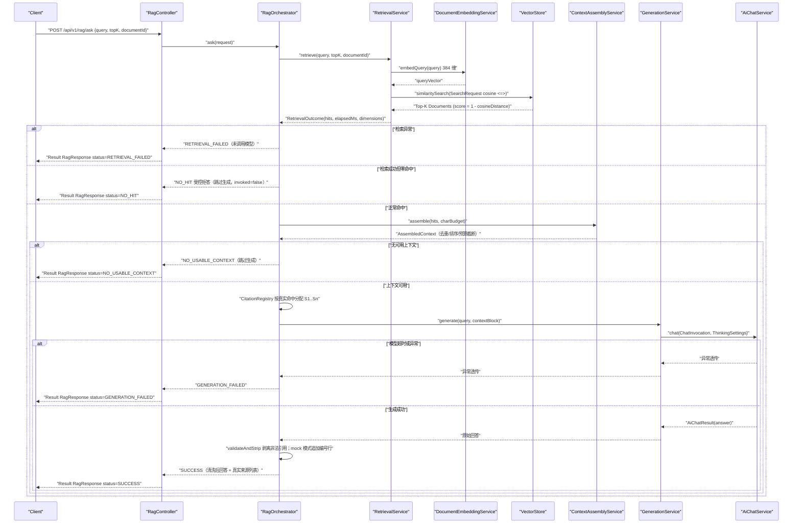

# D33-01 上下文组装与 RAG 最小闭环：项目迭代全量信息与操作

> 文档定位：面向「做了什么、怎么复现」。所有测试数字、路径与命令均为本机真实执行结果，
> 证据见 `docs/evidence/D33/` 与 `logs/D33/`，无虚构结果。
> 配套文档：`D33-02-上下文组装与RAG最小闭环-技术文档说明与操作实践指南.md`（面向原理与排障）。

---

## 1. 迭代概览

| 项 | 值 |
|---|---|
| 迭代名称 | Day 33：上下文组装与 RAG 最小闭环 |
| 项目根目录 | `E:\AI\project\AI-Learning-three-GPT\M3-Java\D33` |
| 模块 | `D33\D33_CAARMCL`（基础包 `com.zl.d33`，218 main 文件骨架） |
| 技术基线 | JDK 21、Spring Boot 3.5.16、Spring AI 1.1.8（BOM 统一管理）、Maven 3.9.16、PostgreSQL 18.7 + pgvector 0.8.7、384 维、cosine `<=>`、HNSW |
| 仓库基线 | 本地 HEAD `1c187dd5c8df24d3c6bb19b98e1768c5a385fdb9`（探测核实与任务书一致） |
| 目标 | 打通「文档导入 → 向量检索 → 上下文组装 → 大模型回答」最小闭环，返回「回答 + 来源列表 + 检索/生成状态」，保留无证据拒答 |

### 1.1 明确不做（本迭代边界）

- 不扩展完整 Agent、MCP、多轮对话、重排序、混合检索；不引入 LangChain4j。
- 不修改 D30–D32 模块；不做公网部署；不修改 `KnowledgeChatOrchestrator`（旧路径保留并存）。
- 不允许模型凭空生成设备知识、伪造引用；AI 生成内容不回写知识库证据。

---

## 2. 环境探测结论（阶段一，证据 `00-env-probe.txt`）

| 探测项 | 结果 |
|---|---|
| Maven / JDK | Maven 3.9.16 + JDK 21.0.7（Oracle），本地仓库 `D:\SoftwareInstall\Apache\repository` |
| git HEAD | `1c187dd5c8df24d3c6bb19b98e1768c5a385fdb9`（= 任务书基线） |
| PG 可达性 | `192.168.200.153:5432` tcp 可达（只报存在性，不打印口令） |
| 文件计数 | main=218、test=0（测试目录为空，本次从零新建 12 个测试类） |
| 关键类在位 | `DocumentVectorSearchService`、`DocumentEmbeddingService`、`KnowledgeChatOrchestrator`、`CitationRegistry`、`AiChatService`、`VectorDimensionGuard`、`Result/ResultCode`、`DocumentVectorIndexService` 等 15 个全部存在 |
| 依赖核对 | `spring-ai-starter-vector-store-pgvector`、`spring-ai-starter-model-deepseek`、`postgresql`、`mybatis-plus-spring-boot3-starter`、`spring-boot-starter-test` 均就位，无需新增 |
| 向量配置 | `dimensions=384`（PGVECTOR_DIMENSIONS/EMBEDDING_DIMENSIONS 双对齐）、`distance-type=COSINE_DISTANCE`、`index-type=HNSW`、`remove-existing-vector-store-table=false`（未启用自动删表）、`managed-by=d33` |
| 检索配置 | `default-top-k=5`、`max-top-k=20`、无相似度阈值（similarityThreshold 保持 0.0） |

---

## 3. 目标架构与五组件

### 3.1 组件职责与硬边界

| 组件 | 职责 | 硬边界（测试断言核验） |
|---|---|---|
| `rag/service/RagOrchestrator` | 编排检索/组装/生成全流程，映射五状态 | 只编排；不写 VectorStore 调用、不拼 Prompt 细节 |
| `rag/service/RetrievalService` | Query Embedding → VectorStore → Top-K | **禁止调用 ChatModel** |
| `rag/service/ContextAssemblyService` | 去重、排序、字符预算、来源组织 | 只处理已检索 Chunk，**不触发新检索** |
| `rag/service/GenerationService` | Prompt 构造 → AiChatService → 回答 | **禁止访问 VectorStore** |
| `rag/model/RagResponse` | 回答 + 来源 + 检索/生成状态 | 纯数据对象（record），不含业务逻辑 |

组件间契约数据对象：`RetrievedChunk` / `RetrievalOutcome` / `AssembledContext` / `RagResponse` / `RagSource`，
全部为明确字段 record，**无无约束 Map**；`chunkId` 取自入库链路真实写入的 metadata 键，缺失为 null，不编造。

### 3.2 五状态枚举（`rag/model/RagStatus`，按 ResultCode 风格）

| 状态 | 语义 | 是否调用生成模型 |
|---|---|---|
| `NO_HIT` | 检索成功但零命中 | 否（可核验零调用） |
| `NO_USABLE_CONTEXT` | 有命中但空白过滤/预算后无可用上下文 | 否（可核验零调用） |
| `RETRIEVAL_FAILED` | 检索基础设施异常 | 否 |
| `GENERATION_FAILED` | 模型调用失败（含超时） | 是（invoked=true，与拒答分支可区分） |
| `SUCCESS` | 全链路成功，回答经引用清洗 | 是 |

### 3.3 编排链路时序图（Mermaid sequenceDiagram，Typora 0.11.18 兼容）



---

## 4. 修改清单（Git diff 仅含 D33 模块与 docs/，无 D30–D32 改动）

### 4.1 新增 main（包 `com.zl.d33.rag`，13 文件）

| 文件 | 职责 |
|---|---|
| `model/RagStatus.java` | 五状态枚举 |
| `model/RetrievedChunk.java` | 检索命中结构体（明确字段 record） |
| `model/RetrievalOutcome.java` | 检索结果 + 执行摘要 |
| `model/AssembledContext.java` | 组装结果（含 truncated/droppedCount/unit=UTF16_CODE_UNIT） |
| `model/RagSource.java` | 来源条目 |
| `model/RagResponse.java` | 响应对象（嵌套 RetrievalState/GenerationState） |
| `dto/RagQueryRequest.java` | 请求 DTO（query 必填、topK/documentId 可选） |
| `config/RagProperties.java` | `app.ai.rag` 配置绑定（全外置） |
| `service/RetrievalService.java` | 包装 DocumentVectorSearchService 真实 pgvector 链路 |
| `service/ContextAssemblyService.java` | 去重/排序/预算截断 |
| `service/GenerationService.java` | Prompt 构造 + AiChatService 调用 |
| `service/RagOrchestrator.java` | 编排 + 五状态映射 + 引用清洗 |
| `controller/RagController.java` | `POST /api/v1/rag/ask` |

### 4.2 修改 main

- `application.yml`：追加 `app.ai.rag` 段（24 行）：default-top-k=5 / max-top-k=20 / context-char-budget=4000（UTF-16 字符）/ similarity-threshold=0.0 / system-prompt / 三条拒答文案，全部环境变量可覆盖（`RAG_*`）。

### 4.3 新增 test（12 文件，33 用例）

- 九类必测场景：`RagAnswerableEndToEndTest`、`RagIrrelevantQuestionTest`、`RagEmptyRetrievalTest`、`RagNoUsableContextTest`、`RagGenerationTimeoutTest`、`RagRetrievalFailureTest`、`RagInvalidCitationTest`、`RagDuplicateChunkTest`、`RagBudgetOverrunTest`
- 服务级：`ContextAssemblyServiceTest`（7 用例）、`GenerationServiceTest`（4 用例）
- 门控真机：`D33RagEndToEndIntegrationTest`（4 用例，`D33_RAG_IT=true` 激活）
- 共享夹具：`RagTestFixtures`

### 4.4 其他

- `.gitignore`：追加 `**/target/surefire-reports/`（surefire 报告含 java.library.path 等环境信息，禁止入库）与 `*.log.err`。
- `docs/temp_docs/D33/probe_d33.ps1`（探测脚本）、`demo_rag_e2e.ps1`（演示脚本，不硬编码密钥）。
- `docs/iteration_records/D33_state_R01.md`（迭代状态记录）。

---

## 5. 测试矩阵与结果（九类必测场景全部覆盖）

| # | 场景 | 测试类 | 关键断言 | 结果 |
|---|---|---|---|---|
| 1 | 文档可答 | RagAnswerableEndToEndTest | SUCCESS；来源 documentId/chunkId 与检索命中一致；mock 模式编号行可回溯 | 通过（2/2） |
| 2 | 无关问题 | RagIrrelevantQuestionTest | 低分命中不强拼答案；模型拒答不引用；sources 为空 | 通过（2/2） |
| 3 | 空检索 | RagEmptyRetrievalTest | NO_HIT；`verifyNoInteractions(AiChatService)` + `invoked=false` 双重零调用证据 | 通过（2/2） |
| 4 | 无可用上下文 | RagNoUsableContextTest | 空白过滤/预算 0 → NO_USABLE_CONTEXT；零调用；hitCount 与 NO_HIT 可区分 | 通过（2/2） |
| 5 | 模型超时 | RagGenerationTimeoutTest | Mockito 可控超时 → GENERATION_FAILED；invoked=true；稳定复现 | 通过（2/2） |
| 6 | 向量库异常 | RagRetrievalFailureTest | RETRIEVAL_FAILED ≠ NO_HIT；对外文案不泄露堆栈/连接信息 | 通过（2/2） |
| 7 | 引用不存在 | RagInvalidCitationTest | [S99] 被 CitationRegistry 剥离并计数（droppedUnknownMarkers=1）；来源无虚假项 | 通过（2/2） |
| 8 | 重复 Chunk | RagDuplicateChunkTest | ArgumentCaptor 核验上下文块不重复拼接；去重后编号 S1/S2 | 通过（2/2） |
| 9 | 预算超限 | RagBudgetOverrunTest | 40 字符预算整块截断；contextChars=40 不超预算；进入上下文的来源映射不丢 | 通过（2/2） |

服务级：ContextAssemblyServiceTest 7 用例（去重/排序/空白过滤/预算恰好等于/超预算截断/预算 0/null 输入）、
GenerationServiceTest 4 用例（系统约束在 Prompt 首位、注入文本不能先于系统指令、异常透传、结果透传）。

### 5.1 真实测试命令与结果

**全量单测（任务书固定命令，真实执行）：**

```powershell
& "D:\SoftwareInstall\Apache\Maven\apache-maven-3.9.16\bin\mvn.cmd" -f "E:\AI\project\AI-Learning-three-GPT\M3-Java\D33\pom.xml" clean test
```

```
Tests run: 33, Failures: 0, Errors: 0, Skipped: 4   BUILD SUCCESS
```

（Skipped 4 = 门控真机集成测试，未设置 `D33_RAG_IT` 时按设计跳过。）

**真机门控集成测试（真实 PG/pgvector + MySQL 台账，AI_MODE=mock 离线模型）：**

```powershell
$env:D33_RAG_IT='true'; $env:PG_VECTOR_PASSWORD='<真实口令>'; $env:AI_MODE='mock'
& "D:\SoftwareInstall\Apache\Maven\apache-maven-3.9.16\bin\mvn.cmd" -f "E:\AI\project\AI-Learning-three-GPT\M3-Java\D33\pom.xml" test "-Dtest=D33RagEndToEndIntegrationTest"
```

```
Tests run: 4, Failures: 0, Errors: 0, Skipped: 0   BUILD SUCCESS
```

**真实 DeepSeek 端到端门控（AI_MODE=deepseek，真实 ChatModel，非 mock）：**

```powershell
$env:D33_RAG_IT='true'; $env:AI_MODE='deepseek'
# PG_VECTOR_PASSWORD、AI_API_KEY 均由用户环境变量自动注入，命令行与脚本不回显真实值
& "D:\SoftwareInstall\Apache\Maven\apache-maven-3.9.16\bin\mvn.cmd" -f "E:\AI\project\AI-Learning-three-GPT\M3-Java\D33\pom.xml" test "-Dtest=D33RagEndToEndIntegrationTest"
```

```
Tests run: 4, Failures: 0, Errors: 0, Skipped: 0   BUILD SUCCESS
```

真实模型证据（日志 `D33-rag-it-deepseek.log`）：两次 `GenerationService` 均 `mode=deepseek, model=deepseek-flash, mocked=false`；
`MODEL_CALL` 记录 provider=deepseek、outcome=SUCCESS、promptTokens=255、completionTokens=197、totalTokens=452、durationMs=1768；
真实回答基于检索证据分三步排查（液压泵/溢流阀、冷却系统、吸油管路/液位），每条带 `[S1]` 合法引用，`droppedUnknownMarkers=0`；
NO_HIT 用例仍 `invoked=false`（真实模型下零调用分支成立）。**真实 DeepSeek 调用仅 2 次（最小必要），两个零调用用例不产生费用。**

真机闭环验证项：真实导入（MySQL 台账 COMPLETED）→ 真实向量入库（PG COMPLETED，1 chunk）→
真实检索（hitCount≥1、queryDimensions=384、documentId 过滤下推）→ 组装 → 生成 SUCCESS；
过滤不存在 documentId → 真实检索零命中 → NO_HIT 且 `invoked=false`；HTTP 接口 `POST /api/v1/rag/ask`
结构断言（code=200/status/hitCount/queryDimensions=384/invoked=true）；空 query → code=4001。

### 5.2 端到端演示（脚本 `docs\temp_docs\D33\demo_rag_e2e.ps1`，输出留痕 `docs\evidence\D33\demo-rag-e2e-output.txt`）

演示脚本真实执行记录（不硬编码密钥：PG_VECTOR_PASSWORD 由调用方注入，AI_MODE=mock 免 API Key）：

```
[00:38:50] 导入完成：documentId=21cd26c1bfe172866ea8767426161c8c，status=COMPLETED
[00:38:50] 向量入库终态：status=COMPLETED，indexedChunkCount=1，failedChunkCount=0
[00:38:51] RAG 应答：status=SUCCESS，hitCount=1，sources=1，invoked=True
[00:38:51] RAG 应答：status=NO_HIT，invoked=False（false=模型零调用证据）
```

### 5.3 分级验收结论（Level 1–5）

| 等级 | 验收条件 | 结论 |
|---|---|---|
| Level 1 | 依赖解析、编译、单元测试通过 | **达成**：33 tests / 0 failures / BUILD SUCCESS |
| Level 2 | 文档导入/向量入库能力复用验证 | **达成（真机）**：门控集成测试真实导入 + 真实入库 COMPLETED |
| Level 3 | 上下文去重、排序、预算控制及来源映射测试 | **达成**：ContextAssemblyServiceTest 7 用例 + RagDuplicateChunkTest + RagBudgetOverrunTest |
| Level 4 | GenerationService、Prompt 约束、无证据拒答及模型异常处理 | **达成**：GenerationServiceTest 4 用例 + 场景 3/4/5/6 拒答与异常分支 |
| Level 5 | 真实 PostgreSQL/pgvector + 实际 ChatModel 完成九类端到端 | **达成**：真实 PG/pgvector + 真实 DeepSeek（mocked=false）门控 4/0/0/0；真实回答带合法 [S1] 引用、token 用量 452 可核验；真实模型调用仅 2 次（最小必要）。 |

---

## 6. 关键设计决定（迭代记录 `docs\iteration_records\D33_state_R01.md` 摘要）

1. **新建 RagOrchestrator 不改造旧编排器**：旧 `KnowledgeChatOrchestrator` 契约（内存检索、空检索普通问答兜底、无状态枚举）与五组件/五状态要求不兼容；新接口并存，旧路径零改动。
2. **检索通道**：接 `DocumentVectorSearchService` 真实 pgvector 链路（同模型同 384 维、cosine `<=>`、HNSW），不沿用 `KnowledgeRetrievalService` 内存 bigram 检索为主路径。
3. **预算口径诚实**：UTF-16 字符（`UTF16_CODE_UNIT`，与 chunk.length-unit 既有口径一致），默认 4000，**明确非 Token、不伪称**；整块截断不切碎证据内容，裁剪计录（truncated/droppedCount）。
4. **去重与排序**：vectorId（稳定 chunkId）优先去重；score 降序 → chunkIndex 升序 → vectorId 字典序稳定排序。
5. **引用编号**：复用 `CitationRegistry`（RetrievedChunk→KnowledgeChunk 适配）；mock 模式服务端追加编号行，离线闭环可演示且编号必然可回溯。
6. **阈值**：`similarity-threshold: 0.0`（不过滤），阈值待真实分数分布评估后决策，不硬编码承诺值。
7. **配置全外置**：模型名/模式/Top-K/预算/阈值/base-url/api-key 全部走环境变量（AI_MODE/AI_MODEL/AI_BASE_URL/AI_API_KEY/RAG_*），禁止硬编码与提交。
8. **ObservationRegistry 兜底（真实 DeepSeek 暴露的问题）**：测试上下文禁用观察自动配置，`DeepSeekChatModelConfiguration` 强依赖 `ObservationRegistry` 会导致上下文启动失败；在该配置类补 `@ConditionalOnMissingBean` 的默认 `ObservationRegistry.create()`，真实运行时自动配置已注册则退让，无冲突。
9. **真机表结构对齐（环境事件，非代码缺陷）**：`knowledge_document`/`knowledge_document_page` 于 18:21 被外部重建为 D31 之前的旧结构（文件时间戳证据），与代码 PO 不匹配；经授权后 DROP 两张 0 行表并按仓库权威 DDL 重建（`MysqlRebuildTables.java`，证据 `06-rebuild-tables.txt`），另两张向量表未受影响。

---

## 7. 证据与日志清单

| 路径 | 内容 |
|---|---|
| `docs/evidence/D33/00-env-probe.txt` | 阶段一环境探测（mvn/git/PG/218+0/pom/维度配置/关键类） |
| `docs/evidence/D33/02-git-status.txt` | git status 快照与 diff --stat（修改仅限 D33 与 docs/） |
| `docs/evidence/D33/03-mysql-table-columns.txt` | 旧 knowledge_document 实际列（确认旧结构 source/content_length） |
| `docs/evidence/D33/04-mysql-four-tables.txt` | 四张表实际结构核查（两向量表为新结构、两文档表为旧结构） |
| `docs/evidence/D33/05-row-count.txt` | 两张旧表行数=0（DROP 无数据损失证据） |
| `docs/evidence/D33/06-rebuild-tables.txt` | 授权后 DROP 重建留痕，重建后列与 D31 DDL 一致 |
| `docs/evidence/D33/demo-rag-e2e-output.txt` | 演示脚本完整留痕（导入/入库/SUCCESS/NO_HIT 响应 JSON） |
| `logs/D33/D33-clean-test.log` | 全量 `mvn clean test`（33/0/0/4，BUILD SUCCESS） |
| `logs/D33/D33-rag-it.log` | 真机 mock 门控（4/0/0/0，BUILD SUCCESS） |
| `logs/D33/D33-rag-it-deepseek.log` | **真实 DeepSeek 门控（4/0/0/0，mocked=false，token=452，BUILD SUCCESS）** |
| `logs/D33/D33-compile.log` | 主代码编译记录 |
| `logs/D33/demo-app-run.log` | 演示脚本启动的应用运行日志 |
| `docs/temp_docs/D33/probe_d33.ps1` | 探测脚本（保留未删） |
| `docs/temp_docs/D33/demo_rag_e2e.ps1` | 演示脚本（保留未删，不硬编码密钥） |
| `docs/temp_docs/D33/MysqlRebuildTables.java` | 表结构对齐迁移脚本（保留未删） |
| `docs/iteration_records/D33_state_R01.md` | 迭代状态记录（精读/修改清单/设计决定/测试结果/遗留） |

---

## 8. 操作手册：怎么复现

### 8.1 环境探测

```powershell
& "E:\AI\project\AI-Learning-three-GPT\M3-Java\docs\temp_docs\D33\probe_d33.ps1"
# 输出落盘 docs\evidence\D33\00-env-probe.txt
```

### 8.2 全量单测（离线，无需数据库口令）

```powershell
& "D:\SoftwareInstall\Apache\Maven\apache-maven-3.9.16\bin\mvn.cmd" -f "E:\AI\project\AI-Learning-three-GPT\M3-Java\D33\pom.xml" clean test
```

### 8.3 真机集成测试（需真实 PG 口令，口令仅注入环境变量）

```powershell
$env:D33_RAG_IT='true'; $env:PG_VECTOR_PASSWORD='<真实口令>'; $env:AI_MODE='mock'
& "D:\SoftwareInstall\Apache\Maven\apache-maven-3.9.16\bin\mvn.cmd" -f "E:\AI\project\AI-Learning-three-GPT\M3-Java\D33\pom.xml" test "-Dtest=D33RagEndToEndIntegrationTest"
```

### 8.4 端到端演示（启动真实应用 + HTTP 调用）

```powershell
$env:PG_VECTOR_PASSWORD='<真实口令>'; $env:AI_MODE='mock'   # deepseek 模式另注入 AI_API_KEY
& "E:\AI\project\AI-Learning-three-GPT\M3-Java\docs\temp_docs\D33\demo_rag_e2e.ps1"
```

### 8.5 最小接口速查

```http
POST /api/v1/rag/ask
Content-Type: application/json

{"query": "液压机压力不足应该怎么排查？", "topK": 5, "documentId": "可选过滤"}
```

响应 `Result<RagResponse>`：`data.status`（五状态）、`data.answer`（清洗后回答/受控拒答文案）、
`data.sources[]`（citationId/documentId/chunkId/title/source/version/chunkIndex/score）、
`data.retrieval`（query/topK/hitCount/queryDimensions/appliedFilter/elapsedMs）、
`data.generation`（invoked/mode/model/mocked/droppedUnknownMarkers/contextChars/truncated）。

---

## 9. 验收清单自检（任务书 §8）

- [x] 最小 RAG 接口真实可调（演示脚本 HTTP 实测），RagResponse 含回答、来源、检索/生成状态字段。
- [x] 九类端到端场景全部有真实测试，空检索验证 ChatModel 零调用且可核验（verifyNoInteractions + invoked=false）。
- [x] Prompt Injection 防护生效（系统约束在 Prompt 首位、检索资料标注不可信、未知编号剥离）、五状态可区分；未启用 remove-existing-vector-store-table（PGVECTOR_RECREATE:false）。
- [x] Level 1–5 全部达成：真实 PG/pgvector + 真实 DeepSeek（mocked=false）门控 4/0/0/0；真实模型调用仅 2 次最小必要，Mock 未冒充真实端到端。
- [x] 无证据拒答生效（NO_HIT/NO_USABLE_CONTEXT 真实响应可核验）；回答引用来源均能回溯实际检索 Chunk。
- [x] 预算字符口径诚实（UTF-16 字符，明确非 Token）；裁剪有记录（truncated/droppedCount）、来源映射不丢。
- [x] 维度固定 384、余弦距离（HNSW，cosine `<=>`），经 VectorDimensionGuard 对齐（queryDimensions=384 实测）。
- [x] `mvn clean test` 本机真实执行，摘要落盘（33/0/0/4），结果可复现。
- [x] 无真实 API Key 入库；时序图、演示脚本、两份 D33 文档交付，命名规范（D33-01/D33-02）。
- [x] `docs\temp_docs\D33\` 临时脚本保留未删；Git diff 仅含 D33 模块与 docs/（见 02-git-status.txt）。

## 10. 遗留问题与后续建议

1. **真实 DeepSeek 端到端已补齐**：AI_MODE=deepseek 门控 4/0/0/0，真实回答带合法引用、token 用量可核验；后续复跑继续遵守最小调用原则（仅两个可答用例计费，拒答/校验用例零调用）。
2. **相似度阈值待定**：本迭代阈值 0.0（不过滤）。D32 评估已证明 local-hashing 模型上 R/N 分数区间重叠、无可用硬阈值；后续换语义 Embedding 模型后重评分数分布再决策。
3. **预算为字符估算**：无 Token 计数能力，4000 UTF-16 字符为保守可解释口径；真实模型已能返回 provider 侧 token 用量（MODEL_CALL 日志），后续可在 AssembledContext 增加 TOKEN 预算口径（保持字符口径字段不变）。
4. **来源与实际引用**：`sources` 仅声明为「被答案引用的后端注册来源」（cited），不声称全部检索证据均被模型实际使用；真机已验证 DeepSeek 输出的编号均来自注册表且未知编号被剥离。
5. **环境隔离建议**：本次表被外部重建为旧结构导致返工，建议后续在同一 MySQL 实例上运行其他模块前，先核对其 schema 资源与 D31+ 结构是否一致，避免旧 DDL 覆盖。
